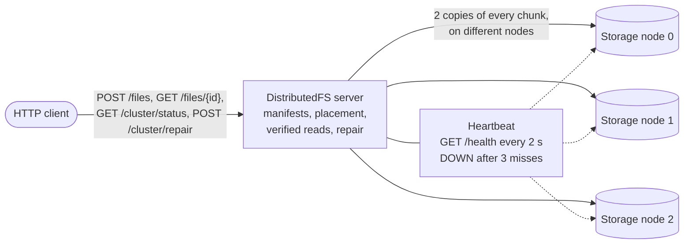

# DistributedFS

[](https://github.com/Manasva504/DistributedFS/actions/workflows/ci.yml)

A small distributed file store in plain Java, with no dependencies: files are split into SHA-256-checked chunks, every chunk is stored twice across 3 storage node processes, failed nodes are detected by heartbeats, and missing copies are restored by an on-demand repair.

> **This is a learning project, not production software.** The server has no authentication, no TLS (plain HTTP on `127.0.0.1` only) and no storage quotas, and it has been tested only on Windows (one laptop and GitHub Actions' Windows runners). See [Known limitations](#limitations-and-future-work).

**More detail:** [docs/DESIGN.md](docs/DESIGN.md) (architecture, every rule, options and limitations) · [docs/TESTING.md](docs/TESTING.md) (the 36 test suites and every recorded result) · [docs/BENCHMARKS.md](docs/BENCHMARKS.md) (throughput, failure detection and repair timings)

## Architecture



The server splits each upload into 1 MiB chunks and stores 2 copies of each on different nodes (round-robin), then writes the file's manifest. A download reads, for each chunk, the first copy whose SHA-256 matches the manifest. The heartbeat marks a node DOWN after 3 failed checks in a row and UP after 1 good one; `POST /cluster/repair` copies chunks that have lost a copy back to 2 good copies and trims extra copies. Everything runs on one machine, over HTTP on `127.0.0.1`.

## Quick start

### Prerequisites

- **JDK 23.** The project has been built and tested with JDK 23.0.1 on Windows 11, using Windows PowerShell 5.1. Check your version with `java -version` and `javac -version`.
- **Git**, to clone the repository.
- **No build tool or libraries.** The code is compiled with plain `javac`; there is no Maven, Gradle, Spring Boot, or external dependency.
- **Free disk space.** The demo needs about four times the size of the file you give it, and each stress test uses a few hundred MiB of temporary space.

### Build

In PowerShell:

```powershell
git clone https://github.com/Manasva504/DistributedFS.git
cd DistributedFS
javac -d out src\main\java\com\distributedfs\*.java
javac -d out-test -cp out src\test\java\com\distributedfs\*.java
```

The compiled classes go to `out` (the program) and `out-test` (the tests). Git ignores both folders, and you can delete and rebuild them at any time. Rebuild both after pulling new code, so that you never run old classes.

### Run the demos

Each demo builds the program into a new temporary folder, starts three storage nodes and the server on free ports, checks everything it shows, stops what it started, deletes its folder, and exits with code 0 only if every check passed:

```powershell
powershell -ExecutionPolicy Bypass -File scripts\demo.ps1          # upload a 5 MiB file, download it, compare SHA-256
powershell -ExecutionPolicy Bypass -File scripts\kill-demo.ps1     # kill a node: downloads and uploads go on
powershell -ExecutionPolicy Bypass -File scripts\repair-demo.ps1   # kill a node, detect it, repair, restart it, trim
powershell -ExecutionPolicy Bypass -File scripts\test.ps1          # build, then all 629 normal tests
```

(`-ExecutionPolicy Bypass` applies to that one command only; it is needed on machines whose policy blocks local scripts.) To run the server and nodes by hand, see [Running the server](docs/DESIGN.md#running-the-server) and [Running a storage node](docs/DESIGN.md#running-a-storage-node).

### What the demos print

Excerpts from real runs on 27 October 2026 (`…` marks lines left out; IDs, ports and paths change on every run).

`scripts\demo.ps1`:

```text
== Upload: POST /files with 5242880 bytes
   {"fileId":"e8d32dc3133474b5de61bc0760d7afa7","size":5242880,"sha256":"df13e494e6340e249994fbabc32efd6094501077572dde7d03bfa0ce1d029b6d","chunkSize":1048576,"chunkCount":5}
== Download: GET /files/e8d32dc3133474b5de61bc0760d7afa7
== Checksums:
   SHA-256 of the uploaded file:   DF13E494E6340E249994FBABC32EFD6094501077572DDE7D03BFA0CE1D029B6D
   SHA-256 of the downloaded file: DF13E494E6340E249994FBABC32EFD6094501077572DDE7D03BFA0CE1D029B6D
   SHA-256 the server recorded:    DF13E494E6340E249994FBABC32EFD6094501077572DDE7D03BFA0CE1D029B6D
== Chunk copies per node (5 chunks of 1048576 bytes, 2 copies each):
   node 0 (c2265e39697e309b7dccfe84834bf244): 3
   node 1 (45e349428dd01cb3d2c59bdf9927e21e): 4
   node 2 (a686546c2af677d96b0e45058a521b12): 3
== RESULT: SUCCESS (the downloaded file is identical to the uploaded one)
```

`scripts\kill-demo.ps1`:

```text
== Killing node 1 (pid 41232)
   node 1 has exited: True
== Download: GET /files/3b5f251e4e9c7793a5d5a3fee0408824
…
== File B, uploaded while node 1 is dead
…
== Where the 2 copies of each chunk of B are:
   chunk 0: nodes 0, 2
…
   every chunk of B is on nodes 0 and 2: True
…
   Warning: upload 3e0f119e0b9725675a05ef53558ed6df, chunk 3e0f119e0b9725675a05ef53558ed6df_0: stored on nodes [2, 0]; skipped unreachable node 1 (storage node bbeb76e91554444cb1f9d6f0faec732e at 127.0.0.1:53919)
…
== RESULT: SUCCESS (with node 1 dead, A was downloaded intact, and B got 2 copies of every chunk and was downloaded intact)
```

`scripts\repair-demo.ps1`:

```text
== Killing node 1 (pid 34060)
   node 1 has exited: True
== Polling GET /cluster/status until node 1 is DOWN
   node 1 is DOWN after 5.1 s:
…
== POST /cluster/repair
   {"dryRun":false,"replicationFactor":2,"nodes":[{"index":0,"state":"UP"},{"index":1,"state":"DOWN"},{"index":2,"state":"UP"}],"filesChecked":1,"filesSkipped":0,"chunksChecked":5,"chunksHealthy":1,"copiesAdded":4,"copiesReplaced":0,"copiesRemoved":0,"chunksLost":0,"chunksUncertain":0,"chunksNotRepaired":0,"trimSkipped":false,"nodesFailedDuringRepair":[],"lost":[],"durationMillis":184}
…
   every chunk has a copy on node 0 and on node 2: True
…
   node 1 is UP after 1.5 s:
…
   every chunk has exactly 2 copies: True
…
== RESULT: SUCCESS (node 1 was detected DOWN, the repair restored 2 copies on nodes 0 and 2, node 1 came back UP, the extra copies were trimmed, and the file downloaded intact)
```

## Features

- **Uploads and downloads over HTTP** on `127.0.0.1`: `POST /files` with an optional `X-Content-SHA256` check, and `GET /files/<fileId>`, which sends a file only after every chunk and the whole file have passed their SHA-256 checks.
- **Streaming with bounded memory:** files pass through fixed-size buffers; the stress tests move 64 to 100 MiB through a 16 MiB Java heap.
- **Storage nodes as separate processes**, reached over HTTP, each with its own folder, ID and lock; or, without `--node` options, local folders.
- **Replication factor 2:** a file stays readable, and uploads keep working, while one node is down.
- **Crash-safe uploads:** interrupted uploads are finished or undone when the server starts.
- **Failure detection and repair:** heartbeats, `GET /cluster/status`, and `POST /cluster/repair` with a dry run.
- **Degraded start:** the server starts with a recorded node down.
- **Tested:** 629 normal tests and 10 stress tests in 36 plain-Java runners, run by GitHub Actions on Windows, with deliberate-break runs that confirm each safety rule has a test that fails without it ([docs/TESTING.md](docs/TESTING.md)).

The full list, with the class behind each feature, is in [docs/DESIGN.md](docs/DESIGN.md#implemented-features).

## Key design decisions

1. **Fixed 1 MiB chunks:** large files are never held in memory, and each chunk can be placed, checked and repaired on its own.
2. **SHA-256 per chunk, in the manifest:** a damaged copy is found on the read that touches it, and only that chunk needs another copy, not the whole file.
3. **Write-ahead pending marker, then an atomic manifest as the commit point:** after a crash every upload is either committed or provably incomplete, so startup recovery can finish or undo it without guessing.
4. **No location index:** the server asks the nodes where copies are (chunk IDs are `<fileId>_<index>`), so there is no second record that can disagree with the disk.
5. **Replication factor 2:** with 3 nodes, one node can be down, or one copy damaged or lost, without losing data, at twice the disk space instead of three times.
6. **Verified reads:** every copy is checked against its SHA-256 before it is used, so a damaged copy is skipped like a missing one and the client never gets bytes that failed a check.
7. **A store with an unknown outcome is never retried elsewhere:** it might have succeeded, so the upload fails and its rollback removes every copy, instead of risking a copy nobody knows about.
8. **Heartbeats: DOWN after 3 failed checks, UP after 1:** one slow answer doesn't mark a node DOWN, and a node that comes back is usable within one 2-second check. The state drives the status and the repair, not uploads or downloads.
9. **Manual repair with strict trimming rules:** a repair runs only when asked, with a dry run to preview it; extra copies are trimmed only when every node is UP, so 2 verified copies are certain to remain.
10. **Degraded start with at least 2 of the recorded nodes:** one dead node doesn't keep the cluster down, and recovery never treats a chunk as absent while a node that may hold it is down.

The rules behind each are in [docs/DESIGN.md](docs/DESIGN.md): [Replication](docs/DESIGN.md#replication), [Failure detection and repair](docs/DESIGN.md#failure-detection-and-repair) and [Startup recovery](docs/DESIGN.md#startup-recovery).

## Benchmarks

Medians of 3 runs of `scripts\bench.ps1` on one laptop (Intel Core i5-13450HX, 16 GB RAM, Windows 11, JDK 23.0.1), with 3 nodes, 2 copies per chunk and everything on `127.0.0.1`:

| Measure | Median |
|---|---|
| Upload of a 64 MiB file | 26.2 MiB/s (2.44 s) |
| Download of that file (every chunk and the whole file checked first) | 63.3 MiB/s (1.01 s) |
| Node killed until `GET /cluster/status` shows it DOWN | 5.31 s |
| `POST /cluster/repair` until every chunk has 2 copies again (44 copies) | 1.69 s |

These are loopback numbers from one machine, not network numbers; the method, every run and the caveats are in [docs/BENCHMARKS.md](docs/BENCHMARKS.md). The benchmark is not run in CI.

## Limitations and future work

In short:

- **Stalled request headers can pin a worker thread.** A client that stops partway through its request headers holds one of the 4 worker threads until it disconnects; the stall watchdog cannot reach that step.
- **No fsync.** Chunks and manifests are not forced to disk, so recently written data may be lost if the power fails.
- **Check-then-act gaps in storage operations.** The no-follow checks on a node's folder and chunk files happen before the read, write or delete, not atomically with it, so a link swapped in between is not detected. The folders above a node's folder are not checked.
- **Repair is manual.** Each chunk has two copies, so one node can be down, or one copy damaged or lost, without losing data. A lost or damaged copy is made again only when someone calls `POST /cluster/repair`; until then the chunk stays under-replicated, and losing its other copy loses it. Nothing checks copies in the background.
- **A degraded start needs 2 nodes and leaves some work for later.** The server starts with recorded nodes down if at least 2 answer, but interrupted uploads that a missing node may be part of keep their markers, and a rollback that a down node cannot confirm keeps its marker, until a start with those nodes.

Every limitation, in detail, is in [docs/DESIGN.md](docs/DESIGN.md#known-limitations).

Networked storage nodes, replication, and failure detection and repair are done (see [Project history](#project-history)). Follow-up work (not scheduled):

- Stop a client that stalls partway through its request headers from holding a worker thread (this step runs inside the JDK's HTTP server, before the handler).
- Use the chunk checksums in startup recovery, and run the repair's checks in the background ("scrubbing"), so damaged copies are found before anyone downloads them or asks for a repair.
- Let uploads and downloads skip nodes the heartbeat marks DOWN, and add or replace a node in `nodes.txt`.
- Listing, metadata and delete endpoints
- Frontend

## API

The server listens on `127.0.0.1` only and answers only requests whose `Host` is `127.0.0.1:<port>` or `localhost:<port>`. Errors are JSON bodies `{"error":"<code>","message":"<fixed sentence>"}`.

| Request | Does | Main answers |
|---|---|---|
| `GET /health` | Liveness check. | `200 {"status":"ok"}` |
| `POST /files` | Uploads the body (`Content-Type: application/octet-stream`; optional `X-Content-SHA256`). Stores 2 copies of every chunk, then commits the manifest. | `201` with `Location: /files/<fileId>` and the manifest as JSON; `400 checksum_mismatch`; `413 payload_too_large` (over 100 MiB by default); `415`; `500 storage_error` |
| `GET /files/<fileId>` | Downloads a file, after checking every chunk and the whole file against the manifest. | `200` with the bytes; `400 invalid_file_id`; `404 file_not_found`; `500 chunk_missing`, `integrity_check_failed` or `metadata_corrupt` |
| `GET /cluster/status` | What the heartbeat last saw: each node's state, last good check and failures in a row. Reads no chunk and takes no lock. | `200` with JSON |
| `POST /cluster/repair` | Restores 2 good copies of every chunk and trims extras; `?dryRun=true` only reports. Answers when finished. | `200` with a JSON report; `400 invalid_query`; `409 repair_in_progress` |

Every request, field and error code is described in [docs/DESIGN.md](docs/DESIGN.md#http-api); the storage nodes' own API is in [Node options and API](docs/DESIGN.md#node-options-and-api).

## Project history

| Phase | Delivered | Commit |
|---|---|---|
| 1 | `FileChunker`: streaming chunking | `76c028a`* |
| 2 | `FileReconstructor`: ordered, byte-exact reconstruction | `76c028a`* |
| 3 | `ChecksumService`: SHA-256 calculation and verification | `76c028a`* |
| 4 | `StorageNode` and `ChunkNotFoundException`: simulated storage node | `76c028a`* |
| 5 | `StorageCluster`: placement and lookup across nodes | `76c028a`* |
| 6 | `DistributedFsDemo`: end-to-end command-line demo | `59529d8` |
| 7 | Documentation: this README | `9b03340` |
| 8 | HTTP API: `GET /health`, `POST /files` uploads with rollback, persistent manifests and startup recovery (`53605c4`); verified `GET /files/<fileId>` downloads (`0feb7a1`) | `53605c4`, `0feb7a1` |
| — | Hardening: stalled request bodies and uploads no longer hold worker threads; chunk retrieval refuses links and junctions | `64ac867` |
| 9 | Verification and integrity: GitHub Actions CI (`scripts\test.ps1`); per-chunk SHA-256 in manifests (format 2), checked on every download; storing refuses a junctioned node folder | `0eec1d1`, merged in PR #3 (`5c26b34`) |
| M1a | Networked storage nodes, first half: the `ChunkStore` interface, the storage node process (`StorageNodeServer`) and its client (`RemoteStorageNode`), with tests | `6b98712`, merged in PR #5 (`d399531`) |
| M1b | Networked storage nodes, second half: the server uses node processes (`--node`, `nodes.txt`), startup recovery through the node API, a lost store answer rolled back as "maybe stored", `scripts\demo.ps1` | `7adce90`, merged in PR #6 (`b6afdef`) |
| M2 | Replication factor 2: two copies of every chunk on different nodes, uploads and downloads with a node down, verified reads that skip damaged copies, recovery and reports for copies, `scripts\kill-demo.ps1` | `528a756`, merged in PR #7 (`3337474`) |
| M3 | Failure detection and repair: heartbeat and `GET /cluster/status`, manual `POST /cluster/repair` (with dry run), more than 2 copies allowed, degraded start with a node down, `scripts\repair-demo.ps1` | `848e8e5`, merged in PR #8 (`8535e73`) |
| M4a | This README rewritten for a short read, with the detail moved to `docs/DESIGN.md` and `docs/TESTING.md`; `scripts\bench.ps1` and `docs/BENCHMARKS.md` | PR #9 |

\* Phases 1–5 were built before the Git repository was created, so they are all in the initial commit.

The repository layout is in [docs/DESIGN.md](docs/DESIGN.md#repository-structure). Personal learning project; issues and suggestions welcome. Before suggesting a change, run all 36 suites (629 normal tests) and, separately, the 10 stress tests, as described in [docs/TESTING.md](docs/TESTING.md#run-the-tests).
