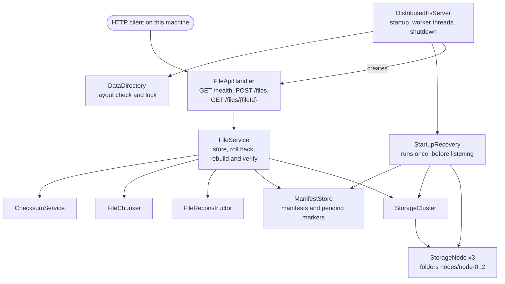
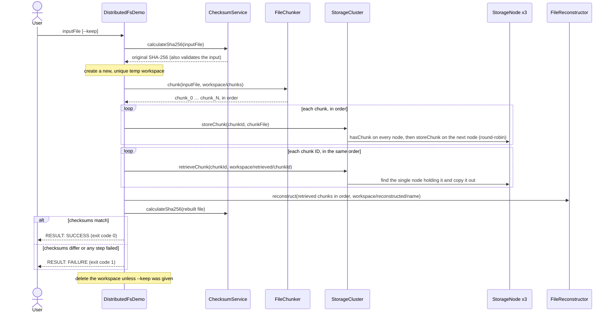

# DistributedFS

A learning implementation of the core ideas behind distributed file storage: splitting files into chunks, spreading the chunks across storage nodes, retrieving and reassembling them, and verifying the result is intact with SHA-256. It is written in plain Java with no external dependencies.

> **Status:** Phases 1–8 are complete: the storage components, an end-to-end command-line demo, and a local HTTP server that uploads files, downloads them only after checking them against their SHA-256, and recovers interrupted uploads when it starts. Everything runs on one machine: the storage nodes are simulated as local folders, and there is no replication or networking between nodes. See the [roadmap](#roadmap).
>
> **This is a learning project, not production software.** The server has no authentication, no TLS (plain HTTP on `127.0.0.1` only) and no storage quotas, and it has been tested only on one Windows machine. See [Known limitations](#known-limitations).

## Contents

- [Why this project exists](#why-this-project-exists)
- [Implemented features](#implemented-features)
- [Architecture](#architecture)
- [End-to-end workflow](#end-to-end-workflow)
- [Components](#components)
- [Getting started](#getting-started)
- [Running the demo](#running-the-demo)
- [Running the server](#running-the-server)
- [HTTP API](#http-api)
- [Data directory, uploads, downloads and startup recovery](#data-directory-uploads-downloads-and-startup-recovery)
- [Known limitations](#known-limitations)
- [Roadmap](#roadmap)
- [Repository structure](#repository-structure)
- [Running tests and contributing](#running-tests-and-contributing)

## Why this project exists

Distributed file systems such as HDFS and GFS store large files by splitting them into chunks, placing the chunks on many machines, and checking them for corruption. DistributedFS builds those ideas one small, tested step at a time, starting on a single machine, so that each design decision can be understood and verified before networking is added.

What it demonstrates:

- **Streaming with bounded memory.** Files are processed through fixed-size buffers and never loaded whole. Nine stress tests push 64 to 100 MiB of data through the components, the demo, the upload and download endpoints and crash recovery, and the documented commands run them with the Java heap limited to 16 MiB (`-Xmx16m`).
- **Data integrity.** The demo compares the SHA-256 checksum of the rebuilt file with the original's, and a test confirms that corrupted chunk data is caught as a mismatch. An upload can carry its SHA-256, and if the data doesn't match, no file is committed to the storage cluster. A download is rebuilt and checked against the size and SHA-256 recorded at upload before any of it is sent; damaged data is reported as an error, never sent as the file.
- **Existing files aren't replaced.** Chunk files, rebuilt files, retrieved copies, manifests and pending-upload markers are created with `CREATE_NEW` or a rename that refuses to replace a file, and temporary files and workspaces get new, unique names. A storage node writes each chunk to a temporary file and gives it the chunk's ID only after all of its bytes have been written. If a write fails with an I/O error that Java reports, the code tries to delete the files that operation created.
- **Crash consistency for uploads.** The server records an upload as pending before storing anything, and treats writing the file's manifest as the moment the upload exists. When the server starts, it finishes or undoes uploads that a crash interrupted, and refuses to start if it cannot tell what is safe (see [startup recovery](#startup-recovery)).
- **Defensive input handling.** Chunk IDs are restricted so that they cannot point outside a node's folder, collide on case-insensitive file systems, or name Windows devices such as `nul`. File IDs are generated by the server and checked strictly. The HTTP server only answers requests addressed to `127.0.0.1` or `localhost`, and its error responses never contain file system paths or exception text.
- **Explicit failure semantics.** "This chunk is missing" and "this node could not be checked" are reported differently, so a broken node is never mistaken for missing data. Damaged metadata is reported as damaged, never as "not found".
- **Testing discipline.** 377 normal tests, plus 9 separate stress tests, in 20 plain-Java test runners, including simulated disk failures, corrupted data, server processes killed partway through an upload, and clients that stop reading or disconnect mid-download.

## Implemented features

- **Chunking** (`FileChunker`): splits a file into 1 MiB chunk files named `chunk_0`, `chunk_1`, … and returns them in order.
- **Reconstruction** (`FileReconstructor`): joins chunk files, in the order given, into a byte-identical copy of the original.
- **Integrity checks** (`ChecksumService`): calculates SHA-256 checksums and verifies a file against an expected value.
- **Simulated storage node** (`StorageNode`, `ChunkNotFoundException`): stores, retrieves and deletes chunks in its own local folder, with safe chunk IDs. A chunk's ID appears only after all of its bytes have been written successfully. Deleting never follows a symbolic link or junction.
- **Storage cluster** (`StorageCluster`): spreads chunks over several nodes round-robin, keeps each chunk ID on exactly one node, falls back to the next node when a store fails with an I/O error, and deletes a chunk only when every node answered and exactly one holds it.
- **End-to-end demo** (`DistributedFsDemo`): runs the whole workflow from the command line and reports whether the rebuilt file's SHA-256 matches the original.
- **HTTP server** (`DistributedFsServer`, `FileApiHandler`): serves `GET /health`, `POST /files` and `GET /files/<fileId>` on `127.0.0.1` only. See [HTTP API](#http-api).
- **Uploads** (`FileService`): checks the optional SHA-256, splits the upload into 1 MiB chunks, stores them on the cluster and writes the file's manifest. A failed upload is rolled back.
- **Downloads** (`FileService`, `FileApiHandler`): rebuilds a stored file from its chunks in a temporary workspace, checks its size and SHA-256 against the manifest, and only then sends it. A watchdog disconnects clients that stop making progress.
- **Persistent metadata** (`ManifestStore`, `FileManifest`): one small text manifest per stored file, and a pending-upload marker for each upload in progress.
- **Data directory** (`DataDirectory`): checks, initializes and locks the server's data folder, so only one server uses it at a time.
- **Startup recovery** (`StartupRecovery`, `StaleTempFiles`): finishes or undoes interrupted uploads, removes stale temporary files and request workspaces, and reports chunks that nothing refers to, without deleting them.
- **Tests:** 20 plain-Java test runners with 377 normal tests, plus 9 separate stress tests, which run with a 16 MiB heap when started with the documented `-Xmx16m` option.

## Architecture

### Storage components and the demo

Arrows point from a component to what it uses. The labelled arrows show the other relationships: `DistributedFsDemo` creates the storage nodes, and `StorageCluster` and the nodes throw `ChunkNotFoundException`. All classes are in the package `com.distributedfs`.


- `FileChunker`, `FileReconstructor`, and `ChecksumService` don't depend on any other project class. They exchange data as files and ordered lists of file paths.
- Only `StorageCluster` stores chunks on the nodes and retrieves them. `DistributedFsDemo` creates the nodes and wires everything together.
- The three storage nodes are ordinary folders on the same machine.

### HTTP server



- `FileApiHandler` knows HTTP; `FileService` knows nothing about HTTP.
- `StorageCluster` and `ManifestStore` are not thread-safe, so `FileService` runs every step that touches them while holding one lock, for uploads and downloads alike. Uploads are stored one at a time, and downloads copy their chunks one at a time. Reading and hashing an upload's body, and rebuilding, checking and sending a download, happen outside the lock.
- `StartupRecovery` runs while the data directory is locked and before the server listens, so no upload or download can run at the same time.

## End-to-end workflow

This is what `DistributedFsDemo` does with the file you give it:



- Chunk order is tracked in an explicit list of chunk IDs. It is never taken from a folder listing, which would sort `chunk_10` before `chunk_2`.
- The input file is only read. Everything the demo writes goes into the new workspace folder, so no existing file can be overwritten.

The server's upload and download workflows are described in [Data directory, uploads, downloads and startup recovery](#data-directory-uploads-downloads-and-startup-recovery).

## Components

| Component | Responsibility | Key behavior |
|---|---|---|
| `FileChunker` | Splits a file into 1 MiB chunk files and returns them in order. | Streams through one chunk-sized buffer. Never overwrites existing files (`CREATE_NEW`). If it fails with an I/O error reported by Java, it tries to delete the chunks it created. Also usable on its own from the command line. |
| `FileReconstructor` | Joins chunk files, in list order, into one new file. | Streams through a 64 KiB buffer. An empty list produces an empty file. Refuses to overwrite the destination. If it fails with an I/O error reported by Java, it tries to delete the partial output it created. |
| `ChecksumService` | Calculates SHA-256 and checks a file against an expected checksum. | Streams through a 64 KiB buffer. `matches()` returns `true` or `false` only when it could actually read the file; otherwise it throws. |
| `StorageNode` | One simulated storage node that stores, retrieves and deletes chunks in its own local folder. | The chunk ID is the file name, and strict ID rules block path traversal. Writes each chunk to a temporary file and renames it to the chunk ID only after writing completes; the rename refuses to replace an existing chunk. Rejects retrieve destinations inside its own folder. A node that cannot check (for example, its folder was deleted) throws an `IOException` instead of reporting the chunk as absent. Deletes only a regular file in a plain folder, checked without following links. |
| `ChunkNotFoundException` | Reports that a chunk is definitely absent. | A subclass of `IOException` that carries the chunk ID. Thrown only when a node, or every node in a cluster, confirms the chunk is not there. |
| `StorageCluster` | Coordinates several storage nodes behind one interface. | Round-robin placement, falling back to the next node after an I/O failure. Checks every node before storing so each chunk ID lives on one node, and refuses to store if any node cannot answer. Distinguishes missing chunks from unavailable nodes. Rejects retrieve destinations inside any node's folder. Deletes a chunk only if every node answered and exactly one holds it. |
| `DistributedFsDemo` | Command-line program that runs the whole workflow and verifies the result. | Works in a new temp workspace and deletes it afterwards, without following links, unless `--keep` is given. Prints the original checksum once it has read the input, and the rebuilt file's checksum only if the run gets that far. Once the arguments are accepted, every outcome it handles prints one `RESULT: SUCCESS` or `RESULT: FAILURE` line; argument errors print usage instructions instead. |
| `DistributedFsServer` | Command-line server: opens the data directory, runs startup recovery, and serves the HTTP API on `127.0.0.1`. | Nothing listens until every startup step has succeeded; a failed start undoes what it started and releases the data directory's lock. 4 worker threads and a queue of 64 requests. Stops on Ctrl+C. |
| `FileApiHandler` | Handles every HTTP request. | Checks the `Host` header first, routes by exact raw path, enforces the upload size limit while reading, checks download file IDs before any decoding, disconnects downloads that stall, and sends fixed JSON error bodies. |
| `FileService` | Stores uploads and prepares downloads. | Upload: writes a pending marker, then the chunks, then the manifest (the commit point), and rolls back a failed upload, newest chunk first. Download: copies the chunks in order, rebuilds the file, and checks its size and SHA-256 against the manifest. |
| `ManifestStore`, `FileManifest` | Manifests and pending-upload markers as small text files. | Written to a temporary file and renamed into place, never replaced. Read strictly: anything not exactly as written is reported as invalid. |
| `DataDirectory` | The server's data folder. | Creates the layout in a new folder, refuses a non-empty folder it doesn't recognize, and holds an operating-system lock on `server.lock` while the server runs. |
| `StartupRecovery`, `StaleTempFiles` | Recovery of interrupted uploads, and cleanup of leftovers from interrupted uploads and downloads, when the server starts. | Assesses everything before changing anything, stops the start when a state is unsafe, sweeps only exact temporary-file and workspace names without following links, and only reports unreferenced chunks. |
| `FileIds`, `Json`, `ApiError`, `FileTrees` | Helpers. | 32-character lowercase hexadecimal file IDs from `SecureRandom`; JSON string quoting; the fixed list of API errors; folder-tree deletion that never follows links or junctions. |

## Getting started

### Prerequisites

- **JDK 23.** The project has been built and tested with JDK 23.0.1 on Windows 11, using Windows PowerShell 5.1. Check your version with `java -version` and `javac -version`.
- **Git**, to clone the repository.
- **No build tool or libraries.** The code is compiled with plain `javac`; there is no Maven, Gradle, Spring Boot, or external dependency.
- **Free disk space.** The demo needs about four times the size of the file you give it, and each stress test uses a few hundred MiB of temporary space.

### Build

In PowerShell:

```powershell
git clone https://github.com/Manasva504/DistributedFS.git
cd DistributedFS
javac -d out src\main\java\com\distributedfs\*.java
javac -d out-test -cp out src\test\java\com\distributedfs\*.java
```

The compiled classes go to `out` (the program) and `out-test` (the tests). Git ignores both folders, and you can delete and rebuild them at any time. Rebuild both after pulling new code, so that you never run old classes.

### Run the tests

Each suite is a plain-Java program. It prints `PASS`, `FAIL` or `SKIP` for every test and ends with a summary such as `18 passed, 0 failed`. A suite exits with code 1 if any test fails.

| Suite | Normal tests | Stress tests (run separately) |
|---|---|---|
| `ApiErrorTest` | 5 | none |
| `ChecksumServiceTest` | 15 | 1 |
| `CrashRecoveryTest` | 8 | 1 |
| `DataDirectoryTest` | 20 | none |
| `DistributedFsDemoTest` | 18 | 1 |
| `DistributedFsServerTest` | 28 | none |
| `DownloadEndpointTest` | 24 | 1 |
| `FileChunkerTest` | 18 | none |
| `FileIdsTest` | 12 | none |
| `FileReconstructorTest` | 15 | 1 |
| `FileServiceTest` | 29 | none |
| `FileTreesTest` | 5 | none |
| `JsonTest` | 8 | none |
| `ManifestStoreTest` | 23 | none |
| `StaleTempFilesTest` | 4 | none |
| `StallWatchTest` | 6 | none |
| `StartupRecoveryTest` | 23 | none |
| `StorageClusterTest` | 41 | 1 |
| `StorageNodeTest` | 52 | 1 |
| `UploadEndpointTest` | 23 | 2 |
| **Total** | **377** | **9** |

Run every suite from the repository folder:

```powershell
foreach ($suite in 'ApiErrorTest', 'ChecksumServiceTest', 'CrashRecoveryTest', 'DataDirectoryTest',
        'DistributedFsDemoTest', 'DistributedFsServerTest', 'DownloadEndpointTest', 'FileChunkerTest',
        'FileIdsTest', 'FileReconstructorTest', 'FileServiceTest', 'FileTreesTest', 'JsonTest',
        'ManifestStoreTest', 'StaleTempFilesTest', 'StallWatchTest', 'StartupRecoveryTest',
        'StorageClusterTest', 'StorageNodeTest', 'UploadEndpointTest') {
    java -cp "out;out-test" "com.distributedfs.$suite"
}
```

Or run one suite, for example:

```powershell
java -cp "out;out-test" com.distributedfs.UploadEndpointTest
```

Some tests are reported as `SKIP` instead of passing when the machine can't run them:

- Two tests, one in `StorageNodeTest` and one in `StorageClusterTest`, need to create a symbolic link. Windows allows that only with Developer Mode turned on or with administrator rights. On the Windows 11 machine where the current code was verified, both were skipped (see [Recorded verification results](#recorded-verification-results)). The same protection is also tested with Windows junctions, which don't need special rights, and those tests ran.
- One `DistributedFsServerTest` test needs an IPv4 address other than loopback, to show that the server can't be reached through it.

`CrashRecoveryTest` and `DataDirectoryTest` start extra Java processes with the same class path, and several tests create Windows junctions with `cmd.exe /c mklink /J` inside their own temporary folders.

Run the stress tests separately. The `-Xmx16m` option limits the Java heap to 16 MiB, so each test shows that the data streams through without being loaded into memory. Without that option the tests still run, and most print a warning if the heap is 64 MiB or larger:

```powershell
java -Xmx16m -cp "out;out-test" com.distributedfs.FileReconstructorTest --stress
java -Xmx16m -cp "out;out-test" com.distributedfs.ChecksumServiceTest --stress
java -Xmx16m -cp "out;out-test" com.distributedfs.StorageNodeTest --stress
java -Xmx16m -cp "out;out-test" com.distributedfs.StorageClusterTest --stress
java -Xmx16m -cp "out;out-test" com.distributedfs.DistributedFsDemoTest --stress
java -Xmx16m -cp "out;out-test" com.distributedfs.UploadEndpointTest --stress
java -Xmx16m -cp "out;out-test" com.distributedfs.CrashRecoveryTest --stress
java -Xmx16m -cp "out;out-test" com.distributedfs.DownloadEndpointTest --stress
```

`UploadEndpointTest --stress` uploads exactly 100 MiB and then four 20 MiB files at once. `CrashRecoveryTest --stress` kills a child process partway through a 64 MiB upload and passes `-Xmx16m` to that child itself. `DownloadEndpointTest --stress` uploads 100 MiB and downloads it again, checking the SHA-256 of the bytes as they arrive.

In PowerShell, keep the quotes around `"out;out-test"`: an unquoted `;` ends the command.

### Recorded verification results

These are the results of one recorded verification run of the code in commit `0feb7a1` ("Add verified HTTP file downloads"), on Windows 11 with JDK 23.0.1, on 20 October 2026. They describe that run on that machine, not a guarantee for other environments.

- **Normal tests:** all 20 suites exited with code 0. Of the 377 normal tests, 375 passed, 0 failed and 2 were skipped. The two skipped tests are the symbolic-link tests described above; Developer Mode was off and the shell was not elevated.
- **Stress tests,** run separately and not included in the figures above: all 9 passed with `-Xmx16m`, including the 100 MiB download.
- **Deliberate-break checks:** 11 checks each broke one rule of the download code in a separate copy of the source (for example: skip the SHA-256 check, decode the file ID before checking it, read without the storage lock, accept `HEAD`, disable the stall watchdog, keep the download workspace). The tests detected all 11.
- **Not verified:** stopping the server with Ctrl+C. The shutdown hook is covered only indirectly, by tests of the server's `stop()` method, and has not been checked by hand.

## Running the demo

```powershell
java -cp out com.distributedfs.DistributedFsDemo C:\path\to\your-file.bin
```

Replace the path with any file. The input file is only read; everything the demo writes goes into a new, uniquely named workspace folder in your temp folder, which is deleted at the end.

Output from a real run on Windows 11 with a 3.5 MiB file. The input file's real path has been replaced with the shorter `C:\data\sample.bin`, and the user name in the workspace path with `<you>`:

```text
DistributedFS demo: a simulated cluster of 3 storage nodes (folders on this machine).
Each chunk is stored on exactly one node; there is no replication.
Input file:            C:\data\sample.bin (3,674,337 bytes)
Original SHA-256:      e128b8839e356ba810f8d4c2e409a2df79ae72ab8cd3331f3bf1a11b432fa1f9
Workspace:             C:\Users\<you>\AppData\Local\Temp\distributedfs-demo-12694042071003609230
[1/5] Split into 4 chunk(s) of up to 1,048,576 bytes
[2/5] Started 3 storage nodes
[3/5] Stored 4 chunk(s): node 0: 2, node 1: 1, node 2: 1
[4/5] Retrieved 4 chunk(s) in their original order
[5/5] Reconstructed 3,674,337 bytes
Reconstructed SHA-256: e128b8839e356ba810f8d4c2e409a2df79ae72ab8cd3331f3bf1a11b432fa1f9
RESULT: SUCCESS - the reconstructed file is identical to the original (SHA-256 match)
Workspace deleted.
```

| Exit code | Meaning |
|---|---|
| 0 | The rebuilt file's SHA-256 matches the original. |
| 1 | The input is missing, is not a regular file (for example, a directory), or can't be read; an I/O error occurred, for example while creating the workspace or copying chunks; or the checksums differ. |
| 2 | A usage error: no file (or a blank one), more than one file, an unknown option, or a path containing characters Windows doesn't allow. Usage instructions are printed instead of a `RESULT` line. |

### Keeping the workspace with `--keep`

Add `--keep`, before or after the file path, to keep the workspace for inspection:

```powershell
java -cp out com.distributedfs.DistributedFsDemo C:\path\to\your-file.bin --keep
```

Instead of deleting the workspace, the demo ends by printing where it is (user name again replaced with `<you>`):

```text
Workspace kept for inspection: C:\Users\<you>\AppData\Local\Temp\distributedfs-demo-10156030369148198879
  chunks\          chunk files made by FileChunker
  nodes\node-N\    each storage node's folder
  retrieved\       chunks copied back out of the cluster
  reconstructed\   the rebuilt file
```

For the 3.5 MiB example file, the kept workspace contained:

```text
distributedfs-demo-<digits>\
├── chunks\          chunk_0, chunk_1, chunk_2, chunk_3
├── nodes\
│   ├── node-0\      chunk_0, chunk_3
│   ├── node-1\      chunk_1
│   └── node-2\      chunk_2
├── retrieved\       chunk_0, chunk_1, chunk_2, chunk_3
└── reconstructed\   sample.bin
```

Delete a kept workspace yourself when you have finished with it, using the exact path the demo printed:

```powershell
Remove-Item -Recurse -Force "C:\Users\<you>\AppData\Local\Temp\distributedfs-demo-<digits>"
```

### Splitting a file without the cluster

`FileChunker` also works on its own:

```powershell
java -cp out com.distributedfs.FileChunker C:\path\to\your-file.bin C:\path\to\chunk-folder
```

It writes `chunk_0`, `chunk_1`, … into the output folder, creating the folder if needed, and refuses to overwrite existing chunk files. When it succeeds, it leaves the chunk files in place; if it fails partway with an I/O error, it tries to delete the chunks it created.

## Running the server

```powershell
java -cp out com.distributedfs.DistributedFsServer --data-dir C:\path\to\data-folder
```

| Option | Meaning |
|---|---|
| `--data-dir <folder>` | Required. The folder where the server keeps everything it stores. It is created if it doesn't exist. Use a new folder or one this server created before: a non-empty folder without the server's marker file is refused. |
| `--port <0-65535>` | Optional; default `8080`. `0` picks any free port, and the server prints the one it chose. |
| `--max-upload-mb <1-1024>` | Optional; default `100`. The largest upload accepted, in MiB. |

Each option may be given once, in any order, and numbers are written without leading zeros. The server listens on `127.0.0.1` only, so other machines can't connect to it. When it is ready, it prints a line such as:

```text
DistributedFS server listening on http://127.0.0.1:8080/ (data directory: C:\path\to\data-folder)
Press Ctrl+C to stop.
```

A new data folder is also reported with `Initialized a new data directory: <folder>`. Press Ctrl+C to stop the server; according to the code, it then waits up to 2 seconds for requests in progress and prints `DistributedFS server stopped.` (This Ctrl+C path has not yet been checked by hand; see [Recorded verification results](#recorded-verification-results).)

| Exit code | Meaning |
|---|---|
| 0 | The server started (it then keeps running until Ctrl+C). |
| 1 | The server could not start, for example because the data folder is refused or in use by another server, the port is taken, or startup recovery found a state it cannot recover safely. The message starts with `Error: the server could not start:`. |
| 2 | A usage error, such as a missing `--data-dir`, an unknown option, or an invalid number. Usage instructions are printed. |

Only one server can use a data folder at a time. If another server holds its lock, a new one retries for up to 2 seconds (Windows releases the lock of a killed process shortly after it ends) and then refuses to start.

## HTTP API

Every request must be addressed to the server itself: it needs exactly one `Host` header, either `127.0.0.1:<port>` or `localhost:<port>`, with the port the server is listening on. Any other request gets `403` before it is looked at. This protects the server from web pages that try to reach it through DNS rebinding. Tools such as `curl.exe` send the right `Host` header automatically when the URL is `http://127.0.0.1:<port>/…`.

In Windows PowerShell 5.1, `curl` is an alias for `Invoke-WebRequest`. The examples below call `curl.exe`, which is included with Windows 10 and 11. They assume the default port, 8080.

### `GET /health`

```powershell
curl.exe -i http://127.0.0.1:8080/health
```

Answers `200` with the body `{"status":"ok"}`. Other methods get `405` with `Allow: GET`.

### `POST /files`

Uploads one file. The request body is the file's raw bytes.

```powershell
curl.exe -i -X POST -H "Content-Type: application/octet-stream" --data-binary "@C:\path\to\your-file.bin" http://127.0.0.1:8080/files
```

To have the server check the data, add the file's SHA-256 as a header. `Get-FileHash` prints it in uppercase, and the server accepts either letter case:

```powershell
$sha = (Get-FileHash C:\path\to\your-file.bin -Algorithm SHA256).Hash
curl.exe -i -X POST -H "Content-Type: application/octet-stream" -H "X-Content-SHA256: $sha" --data-binary "@C:\path\to\your-file.bin" http://127.0.0.1:8080/files
```

Request rules:

- **`Content-Type`**: exactly one, `application/octet-stream` (parameters after a `;` are allowed).
- **`X-Content-SHA256`** (optional): exactly one, 64 hexadecimal characters in either case. If the uploaded data has a different SHA-256, the upload is refused and no file is committed to the storage cluster: nothing reaches the storage nodes or the manifest folder. (The body has already been written to the request's temporary workspace by then; that workspace is deleted afterwards, as for every upload.)
- **Size limit**: 100 MiB unless `--max-upload-mb` says otherwise. A `Content-Length` over the limit is refused before any of the body is read, and a body sent without a length (chunked transfer encoding) is cut off with `413` as soon as it passes the limit.
- `Expect: 100-continue` is supported.

A successful upload answers `201 Created`, with `Location: /files/<fileId>` and the new file's manifest as JSON:

```json
{"fileId":"<32 lowercase hex characters>","size":3145729,"sha256":"<64 lowercase hex characters>","chunkSize":1048576,"chunkCount":4}
```

The server creates the file ID; a client cannot choose it. The `Location` header is the path to download the file from.

### `GET /files/<fileId>`

Downloads a stored file.

```powershell
$fileId = "paste-the-actual-32-character-file-id-here"
curl.exe -o C:\path\to\downloaded.bin "http://127.0.0.1:8080/files/$fileId"
```

Replace the placeholder with the `fileId` from the upload's response (or the last part of its `Location` header) before running the command; the placeholder itself is not a valid file ID and would be refused with `400 invalid_file_id`.

- **File ID:** the part of the path after `/files/` must be exactly a file ID as the server wrote it: 32 characters, each `0-9` or lowercase `a-f`. It is checked exactly as received, before any percent-decoding, so encoded forms (`%30…`, `%2F`, `%2e%2e`), uppercase letters, extra path segments, dots and other characters are all refused with `400 invalid_file_id`. No form of the path can reach a file other than a stored one.
- **Integrity first:** the server copies the file's chunks, in order, into a new temporary workspace, rebuilds the file there, and checks its size and SHA-256 against the manifest written at upload. Only a file that passes is sent. A file that fails is answered with an error, never sent as `200`.
- **Success:** `200` with the file's bytes, `Content-Type: application/octet-stream`, `Content-Length` set to the verified size (`0` for an empty file), `X-Content-Type-Options: nosniff` and `Accept-Ranges: none`.
- **Range requests are not supported.** A `Range` header is ignored: the answer is always `200` with the whole file, never `206`.
- **Methods:** only `GET`. Any other method on a path under `/files/`, including `HEAD`, gets `405` with `Allow: GET`.
- **Uncommitted uploads are not files.** Only a file whose manifest has been written can be downloaded. An upload that never committed (a pending marker without a manifest) is `404 file_not_found`, like an ID that was never used.
- **Damaged files** are reported, never served: an unreadable or invalid manifest is `500 metadata_corrupt`, a chunk that every storage node confirms is gone is `500 chunk_missing` (not `404`), and rebuilt content whose size or SHA-256 differs from the manifest is `500 integrity_check_failed`. A failed download never changes stored chunks, manifests or pending markers.
- **Slow and stalled clients:** a watchdog closes the connection if a download makes no progress for 30 seconds. Progress counts only when a whole write of up to 64 KiB has been taken in, so a client must accept roughly 64 KiB every 30 seconds; a slower client is disconnected and receives an incomplete body. A `GET` should have no request body; if one declares a body (`Content-Length` or chunked), the body is read and discarded first, and if it does not arrive within the same 30 seconds the connection is closed without a response.

The whole file is rebuilt and checked before the first byte is sent, so large files take a moment to start, and each download needs temporary disk space (see [How a download is served](#how-a-download-is-served)).

### Errors

Every error has a JSON body of the same shape, for example:

```json
{"error":"payload_too_large","message":"The upload is larger than this server allows."}
```

The message is a fixed sentence: it never contains request input, exception text or file system paths. Details go to the server's console.

| Status | `error` | When |
|---|---|---|
| 400 | `invalid_checksum` | `X-Content-SHA256` is repeated or is not 64 hexadecimal characters. |
| 400 | `checksum_mismatch` | The uploaded data doesn't match `X-Content-SHA256`. No file was committed to the storage cluster. |
| 400 | `invalid_file_id` | The path under `/files/` is not exactly a file ID (including `/files/` itself). |
| 403 | `host_not_allowed` | The `Host` header is missing, repeated, or names another host or port, or the request target names a host. |
| 404 | `not_found` | Any path other than `/health`, `/files` and paths under `/files/`. |
| 404 | `file_not_found` | No file with this ID has been committed. |
| 405 | `method_not_allowed` | A method the endpoint doesn't support. The `Allow` header lists the one it does: `GET` for `/health` and `/files/<fileId>`, `POST` for `/files`. |
| 413 | `payload_too_large` | The upload is over the size limit. |
| 415 | `unsupported_media_type` | `Content-Type` is missing, repeated, or not `application/octet-stream`. |
| 500 | `metadata_corrupt` | The file's manifest is unreadable or invalid. |
| 500 | `chunk_missing` | The file is committed, but one of its chunks is confirmed gone from every storage node. |
| 500 | `integrity_check_failed` | The rebuilt file's size or SHA-256 doesn't match its manifest. |
| 500 | `storage_error` | The data couldn't be stored or read. A failed upload was rolled back, or, if that couldn't be completed, left for startup recovery. |
| 500 | `internal_error` | An unexpected error. |

If an upload's client disconnects or sends an incomplete body, the server sends no response and the upload is not committed to the storage cluster: nothing reaches the storage nodes or the manifest folder, and the request's temporary workspace, which may already hold part of the body, is deleted. If a download's client disconnects, the download is abandoned and its workspace deleted. When all 4 worker threads are busy and 64 more requests are waiting, the server closes new connections without a response.

## Data directory, uploads, downloads and startup recovery

### Layout

```text
<data-dir>\
├── distributedfs-data.txt   marker: identifies the folder as a DistributedFS data directory
├── server.lock              locked while a server uses the folder
├── manifests\               <fileId>.manifest and <fileId>.pending files
├── tmp\                     one workspace per upload (upload-<digits>) or download (download-<digits>), deleted afterwards
└── nodes\
    ├── node-0\              the storage nodes' chunks, named <fileId>_<index>
    ├── node-1\
    └── node-2\
```

Don't edit, move or delete files inside a data folder by hand while it holds stored files. A damaged marker file makes the server refuse to start, and it never deletes the folder's contents to fix that.

### Manifests and pending markers

A **manifest** records one stored file in six lines of plain text:

```text
format=1
fileId=0123456789abcdef0123456789abcdef
size=3145729
sha256=<64 lowercase hexadecimal characters>
chunkSize=1048576
chunkCount=4
```

Chunk `i` of the file is stored as `<fileId>_<i>`. The chunk IDs are derived from the file ID rather than stored, so a damaged manifest can never point at another file's chunks.

A **pending-upload marker** (`<fileId>.pending`) records that an upload has started and how many chunks it will store:

```text
format=1
fileId=0123456789abcdef0123456789abcdef
chunkCount=4
```

Both are written to a temporary file and renamed into place, never replaced, and both are read strictly: any difference from exactly what the server writes means the file is invalid.

### How an upload is stored

1. The body is copied into a new workspace in `tmp\`, enforcing the size limit while reading.
2. Its SHA-256 is calculated and compared with `X-Content-SHA256`, if given. On a mismatch, the upload stops here: no file is committed, and nothing reaches the storage nodes or the manifest folder. The workspace, which already holds the body, is deleted as in every other case.
3. The body is split into 1 MiB chunks inside the workspace.
4. Holding the storage lock: the server picks an unused file ID, writes the pending marker, stores the chunks on the cluster, and writes the manifest. **Writing the manifest is the commit point:** before it, the file doesn't exist; after it, it does.
5. The pending marker is deleted. If that fails, the upload has still succeeded; the marker is left and the next start removes it.

If storing a chunk or writing the manifest fails, the upload is rolled back: the chunks it stored are deleted, newest first, and then the marker. If any of those deletes fails, the marker is kept, so the leftover chunks stay on record for startup recovery. If the manifest write reports a failure, the server reads the manifest back before rolling anything back, and rolls back only when the manifest is confirmed absent. The request's workspace is always deleted.

### How a download is served

1. The file ID in the path is checked exactly as received (see [`GET /files/<fileId>`](#get-filesfileid)). Any request body is read and discarded, under the stall watchdog, before anything is created.
2. A new workspace `download-<digits>` is created in `tmp\`.
3. Holding the storage lock: the server reads the manifest and copies the file's chunks, in manifest order, into the workspace. The manifest alone decides whether the file exists, because writing it is the upload's commit point. A pending marker without a manifest is an upload that never committed, so it is not found. A manifest with a leftover pending marker is a committed file whose marker could not be deleted, so it is served. Because uploads write the manifest last and roll back only uploads that have none, all under the same lock, a download never sees a half-stored or half-rolled-back file.
4. Without the lock: the chunks are joined into one file, the copies are deleted, and the file's size and SHA-256 are compared with the manifest.
5. Only if both match is the file sent, with a watchdog that disconnects a client that stops taking data.
6. The workspace is always deleted afterwards, whatever happened. Deletion never follows links or junctions. If it fails (for example because a file in it is held open), a warning is logged, the answer already given stands, and the next start's recovery removes the stale workspace.

While a download is prepared, its workspace needs up to about twice the file's size (the chunk copies and the rebuilt file), and the file's size while it is sent.

### Startup recovery

Every time the server starts, before it listens, it checks for uploads that a crash or kill interrupted (their pending marker is still there):

1. **List** the manifest folder and every node folder. If any listing fails, the server doesn't start, and nothing has been changed.
2. **Assess every marker before acting on any.** An upload whose manifest exists was committed: the server only checks it and deletes the marker. An upload without a manifest is incomplete: the server will delete the chunks it may have stored, then the marker. The server doesn't start, and changes nothing, if any marker or upload is in a state it can't explain, for example:
   - a corrupt or unreadable marker (its chunk count is never guessed);
   - an upload whose manifest is invalid or unreadable, so recovery cannot tell whether it was committed;
   - a committed upload whose manifest's chunk count differs from the marker's, or whose chunks are missing, stored on more than one node, or not regular files;
   - an unexpected entry among the upload's chunk names on a node.
3. **Act**, one marker at a time. A marker is deleted only after all of its chunks have been deleted. If a delete fails, the upload is checked again: if its state is still understood, the cleanup is postponed to the next start and the server starts with a warning; otherwise the server stops and the message says which uploads were already resolved.
4. **Sweep stale temporary files** in the manifest folder, the node folders and `tmp\`. Only entries with the exact names the server itself uses for temporary files and for upload and download workspaces (`upload-<digits>`, `download-<digits>`) are deleted. Symbolic links, junctions and other unexpected entries are never deleted or followed; they are left in place with a warning.
5. **Report unreferenced chunks.** A chunk named like a server chunk is reported as `ORPHAN_CHUNK` if its file ID has neither a manifest nor a pending marker, or as `UNREFERENCED_EXTRA_CHUNK` if its index is beyond its file's chunk count. A file whose manifest can't be read is reported as `UNCHECKED_FILE`. **This step only reports: it never deletes or changes anything.**

When recovery did something, it prints a summary such as:

```text
Recovery: 1 interrupted upload(s): 0 committed, 1 rolled back (3 chunk(s) deleted), 0 deferred; 3 stale temp file(s) or workspace(s) removed
```

Unreferenced chunks are listed under a `Chunk scan:` line, which ends with `Report only: nothing was deleted or changed.` Nothing is printed when there was nothing to do.

If recovery stops the start, the message lists each upload concerned and why, and the server exits with code 1. Inspect the entries it names; recovery never deletes what it cannot explain.

## Known limitations

- **Simulated, single machine.** The storage nodes are folders on one machine, and there is no network transport between them.
- **No replication.** Each chunk is stored on exactly one node. If that node's folder is lost, the chunk is lost.
- **Not production-ready.** This is a learning project. It has been built and tested on one Windows machine only, and it lacks the safeguards listed below.
- **Upload and download only.** There is no endpoint to list files, read a file's metadata on its own, or delete a file over HTTP.
- **No authentication, TLS or quotas.** The server only accepts connections from this machine (`127.0.0.1`) and requests addressed to `127.0.0.1` or `localhost`, but any program on this machine can upload and download files. Traffic is plain HTTP, and nothing limits how much a client stores in total; the only limit is the per-upload size.
- **A request body that is declared but never sent can hold a worker thread.** Every response closes its request's unread body, which waits for that body to arrive. Downloads are protected: they finish the body first, under the 30-second watchdog. But for every other response (`/health`, error answers such as `400`, `404`, `405` and `415`, including errors on the download path), a client that declares a body and never sends it holds one of the 4 worker threads until it disconnects. There is also no general read timeout for request bodies, so a client that stalls while sending an upload body holds a worker the same way. Only the download path has watchdog protection today; fixing this for all requests is planned follow-up work (see the [roadmap](#roadmap)).
- **Slow downloads can be disconnected.** A client that takes in less than roughly 64 KiB in 30 seconds is cut off, even if it is still reading.
- **Downloads start only after the whole file is checked.** The server rebuilds the file and checks its SHA-256 before sending the first byte, so the start is delayed for large files, and each download in progress needs temporary disk space of up to about twice the file's size. There is no check of free disk space.
- **Recovery checks committed chunks only by name and type.** For a committed upload, startup recovery checks that each chunk exists as a regular file on exactly one node. It does not check the chunks' sizes or contents against the manifest.
- **One checksum per file.** The manifest records the whole file's SHA-256; individual chunks have no checksum of their own.
- **Unreferenced chunks are never deleted automatically.** Startup recovery reports them; removing them is up to you.
- **Storage steps run one at a time.** Several requests can upload and download at once, but storing an upload's chunks and copying a download's chunks run under one lock, so a large transfer delays the others' storage steps. `StorageNode` and `StorageCluster` themselves are not safe for concurrent use.
- **The demo's chunk names are global within its cluster.** `FileChunker` names every file's chunks `chunk_0`, `chunk_1`, and so on, so two files stored in one cluster under those names would collide. The demo avoids this by creating a fresh cluster, in a new workspace, for each run. The server names chunks `<fileId>_<index>`, so its files never collide.
- **One unavailable node blocks all stores.** The cluster refuses to store a chunk when any node cannot confirm that it doesn't already hold that chunk ID. This prevents duplicates at the cost of availability; chunks on healthy nodes can still be retrieved.
- **No failure detection or self-healing.** Nothing monitors the nodes or repairs lost chunks.
- **Temporary disk usage.** A demo run needs about four times the input file's size. While the server handles an upload, its workspace needs up to about twice the upload's size, in addition to the stored chunks.
- **Interrupted demo runs can leave files behind.** If the demo is killed (for example with Ctrl+C or Task Manager) or the power fails, its workspace may remain. The demo prints its workspace path as soon as it creates it. (The server's startup recovery handles interrupted uploads in its data folder.)
- **No durability guarantee.** Data is not forced to disk (no fsync), so recently written data may be lost if the power fails. Damaged manifests are then reported as invalid rather than read as wrong data. Behavior after a power loss has not been tested.
- **Text-based path checks.** The checks that keep retrieved files out of node folders compare normalized paths and don't resolve symbolic links, junctions, or Windows short names. Deleting (chunk deletes, the temporary-file sweep, and workspace cleanup) never follows links or junctions. Reading a chunk does follow links; a linked chunk with the wrong content is still caught by a download's SHA-256 check.
- **Symbolic-link tests were skipped where the code was verified.** The two tests that create symbolic links need Windows Developer Mode or administrator rights, and were skipped on the verification machine. The junction tests, which cover the same rule for junctions, ran and passed.
- **Ctrl+C shutdown has not been checked by hand.**
- **Tested only on Windows 11 with JDK 23.0.1.** Other operating systems and JDK versions are untested, and the commands in this README are written for PowerShell.

## Roadmap

### Completed

| Phase | Delivered | Commit |
|---|---|---|
| 1 | `FileChunker`: streaming chunking | `76c028a`* |
| 2 | `FileReconstructor`: ordered, byte-exact reconstruction | `76c028a`* |
| 3 | `ChecksumService`: SHA-256 calculation and verification | `76c028a`* |
| 4 | `StorageNode` and `ChunkNotFoundException`: simulated storage node | `76c028a`* |
| 5 | `StorageCluster`: placement and lookup across nodes | `76c028a`* |
| 6 | `DistributedFsDemo`: end-to-end command-line demo | `59529d8` |
| 7 | Documentation: this README | `9b03340` |
| 8 | HTTP API: `GET /health`, `POST /files` uploads with rollback, persistent manifests and startup recovery (`53605c4`); verified `GET /files/<fileId>` downloads (`0feb7a1`) | `53605c4`, `0feb7a1` |

\* Phases 1–5 were built before the Git repository was created, so they are all in the initial commit.

### Planned (not implemented)

Next, as follow-up work:

- Stop a declared-but-unsent request body, or a stalled upload body, from holding a worker thread for every kind of request, not only downloads.
- Check the symbolic-link tests on a machine with Developer Mode, and check Ctrl+C shutdown by hand.

Possible later work (not decided, order not final):

- Listing, metadata and delete endpoints
- Replication
- Failure detection
- Self-healing
- Networked nodes
- Frontend

## Repository structure

```text
DistributedFS/
├── src/
│   ├── main/java/com/distributedfs/      the program
│   │   ├── FileChunker.java              chunking
│   │   ├── FileReconstructor.java        reconstruction
│   │   ├── ChecksumService.java          SHA-256
│   │   ├── StorageNode.java              one simulated node
│   │   ├── ChunkNotFoundException.java
│   │   ├── StorageCluster.java           placement across nodes
│   │   ├── DistributedFsDemo.java        command-line demo
│   │   ├── DistributedFsServer.java      HTTP server: startup and shutdown
│   │   ├── FileApiHandler.java           HTTP requests and responses
│   │   ├── ApiError.java                 the API's error responses
│   │   ├── Json.java                     JSON string quoting
│   │   ├── FileService.java              storing uploads, preparing downloads
│   │   ├── FileServiceException.java
│   │   ├── FileIds.java                  file and chunk IDs
│   │   ├── FileManifest.java             the manifest format
│   │   ├── ManifestStore.java            manifests and pending markers on disk
│   │   ├── InvalidManifestException.java
│   │   ├── DataDirectory.java            the server's data folder and lock
│   │   ├── DataDirectoryException.java
│   │   ├── StartupRecovery.java          recovery when the server starts
│   │   ├── UnsafeRecoveryException.java
│   │   ├── StaleTempFiles.java           temporary-file sweep
│   │   └── FileTrees.java                link-safe folder deletion
│   └── test/java/com/distributedfs/      plain-Java test runners
│       ├── 20 test runners (*Test.java)
│       └── CrashUploadMain.java          helper program that CrashRecoveryTest kills mid-upload
├── .gitattributes                         LF line endings for text files
├── .gitignore                             ignores build output, logs, editor and OS files, demo workspaces
└── README.md
```

`out/` and `out-test/` are created by `javac`. `.gitignore` excludes them along with `*.class`, `*.log`, editor folders (`.idea/`, `.vscode/`), operating-system files (`Thumbs.db`, `desktop.ini`, `.DS_Store`), and demo workspaces (`distributedfs-demo-*/`). `ChunkNotFoundException`, `FileServiceException`, `InvalidManifestException`, `DataDirectoryException` and `UnsafeRecoveryException` have no test files of their own; the tests of the classes that throw them cover them. `FileApiHandler` and `DistributedFsServer` are tested by `DistributedFsServerTest`, `UploadEndpointTest` and `DownloadEndpointTest`; the download stall watchdog also has its own unit tests in `StallWatchTest`.

## Running tests and contributing

Personal learning project; issues and suggestions welcome.

- Each `*Test` class is a small test runner with its own `main` method; no test framework is used. Every test that touches files runs in its own temporary folder, which is deleted afterwards, and a suite exits with code 1 if any test fails. HTTP tests start servers on free ports chosen at run time.
- Several classes have package-private test hooks, such as `FileReconstructor.openChunk`, `StorageNode.openForReading`, `StorageNode.deleteChunkFile`, `ManifestStore.writeContent` and `ManifestStore.moveIntoPlace`, `FileApiHandler.respondHealth` and `FileApiHandler.prepareDownload`, and `DistributedFsDemo.createNode`. Tests in the same package override them to simulate disk failures, corrupted data and crashes.
- Before suggesting a change, rebuild and run all 20 suites (377 normal tests) and, separately, the 9 stress tests, using the commands in [Getting started](#getting-started).
