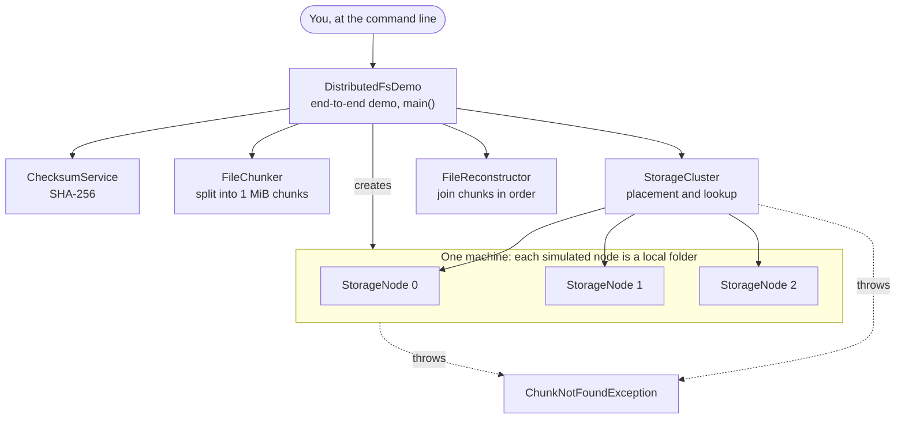
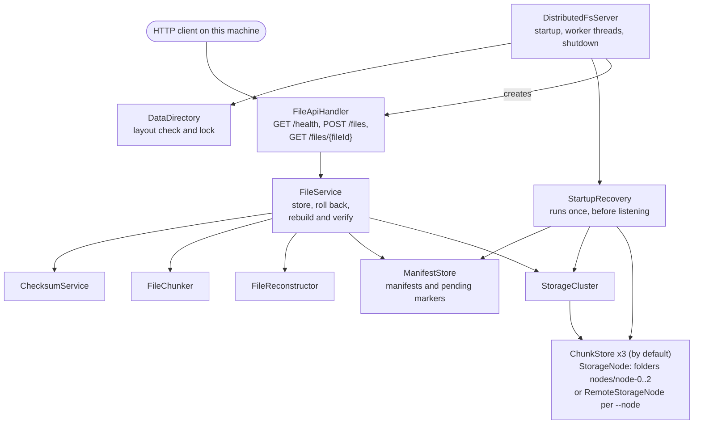
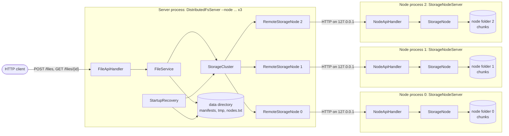
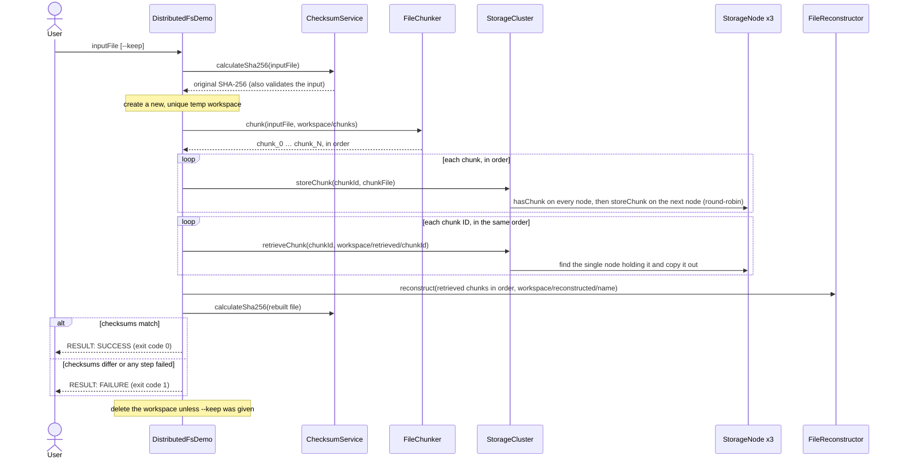

# DistributedFS

[](https://github.com/Manasva504/DistributedFS/actions/workflows/ci.yml)

A learning implementation of the core ideas behind distributed file storage: splitting files into chunks, spreading the chunks across storage nodes, retrieving and reassembling them, and verifying the result is intact with SHA-256. It is written in plain Java with no external dependencies.

> **Status:** Phases 1–8 are complete: the storage components, an end-to-end command-line demo, and a local HTTP server that uploads files, downloads them only after checking every chunk and the whole file against the SHA-256 values recorded at upload, and recovers interrupted uploads when it starts. The storage nodes are local folders by default, or, with `--node` options, separate storage node processes that the server reaches over HTTP (milestone M1). Everything runs on one machine (`127.0.0.1`), and each chunk is stored once: there is no replication yet. See the [roadmap](#roadmap).
>
> **This is a learning project, not production software.** The server has no authentication, no TLS (plain HTTP on `127.0.0.1` only) and no storage quotas, and it has been tested only on one Windows machine. See [Known limitations](#known-limitations).

## Contents

- [Why this project exists](#why-this-project-exists)
- [Implemented features](#implemented-features)
- [Architecture](#architecture)
- [End-to-end workflow](#end-to-end-workflow)
- [Components](#components)
- [Getting started](#getting-started)
- [Running the demo](#running-the-demo)
- [Running the server](#running-the-server)
- [Running a storage node](#running-a-storage-node)
- [HTTP API](#http-api)
- [Data directory, uploads, downloads and startup recovery](#data-directory-uploads-downloads-and-startup-recovery)
- [Known limitations](#known-limitations)
- [Roadmap](#roadmap)
- [Repository structure](#repository-structure)
- [Running tests and contributing](#running-tests-and-contributing)

## Why this project exists

Distributed file systems such as HDFS and GFS store large files by splitting them into chunks, placing the chunks on many machines, and checking them for corruption. DistributedFS builds those ideas one small, tested step at a time, starting on a single machine, so that each design decision can be understood and verified before networking is added.

What it demonstrates:

- **Streaming with bounded memory.** Files are processed through fixed-size buffers and never loaded whole. Ten stress tests push 64 to 100 MiB of data through the components, the demo, the upload and download endpoints, crash recovery and a storage node reached over HTTP, and the documented commands run them with the Java heap limited to 16 MiB (`-Xmx16m`).
- **Data integrity.** The demo compares the SHA-256 checksum of the rebuilt file with the original's, and a test confirms that corrupted chunk data is caught as a mismatch. An upload can carry its SHA-256, and if the data doesn't match, no file is committed to the storage cluster. Every upload also records the SHA-256 of each chunk. A download checks each retrieved chunk against its recorded checksum (naming a damaged chunk in the server log), then rebuilds the file and checks its size and whole-file SHA-256, all before any of it is sent; damaged data is reported as an error, never sent as the file.
- **Existing files aren't replaced.** Chunk files, rebuilt files, retrieved copies, manifests and pending-upload markers are created with `CREATE_NEW` or a rename that refuses to replace a file, and temporary files and workspaces get new, unique names. A storage node writes each chunk to a temporary file and gives it the chunk's ID only after all of its bytes have been written. If a write fails with an I/O error that Java reports, the code tries to delete the files that operation created.
- **Crash consistency for uploads.** The server records an upload as pending before storing anything, and treats writing the file's manifest as the moment the upload exists. When the server starts, it finishes or undoes uploads that a crash interrupted, and refuses to start if it cannot tell what is safe (see [startup recovery](#startup-recovery)).
- **Defensive input handling.** Chunk IDs are restricted so that they cannot point outside a node's folder, collide on case-insensitive file systems, or name Windows devices such as `nul`. File IDs are generated by the server and checked strictly. The HTTP server only answers requests addressed to `127.0.0.1` or `localhost`, and its error responses never contain file system paths or exception text.
- **Explicit failure semantics.** "This chunk is missing" and "this node could not be checked" are reported differently, so a broken node is never mistaken for missing data. Damaged metadata is reported as damaged, never as "not found".
- **Testing discipline.** 510 normal tests, plus 10 separate stress tests, in 28 plain-Java test runners, including simulated disk failures, corrupted data, server and storage-node processes killed partway through an upload or a store, nodes that never answer or drop the connection, and clients that stop reading or disconnect mid-download. A GitHub Actions workflow builds and runs them on Windows, and new safety rules are checked with deliberate-break runs: each rule is removed in a copy of the source to confirm a test fails (see [Recorded verification results](#recorded-verification-results)).

## Implemented features

- **Chunking** (`FileChunker`): splits a file into 1 MiB chunk files named `chunk_0`, `chunk_1`, … and returns them in order.
- **Reconstruction** (`FileReconstructor`): joins chunk files, in the order given, into a byte-identical copy of the original.
- **Integrity checks** (`ChecksumService`): calculates SHA-256 checksums and verifies a file against an expected value.
- **Simulated storage node** (`StorageNode`, `ChunkNotFoundException`): stores, retrieves and deletes chunks in its own local folder, with safe chunk IDs. A chunk's ID appears only after all of its bytes have been written successfully. Before storing, retrieving or deleting a chunk, it checks without following links that its folder is a plain folder; retrieving and deleting also require the chunk itself to be a regular file. See [Known limitations](#known-limitations) for what these checks don't cover.
- **Storage cluster** (`StorageCluster`): spreads chunks over several nodes round-robin, keeps each chunk ID on exactly one node, falls back to the next node when a store certainly stored nothing (but never after a store whose outcome is unknown), and deletes a chunk only when every node answered and exactly one holds it. Its nodes can be local folders, remote node processes, or a mix.
- **Storage node process** (`StorageNodeServer`, `NodeApiHandler`, `NodeDataDirectory`) and its client (`RemoteStorageNode`): a storage node as its own Java process with its own folder, serving its chunks over HTTP on `127.0.0.1`, and the client that reaches it. The server uses node processes instead of its local node folders when it is started with `--node` options, records which nodes hold its chunks (`ClusterMembership`, `nodes.txt`), and runs startup recovery through the nodes' API. `scripts\demo.ps1` starts three nodes and the server and round-trips a file; see [Running a storage node](#running-a-storage-node).
- **End-to-end demo** (`DistributedFsDemo`): runs the whole workflow from the command line and reports whether the rebuilt file's SHA-256 matches the original.
- **HTTP server** (`DistributedFsServer`, `FileApiHandler`): serves `GET /health`, `POST /files` and `GET /files/<fileId>` on `127.0.0.1` only. See [HTTP API](#http-api).
- **Uploads** (`FileService`): checks the optional SHA-256, splits the upload into 1 MiB chunks, records the SHA-256 of every chunk, stores the chunks on the cluster and writes the file's manifest. A failed upload is rolled back.
- **Downloads** (`FileService`, `FileApiHandler`): copies a stored file's chunks into a temporary workspace, checks each one against its recorded SHA-256, rebuilds the file, checks its size and whole-file SHA-256, and only then sends it. A watchdog disconnects clients that stop making progress.
- **Persistent metadata** (`ManifestStore`, `FileManifest`): one small text manifest per stored file, with the whole file's and each chunk's SHA-256, and a pending-upload marker for each upload in progress. Manifests written before per-chunk checksums existed are still read.
- **Data directory** (`DataDirectory`): checks, initializes and locks the server's data folder, so only one server uses it at a time.
- **Startup recovery** (`StartupRecovery`, `StaleTempFiles`): finishes or undoes interrupted uploads, removes stale temporary files and request workspaces, and reports chunks that nothing refers to, without deleting them.
- **Tests:** 28 plain-Java test runners with 510 normal tests, plus 10 separate stress tests, which run with a 16 MiB heap when started with the documented `-Xmx16m` option. `scripts\test.ps1` builds the project and runs them, locally and in [continuous integration](#continuous-integration).

## Architecture

### Storage components and the demo

Arrows point from a component to what it uses. The labelled arrows show the other relationships: `DistributedFsDemo` creates the storage nodes, and `StorageCluster` and the nodes throw `ChunkNotFoundException`. All classes are in the package `com.distributedfs`.



- `FileChunker`, `FileReconstructor`, and `ChecksumService` don't depend on any other project class. They exchange data as files and ordered lists of file paths.
- Only `StorageCluster` stores chunks on the nodes and retrieves them. `DistributedFsDemo` creates the nodes and wires everything together.
- The three storage nodes are ordinary folders on the same machine.

### HTTP server



- `FileApiHandler` knows HTTP; `FileService` knows nothing about HTTP.
- `StorageCluster` and `ManifestStore` are not thread-safe, so `FileService` runs every step that touches them while holding one lock, for uploads and downloads alike. Uploads are stored one at a time, and downloads copy their chunks one at a time. Reading and hashing an upload's body, and rebuilding, checking and sending a download, happen outside the lock.
- `StartupRecovery` runs while the data directory is locked and before the server listens, so no upload or download can run at the same time.

### Storage node processes

Started with `--node` options, the server keeps no chunks itself: each storage node is its own Java process with its own folder, and the server reaches it over HTTP on `127.0.0.1`. This is what `scripts\demo.ps1` starts:



- The cluster sees every node as a `ChunkStore`, so placement (round-robin), the duplicate check before each store, and deleting only with every node answering work the same as with local folders.
- Each node checks chunk IDs, never follows links, and publishes a chunk only if its length and SHA-256 match what the server sent. The server checks each chunk again against its manifest when the file is downloaded.
- A node that cannot be reached, times out, or answers unexpectedly is "could not check", never "absent". A store with an unknown outcome is not retried on another node; the upload fails and its chunk is rolled back as "maybe stored".
- The data directory's `nodes.txt` records the node IDs. Every later start needs exactly those nodes (on any ports), so a missing node can never make its chunks look absent.

## End-to-end workflow

This is what `DistributedFsDemo` does with the file you give it:



- Chunk order is tracked in an explicit list of chunk IDs. It is never taken from a folder listing, which would sort `chunk_10` before `chunk_2`.
- The input file is only read. Everything the demo writes goes into the new workspace folder, so no existing file can be overwritten.

The server's upload and download workflows are described in [Data directory, uploads, downloads and startup recovery](#data-directory-uploads-downloads-and-startup-recovery).

## Components

| Component | Responsibility | Key behavior |
|---|---|---|
| `FileChunker` | Splits a file into 1 MiB chunk files and returns them in order. | Streams through one chunk-sized buffer. Never overwrites existing files (`CREATE_NEW`). If it fails with an I/O error reported by Java, it tries to delete the chunks it created. Also usable on its own from the command line. |
| `FileReconstructor` | Joins chunk files, in list order, into one new file. | Streams through a 64 KiB buffer. An empty list produces an empty file. Refuses to overwrite the destination. If it fails with an I/O error reported by Java, it tries to delete the partial output it created. |
| `ChecksumService` | Calculates SHA-256 and checks a file against an expected checksum. | Streams through a 64 KiB buffer. `matches()` returns `true` or `false` only when it could actually read the file; otherwise it throws. |
| `StorageNode` | One simulated storage node that stores, retrieves and deletes chunks in its own local folder. | The chunk ID is the file name, and strict ID rules block path traversal. Writes each chunk to a temporary file and renames it to the chunk ID only after writing completes; the rename refuses to replace an existing chunk. Rejects retrieve destinations inside its own folder. A node that cannot check (for example, its folder was deleted) throws an `IOException` instead of reporting the chunk as absent. Before storing, retrieving or deleting, checks without following links that its folder is a plain folder; retrieving and deleting also require the chunk to be a regular file. `hasChunk` follows links (see [Known limitations](#known-limitations)). |
| `ChunkNotFoundException` | Reports that a chunk is definitely absent. | A subclass of `IOException` that carries the chunk ID. Thrown only when a node, or every node in a cluster, confirms the chunk is not there. |
| `ChunkStore` | What a storage node is to the cluster: store, retrieve, check, delete, list and sweep chunks by ID. | Implemented by `StorageNode` (a local folder) and `RemoteStorageNode` (a node process). Every implementation answers "absent" only when a working node confirms it, and throws an `IOException` when it cannot tell. |
| `RemoteStorageNode`, `RemoteNodeConfig` | The client of a storage node process, over HTTP on `127.0.0.1` with the JDK's `HttpClient`. | Checks chunk IDs before sending anything. Every reply must carry the node's own ID (`X-Node-Id`), so another program on the same port can never answer "absent". A refused connection, a timeout, a reset or an unexpected reply is "could not check", never "absent". A store that may have reached the node without a clear answer is an `AmbiguousStoreException`. Streams chunks from and to files; time limits for connecting, replies and stalled transfers. |
| `StorageNodeServer`, `NodeApiHandler`, `NodeDataDirectory` | A storage node as its own process: its folder, its lock, and its HTTP API. | Binds `127.0.0.1` only and checks the `Host` header. Publishes a stored chunk only if its length and SHA-256 match what the client sent. Runs one chunk operation at a time under a node-wide lock. Answers every request with its node ID and logs one line per request, without file paths or exception text. |
| `StorageCluster` | Coordinates several storage nodes behind one interface. | Round-robin placement, falling back to the next node only after a store that certainly stored nothing; after a store whose outcome is unknown, no other node is tried. Checks every node before storing so each chunk ID lives on one node, and refuses to store if any node cannot answer. Distinguishes missing chunks from unavailable nodes. Rejects retrieve destinations inside any node's folder. Deletes a chunk only if every node answered and exactly one holds it. |
| `DistributedFsDemo` | Command-line program that runs the whole workflow and verifies the result. | Works in a new temp workspace and deletes it afterwards, without following links, unless `--keep` is given. Prints the original checksum once it has read the input, and the rebuilt file's checksum only if the run gets that far. Once the arguments are accepted, every outcome it handles prints one `RESULT: SUCCESS` or `RESULT: FAILURE` line; argument errors print usage instructions instead. |
| `DistributedFsServer` | Command-line server: opens the data directory, connects to its storage nodes, runs startup recovery, and serves the HTTP API on `127.0.0.1`. | Nothing listens until every startup step has succeeded; a failed start undoes what it started and releases the data directory's lock. With `--node` options, every node must answer its health check with a distinct node ID that matches the membership file. 4 worker threads and a queue of 64 requests. Stops on Ctrl+C. |
| `ClusterMembership` | The membership file `nodes.txt`: which remote nodes hold this data directory's chunks. | Written once, by the first start with `--node` options (temporary file, forced to disk, renamed without replacing). Later starts must give exactly the recorded node IDs, in any order and on any ports. Refuses to switch a data directory between local node folders and remote nodes. |
| `FileApiHandler` | Handles every HTTP request. | Checks the `Host` header first, routes by exact raw path, enforces the upload size limit while reading, checks download file IDs before any decoding, disconnects clients that stall while sending a request body or receiving a download, and sends fixed JSON error bodies. |
| `FileService` | Stores uploads and prepares downloads. | Upload: writes a pending marker, then the chunks, then the manifest (the commit point), and rolls back a failed upload, newest chunk first. Upload also records each chunk's SHA-256. Download: copies the chunks in order, checks each against its recorded SHA-256, rebuilds the file, and checks its size and SHA-256 against the manifest. |
| `ManifestStore`, `FileManifest` | Manifests (with whole-file and per-chunk SHA-256) and pending-upload markers as small text files. | Written to a temporary file and renamed into place, never replaced. Read strictly: anything not exactly as written is reported as invalid. Older manifests without chunk checksums (format 1) are still read. |
| `DataDirectory` | The server's data folder. | Creates the layout in a new folder, refuses a non-empty folder it doesn't recognize, and holds an operating-system lock on `server.lock` while the server runs. |
| `StartupRecovery`, `StaleTempFiles` | Recovery of interrupted uploads, and cleanup of leftovers from interrupted uploads and downloads, when the server starts. | Works through `ChunkStore`, so with remote nodes every listing, no-follow check and temp sweep runs on the node itself; a node that cannot be listed stops the start. Assesses everything before changing anything, stops the start when a state is unsafe, sweeps only exact temporary-file and workspace names without following links, and only reports unreferenced chunks. |
| `FileIds`, `Json`, `ApiError`, `FileTrees` | Helpers. | 32-character lowercase hexadecimal file IDs from `SecureRandom`; JSON string quoting; the fixed list of API errors; folder-tree deletion that never follows links or junctions. |

## Getting started

### Prerequisites

- **JDK 23.** The project has been built and tested with JDK 23.0.1 on Windows 11, using Windows PowerShell 5.1. Check your version with `java -version` and `javac -version`.
- **Git**, to clone the repository.
- **No build tool or libraries.** The code is compiled with plain `javac`; there is no Maven, Gradle, Spring Boot, or external dependency.
- **Free disk space.** The demo needs about four times the size of the file you give it, and each stress test uses a few hundred MiB of temporary space.

### Build

In PowerShell:

```powershell
git clone https://github.com/Manasva504/DistributedFS.git
cd DistributedFS
javac -d out src\main\java\com\distributedfs\*.java
javac -d out-test -cp out src\test\java\com\distributedfs\*.java
```

The compiled classes go to `out` (the program) and `out-test` (the tests). Git ignores both folders, and you can delete and rebuild them at any time. Rebuild both after pulling new code, so that you never run old classes.

### Run the tests

Each suite is a plain-Java program. It prints `PASS`, `FAIL` or `SKIP` for every test and ends with a summary such as `18 passed, 0 failed`. A suite exits with code 1 if any test fails.

| Suite | Normal tests | Stress tests (run separately) |
|---|---|---|
| `ApiErrorTest` | 5 | none |
| `ChecksumServiceTest` | 15 | 1 |
| `CrashRecoveryTest` | 8 | 1 |
| `DataDirectoryTest` | 20 | none |
| `DistributedFsDemoTest` | 18 | 1 |
| `DistributedFsServerTest` | 28 | none |
| `DownloadEndpointTest` | 26 | 1 |
| `FileChunkerTest` | 18 | none |
| `FileIdsTest` | 12 | none |
| `FileReconstructorTest` | 15 | 1 |
| `FileServiceTest` | 34 | none |
| `FileTreesTest` | 5 | none |
| `JsonTest` | 8 | none |
| `ManifestStoreTest` | 28 | none |
| `NetworkedRecoveryTest` | 8 | none |
| `NodeApiTest` | 26 | none |
| `NodeDataDirectoryTest` | 11 | none |
| `RemoteClusterTest` | 10 | none |
| `RemoteServerTest` | 11 | none |
| `RemoteStorageNodeTest` | 20 | 1 |
| `StaleTempFilesTest` | 4 | none |
| `StalledRequestTest` | 16 | none |
| `StallWatchTest` | 6 | none |
| `StartupRecoveryTest` | 25 | none |
| `StorageClusterTest` | 45 | 1 |
| `StorageNodeServerTest` | 6 | none |
| `StorageNodeTest` | 58 | 1 |
| `UploadEndpointTest` | 24 | 2 |
| **Total** | **510** | **10** |

The simplest way to build and run everything is the script that continuous integration uses. From the repository folder:

```powershell
powershell -ExecutionPolicy Bypass -File scripts\test.ps1                 # build, then every normal suite
powershell -ExecutionPolicy Bypass -File scripts\test.ps1 -Stress         # build, then the stress tests with -Xmx16m
powershell -ExecutionPolicy Bypass -File scripts\test.ps1 -Suite StorageNodeTest,FileServiceTest
```

Each run compiles into a new temporary folder (never `out` or `out-test`), so classes left over from deleted or renamed sources cannot hide an error, and deletes that folder when it finishes. It prints every suite's output, then a total and the name of every skipped test, and exits with code 1 if compilation or any suite failed. It works in Windows PowerShell 5.1 and PowerShell 7. (`-ExecutionPolicy Bypass` applies to that one command only; it is needed on machines whose policy blocks local scripts.)

To run the suites by hand instead, from the repository folder:

```powershell
foreach ($suite in 'ApiErrorTest', 'ChecksumServiceTest', 'CrashRecoveryTest', 'DataDirectoryTest',
        'DistributedFsDemoTest', 'DistributedFsServerTest', 'DownloadEndpointTest', 'FileChunkerTest',
        'FileIdsTest', 'FileReconstructorTest', 'FileServiceTest', 'FileTreesTest', 'JsonTest',
        'ManifestStoreTest', 'NetworkedRecoveryTest', 'NodeApiTest', 'NodeDataDirectoryTest', 'RemoteClusterTest',
        'RemoteServerTest', 'RemoteStorageNodeTest',
        'StaleTempFilesTest', 'StalledRequestTest', 'StallWatchTest', 'StartupRecoveryTest',
        'StorageClusterTest', 'StorageNodeServerTest', 'StorageNodeTest', 'UploadEndpointTest') {
    java -cp "out;out-test" "com.distributedfs.$suite"
}
```

Or run one suite, for example:

```powershell
java -cp "out;out-test" com.distributedfs.UploadEndpointTest
```

Some tests are reported as `SKIP` instead of passing when the machine can't run them:

- Five tests, two in `StorageNodeTest`, two in `StorageClusterTest` and one in `NodeApiTest`, need to create a symbolic link. Windows allows that only with Developer Mode turned on or with administrator rights. On the Windows 11 machine where the code was verified, the first four were skipped while Developer Mode was off, and all five ran and passed with it turned on (see [Recorded verification results](#recorded-verification-results)). Related checks are also tested with Windows junctions, which don't need special rights, and those tests ran; they don't replace the symbolic-link tests (see [Known limitations](#known-limitations)).
- One `DistributedFsServerTest` test needs an IPv4 address other than loopback, to show that the server can't be reached through it.

`CrashRecoveryTest`, `DataDirectoryTest`, `NetworkedRecoveryTest` and `StorageNodeServerTest` start extra Java processes with the same class path, the node tests start node servers on free ports of `127.0.0.1`, and several tests create Windows junctions with `cmd.exe /c mklink /J` inside their own temporary folders.

Run the stress tests separately. The `-Xmx16m` option limits the Java heap to 16 MiB, so each test shows that the data streams through without being loaded into memory. Without that option the tests still run, and most print a warning if the heap is 64 MiB or larger:

```powershell
java -Xmx16m -cp "out;out-test" com.distributedfs.FileReconstructorTest --stress
java -Xmx16m -cp "out;out-test" com.distributedfs.ChecksumServiceTest --stress
java -Xmx16m -cp "out;out-test" com.distributedfs.StorageNodeTest --stress
java -Xmx16m -cp "out;out-test" com.distributedfs.StorageClusterTest --stress
java -Xmx16m -cp "out;out-test" com.distributedfs.DistributedFsDemoTest --stress
java -Xmx16m -cp "out;out-test" com.distributedfs.UploadEndpointTest --stress
java -Xmx16m -cp "out;out-test" com.distributedfs.CrashRecoveryTest --stress
java -Xmx16m -cp "out;out-test" com.distributedfs.DownloadEndpointTest --stress
java -Xmx16m -cp "out;out-test" com.distributedfs.RemoteStorageNodeTest --stress
```

`UploadEndpointTest --stress` uploads exactly 100 MiB and then four 20 MiB files at once. `RemoteStorageNodeTest --stress` stores one 64 MiB chunk on a storage node over HTTP and retrieves it again, with the node and its client in the same 16 MiB heap. `CrashRecoveryTest --stress` kills a child process partway through a 64 MiB upload and passes `-Xmx16m` to that child itself. `DownloadEndpointTest --stress` uploads 100 MiB and downloads it again, checking the SHA-256 of the bytes as they arrive.

In PowerShell, keep the quotes around `"out;out-test"`: an unquoted `;` ends the command.

### Continuous integration

`.github/workflows/ci.yml` runs on every push and pull request to `main` (and by hand from the Actions tab). On a `windows-latest` runner with Temurin JDK 23 it reports whether the runner may create symbolic links, then runs `scripts\test.ps1` and `scripts\test.ps1 -Stress`. The job's summary page lists each suite's result and every skipped test by name. It needs no secrets. The tests use Windows junctions, so CI runs on Windows only. Hosted Windows runners usually allow symbolic links, so the four symbolic-link tests may run there even where they are skipped locally; the job log shows whether they did.

### Recorded verification results

The results below were recorded when each run was made; they are not rerun when this README changes. They describe those runs on that machine, not a guarantee for other environments.

The first recorded run tested the code in commit `0feb7a1` ("Add verified HTTP file downloads"), on Windows 11 with JDK 23.0.1, on 20 October 2026:

- **Normal tests:** all 20 suites exited with code 0. Of the 377 normal tests, 375 passed, 0 failed and 2 were skipped. The two skipped tests are the symbolic-link tests described above; Developer Mode was off and the shell was not elevated.
- **Stress tests,** run separately and not included in the figures above: all 9 passed with `-Xmx16m`, including the 100 MiB download.
- **Deliberate-break checks:** 11 checks each broke one rule of the download code in a separate copy of the source (for example: skip the SHA-256 check, decode the file ID before checking it, read without the storage lock, accept `HEAD`, disable the stall watchdog, keep the download workspace). The tests detected all 11.
- **Not verified:** stopping the server with Ctrl+C. The shutdown hook is covered only indirectly, by tests of the server's `stop()` method, and has not been checked by hand.

A later recorded run tested the request-stall hardening (stalled request bodies and uploads, and the no-follow check before retrieving chunks), the Java source and tests of commit `64ac867`, on the same machine with JDK 23.0.1, on 22 October 2026:

- **Normal tests:** all 21 suites exited with code 0. Of the 398 normal tests, 394 passed, 0 failed and 4 were skipped: the four symbolic-link tests, with Developer Mode off and the shell not elevated.
- **Stress tests,** run separately: all 9 passed with `-Xmx16m`.
- **Regression check:** the new tests were also run against the code from before the change. There, 13 of the 16 `StalledRequestTest` tests and all 3 new junction tests failed, as intended. The 3 `StalledRequestTest` tests that passed cover behavior that was already correct: complete bodies, a slow but steady upload, and the download route.
- **Deliberate-break checks:** 6 checks each broke one new rule in a separate copy of the source (skip finishing the body before a response, ignore chunked bodies, treat every request as having no body, count no upload progress, let the upload watchdog never fire, follow links when retrieving). The tests detected all 6.

A third recorded run tested the per-chunk checksums, the CI script and the link-safety additions (store refuses a junctioned node folder; new dangling-junction delete tests), on the same machine with JDK 23.0.1, on 23 October 2026, before they were committed:

- **Normal tests:** all 21 suites exited with code 0. Of the 417 normal tests, 413 passed, 0 failed and 4 were skipped: the four symbolic-link tests, with Developer Mode off and the shell not elevated. `scripts\test.ps1` was run in Windows PowerShell 5.1 on a copy of the source and gave the same counts; it exited with code 1 on a copy with a deliberately broken rule. GitHub Actions had not yet run the workflow.
- **Stress tests,** run separately: all 9 passed with `-Xmx16m`.
- **Deliberate-break checks:** an earlier check, removing the no-follow option from the storage node's regular-file check (the check deleting relies on), had gone undetected because only the skipped symbolic-link tests could catch it. Against this code it fails 3 tests, two of them new delete tests built on dangling junctions, which need no special rights. Three new checks broke the per-chunk checksums (skip the chunk check, record wrong chunk checksums, remove the chunk-count limit); the tests detected all 3. The new test for a junctioned node folder failed against the code before the fix.

A follow-up run on the same machine on 23 October 2026, also before commit, with Windows Developer Mode turned on, tested the same code plus a fix to the order of `storeChunk`'s checks and a `scripts\test.ps1` that builds into a new temporary folder on each run:

- **Normal tests:** `scripts\test.ps1` in Windows PowerShell 5.1: all 21 suites exited with code 0. Of the 418 normal tests, 418 passed, 0 failed and 0 were skipped. The four symbolic-link tests ran and passed.
- **Stress tests,** run separately with `scripts\test.ps1 -Stress`: all 9 passed with `-Xmx16m`.
- **Deliberate-break checks:** removing the no-follow option from the storage node's regular-file check now fails 7 tests, including all four symbolic-link tests. Putting `storeChunk`'s duplicate check back before its node-folder check fails the new test for that case, which then sees a misleading "already exists" error.
- **Ctrl+C shutdown,** checked manually on Windows 11 with JDK 23: the server printed `DistributedFS server stopped.` after about 2 seconds, restarted immediately on the same data directory without an "already in use" error, and a file uploaded before the restart downloaded byte-for-byte identical.

A run on 24 October 2026, on the same machine with Developer Mode on, tested milestone M1a (the `ChunkStore` interface, the storage node process and its client) before it was committed as `6b98712` and merged in PR #5 (`d399531`):

- **Normal tests:** `scripts\test.ps1` in Windows PowerShell 5.1: all 26 suites exited with code 0. Of the 491 normal tests, 491 passed, 0 failed and 0 were skipped, including all five symbolic-link tests. The run took about 104 seconds.
- **Stress tests,** run separately with `scripts\test.ps1 -Stress`: all 10 passed with `-Xmx16m`, in about 16 seconds.
- **Deliberate-break checks:** 17 checks each broke one rule of the new code in a separate copy of the source. 16 were detected:
  - client side: a timeout or refused connection reported as "absent"; any 404 reported as a missing chunk; the node ID ignored; local chunk-ID checks skipped; a failure after connecting treated as "certainly not stored"; a partial retrieved copy kept; a chunk held in memory (`OutOfMemoryError` under `-Xmx16m`);
  - cluster: another node tried after a store with an unknown outcome;
  - node: chunk-ID rules skipped; the SHA-256 check skipped; a short body published; the `Host` check removed; `mode=nofollow` following links; the node-wide lock removed; the folder lock removed.
  
  The short-body check was at first not detected over HTTP, because the JDK's own request stream and the SHA-256 check both refuse such a body; a direct test of the node's store was added, and it then failed as intended. One check was not detected: removing the client's own check that a chunk's body is as long as its `Content-Length`, because the JDK's HTTP client already refuses such a body before that check runs.

A run on 25 October 2026, on the same machine with Developer Mode on, tested milestone M1b (the server with storage node processes) before it was committed:

- **Normal tests:** `scripts\test.ps1` in Windows PowerShell 5.1: all 28 suites exited with code 0. Of the 510 normal tests, 510 passed, 0 failed and 0 were skipped. The run took about 107 seconds.
- **Stress tests,** run separately with `scripts\test.ps1 -Stress`: all 10 passed with `-Xmx16m`, in about 15 seconds.
- **Deliberate-break checks:** 5 checks each broke one new rule in a separate copy of the source, and the tests detected all 5: a chunk whose store answer was lost left out of the rollback; a node that cannot be listed at startup ignored; the membership file not checked; the same node given twice not refused (a later step still refuses the start, but only with an internal error); a node failure during a download reported as a missing chunk. The check of an unlistable node was at first masked by the per-chunk checks of an interrupted upload, so a test without interrupted uploads was added before the run.
- **`scripts\demo.ps1`:** started three node processes and the server on free ports, uploaded a random 5 MiB file (5 chunks, stored 2, 2 and 1 per node), downloaded it with the same SHA-256 as the original and as recorded by the server, printed `RESULT: SUCCESS`, exited with code 0, and left no process or folder behind.

## Running the demo

```powershell
java -cp out com.distributedfs.DistributedFsDemo C:\path\to\your-file.bin
```

Replace the path with any file. The input file is only read; everything the demo writes goes into a new, uniquely named workspace folder in your temp folder, which is deleted at the end.

Output from a real run on Windows 11 with a 3.5 MiB file. The input file's real path has been replaced with the shorter `C:\data\sample.bin`, and the user name in the workspace path with `<you>`:

```text
DistributedFS demo: a simulated cluster of 3 storage nodes (folders on this machine).
Each chunk is stored on exactly one node; there is no replication.
Input file:            C:\data\sample.bin (3,674,337 bytes)
Original SHA-256:      e128b8839e356ba810f8d4c2e409a2df79ae72ab8cd3331f3bf1a11b432fa1f9
Workspace:             C:\Users\<you>\AppData\Local\Temp\distributedfs-demo-12694042071003609230
[1/5] Split into 4 chunk(s) of up to 1,048,576 bytes
[2/5] Started 3 storage nodes
[3/5] Stored 4 chunk(s): node 0: 2, node 1: 1, node 2: 1
[4/5] Retrieved 4 chunk(s) in their original order
[5/5] Reconstructed 3,674,337 bytes
Reconstructed SHA-256: e128b8839e356ba810f8d4c2e409a2df79ae72ab8cd3331f3bf1a11b432fa1f9
RESULT: SUCCESS - the reconstructed file is identical to the original (SHA-256 match)
Workspace deleted.
```

| Exit code | Meaning |
|---|---|
| 0 | The rebuilt file's SHA-256 matches the original. |
| 1 | The input is missing, is not a regular file (for example, a directory), or can't be read; an I/O error occurred, for example while creating the workspace or copying chunks; or the checksums differ. |
| 2 | A usage error: no file (or a blank one), more than one file, an unknown option, or a path containing characters Windows doesn't allow. Usage instructions are printed instead of a `RESULT` line. |

### Keeping the workspace with `--keep`

Add `--keep`, before or after the file path, to keep the workspace for inspection:

```powershell
java -cp out com.distributedfs.DistributedFsDemo C:\path\to\your-file.bin --keep
```

Instead of deleting the workspace, the demo ends by printing where it is (user name again replaced with `<you>`):

```text
Workspace kept for inspection: C:\Users\<you>\AppData\Local\Temp\distributedfs-demo-10156030369148198879
  chunks\          chunk files made by FileChunker
  nodes\node-N\    each storage node's folder
  retrieved\       chunks copied back out of the cluster
  reconstructed\   the rebuilt file
```

For the 3.5 MiB example file, the kept workspace contained:

```text
distributedfs-demo-<digits>\
├── chunks\          chunk_0, chunk_1, chunk_2, chunk_3
├── nodes\
│   ├── node-0\      chunk_0, chunk_3
│   ├── node-1\      chunk_1
│   └── node-2\      chunk_2
├── retrieved\       chunk_0, chunk_1, chunk_2, chunk_3
└── reconstructed\   sample.bin
```

Delete a kept workspace yourself when you have finished with it, using the exact path the demo printed:

```powershell
Remove-Item -Recurse -Force "C:\Users\<you>\AppData\Local\Temp\distributedfs-demo-<digits>"
```

### Splitting a file without the cluster

`FileChunker` also works on its own:

```powershell
java -cp out com.distributedfs.FileChunker C:\path\to\your-file.bin C:\path\to\chunk-folder
```

It writes `chunk_0`, `chunk_1`, … into the output folder, creating the folder if needed, and refuses to overwrite existing chunk files. When it succeeds, it leaves the chunk files in place; if it fails partway with an I/O error, it tries to delete the chunks it created.

## Running the server

```powershell
java -cp out com.distributedfs.DistributedFsServer --data-dir C:\path\to\data-folder
```

| Option | Meaning |
|---|---|
| `--data-dir <folder>` | Required. The folder where the server keeps everything it stores. It is created if it doesn't exist. Use a new folder or one this server created before: a non-empty folder without the server's marker file is refused. |
| `--port <0-65535>` | Optional; default `8080`. `0` picks any free port, and the server prints the one it chose. |
| `--max-upload-mb <1-1024>` | Optional; default `100`. The largest upload accepted, in MiB. |
| `--node 127.0.0.1:<port>` | Optional, repeatable (1 to 16 times, each port once). Use the storage node process listening on that port instead of the local node folders; see [Running a storage node](#running-a-storage-node). |

Each option other than `--node` may be given once, in any order, and numbers are written without leading zeros. The server listens on `127.0.0.1` only, so other machines can't connect to it. When it is ready, it prints a line such as:

```text
DistributedFS server listening on http://127.0.0.1:8080/ (data directory: C:\path\to\data-folder)
Press Ctrl+C to stop.
```

A new data folder is also reported with `Initialized a new data directory: <folder>`. Press Ctrl+C to stop the server; according to the code, it then waits up to 2 seconds for requests in progress and prints `DistributedFS server stopped.` (This was checked by hand on 23 October 2026; see [Recorded verification results](#recorded-verification-results).)

| Exit code | Meaning |
|---|---|
| 0 | The server started (it then keeps running until Ctrl+C). |
| 1 | The server could not start, for example because the data folder is refused or in use by another server, the port is taken, a storage node did not answer or is not one of the recorded nodes, or startup recovery found a state it cannot recover safely. The message starts with `Error: the server could not start:`. |
| 2 | A usage error, such as a missing `--data-dir`, an unknown option, or an invalid number. Usage instructions are printed. |

Only one server can use a data folder at a time. If another server holds its lock, a new one retries for up to 2 seconds (Windows releases the lock of a killed process shortly after it ends) and then refuses to start.

## Running a storage node

A storage node can also run as its own Java process, with its own folder and port, so that nodes can fail independently. The server then uses the nodes instead of its local node folders. Start the nodes first, then the server with one `--node` option per node, each in its own PowerShell window:

```powershell
java -cp out com.distributedfs.StorageNodeServer --data-dir C:\dfs\node-0 --port 9101
java -cp out com.distributedfs.StorageNodeServer --data-dir C:\dfs\node-1 --port 9102
java -cp out com.distributedfs.StorageNodeServer --data-dir C:\dfs\node-2 --port 9103
java -cp out com.distributedfs.DistributedFsServer --data-dir C:\dfs\server-data --node 127.0.0.1:9101 --node 127.0.0.1:9102 --node 127.0.0.1:9103
```

The server checks every node's health and ID before anything else. The first start records the node IDs in the data directory's `nodes.txt`; every later start needs exactly those nodes, in any order and on any ports, and refuses to start otherwise (also when a node is down). A data directory that already keeps chunks in its local node folders cannot switch to remote nodes, and one with a `nodes.txt` cannot be started without `--node` options.

### The cluster demo

`scripts\demo.ps1` does all of that in a new temporary folder: it builds the program, starts three nodes and the server on free ports (read from their ready lines), uploads a random 5 MiB file, downloads it, compares the SHA-256 of both copies with `Get-FileHash`, prints how many chunks each node holds, stops the processes it started and deletes its folder (`-Keep` keeps the folder):

```powershell
powershell -ExecutionPolicy Bypass -File scripts\demo.ps1
```

It ends with `== RESULT: SUCCESS (the downloaded file is identical to the uploaded one)` and exit code 0, or `RESULT: FAILURE` and exit code 1. It starts the JDK's own `java.exe` (found through `java.home`), so that stopping a process really stops its JVM even where `java` on the `PATH` is a launcher such as Oracle's `javapath`.

### Node options and API

| Option | Meaning |
|---|---|
| `--data-dir <folder>` | Required. The node's own folder, created if missing. A non-empty folder without the node's marker (including the server's data directory) is refused. |
| `--port <0-65535>` | Required. `0` picks any free port, and the node prints the one it chose. |
| `--max-chunk-mb <1-64>` | Optional; default `16`. The largest chunk the node accepts. |

The folder holds `distributedfs-node.txt` (a marker with the node's ID, 32 random hexadecimal characters chosen when the folder is created), `node.lock` (locked while a node process uses the folder, so only one can) and `chunks\` (one file per chunk, with the same ID rules as `StorageNode`). At startup the node removes temporary files that a killed store left behind, then prints a line such as:

```text
DistributedFS storage node 0123456789abcdef0123456789abcdef listening on http://127.0.0.1:9101/ (data directory: C:\path\to\node-folder)
```

and then one line per request, for example `POST /chunks/<id> 201 1048576 bytes 3 ms` (method, route, status or `-` if no answer was sent, bytes, duration). The request log never contains file paths or exception text. The exit codes are those of the server: 0 started, 1 could not start, 2 usage error.

The node's API, which only `RemoteStorageNode` is meant to call (bodies are `key=value` lines; errors are `error=<code>`):

| Request | Answers |
|---|---|
| `GET /health` | `200` with `status=ok`, `node-id`, `format=1` |
| `POST /chunks/<id>` with `Content-Length` and `X-Chunk-Sha256` | `201 stored=<bytes>`; `409 chunk_exists`; `400`; `413 too_large`; `422 checksum_mismatch`; `503 storage_unavailable` or `node_busy`; `500 store_failed`. Only `201` means the chunk was published, and only once its length and SHA-256 matched. |
| `GET /chunks/<id>` | `200` with the bytes; `404 chunk_not_found`; `500 unsafe_entry` (a link, junction or folder under the ID); `503` |
| `GET /chunks/<id>/exists?mode=follow` or `mode=nofollow` | `200 exists=true` or `exists=false`; `500 unsafe_entry`; `503` |
| `DELETE /chunks/<id>` | `200 deleted=true` or `deleted=false`; `500 unsafe_entry` or `delete_failed`; `503` |
| `GET /entries` | `200`, one `<kind> <percent-encoded name>` line per entry of the chunk folder; `503` |
| `POST /sweep` | `200` with `removed` and `warnings`; `503` |

Every answer carries `X-Node-Id` and closes the connection. A wrong `Host` header is `403 host_not_allowed`, an invalid chunk ID `400 invalid_chunk_id` before anything touches the disk. "Absent" (`404 chunk_not_found`, `exists=false`, `deleted=false`) is answered only when the chunk folder is a plain folder with no entry under the ID; a node that cannot tell answers `500` or `503`. On the client side, a refused connection, a timeout, a reset, an unexpected reply or a reply from a different node ID is "could not check", never "absent", and a store that may have reached the node without a clear answer is reported as an unknown outcome, so the cluster never stores that chunk on a second node.

## HTTP API

Every request must be addressed to the server itself: it needs exactly one `Host` header, either `127.0.0.1:<port>` or `localhost:<port>`, with the port the server is listening on. Any other request gets `403` before it is looked at. This protects the server from web pages that try to reach it through DNS rebinding. Tools such as `curl.exe` send the right `Host` header automatically when the URL is `http://127.0.0.1:<port>/…`.

In Windows PowerShell 5.1, `curl` is an alias for `Invoke-WebRequest`. The examples below call `curl.exe`, which is included with Windows 10 and 11. They assume the default port, 8080.

### `GET /health`

```powershell
curl.exe -i http://127.0.0.1:8080/health
```

Answers `200` with the body `{"status":"ok"}`. Other methods get `405` with `Allow: GET`.

### `POST /files`

Uploads one file. The request body is the file's raw bytes.

```powershell
curl.exe -i -X POST -H "Content-Type: application/octet-stream" --data-binary "@C:\path\to\your-file.bin" http://127.0.0.1:8080/files
```

To have the server check the data, add the file's SHA-256 as a header. `Get-FileHash` prints it in uppercase, and the server accepts either letter case:

```powershell
$sha = (Get-FileHash C:\path\to\your-file.bin -Algorithm SHA256).Hash
curl.exe -i -X POST -H "Content-Type: application/octet-stream" -H "X-Content-SHA256: $sha" --data-binary "@C:\path\to\your-file.bin" http://127.0.0.1:8080/files
```

Request rules:

- **`Content-Type`**: exactly one, `application/octet-stream` (parameters after a `;` are allowed).
- **`X-Content-SHA256`** (optional): exactly one, 64 hexadecimal characters in either case. If the uploaded data has a different SHA-256, the upload is refused and no file is committed to the storage cluster: nothing reaches the storage nodes or the manifest folder. (The body has already been written to the request's temporary workspace by then; that workspace is deleted afterwards, as for every upload.)
- **Size limit**: 100 MiB unless `--max-upload-mb` says otherwise. A `Content-Length` over the limit is refused with `413` after at most 64 KiB of the body has been read and discarded; the rest is never read. (Like every early answer, the refusal waits for that much of the declared body, under a fixed 30-second deadline: a client that sends no body at all, or not enough of it in time, gets no answer, and its connection is closed. See [Errors](#errors).) A body sent without a length (chunked transfer encoding) is cut off with `413` as soon as it passes the limit.
- `Expect: 100-continue` is supported.

A successful upload answers `201 Created`, with `Location: /files/<fileId>` and the new file's manifest as JSON:

```json
{"fileId":"<32 lowercase hex characters>","size":3145729,"sha256":"<64 lowercase hex characters>","chunkSize":1048576,"chunkCount":4}
```

The server creates the file ID; a client cannot choose it. The `Location` header is the path to download the file from.

### `GET /files/<fileId>`

Downloads a stored file.

```powershell
$fileId = "paste-the-actual-32-character-file-id-here"
curl.exe -o C:\path\to\downloaded.bin "http://127.0.0.1:8080/files/$fileId"
```

Replace the placeholder with the `fileId` from the upload's response (or the last part of its `Location` header) before running the command; the placeholder itself is not a valid file ID and would be refused with `400 invalid_file_id`.

- **File ID:** the part of the path after `/files/` must be exactly a file ID as the server wrote it: 32 characters, each `0-9` or lowercase `a-f`. It is checked exactly as received, before any percent-decoding, so encoded forms (`%30…`, `%2F`, `%2e%2e`), uppercase letters, extra path segments, dots and other characters are all refused with `400 invalid_file_id`. No form of the path can reach a file other than a stored one.
- **Integrity first:** the server copies the file's chunks, in order, into a new temporary workspace, checks each chunk against the SHA-256 recorded for it at upload, rebuilds the file there, and checks its size and whole-file SHA-256 against the manifest. Only a file that passes every check is sent. A file that fails is answered with an error, never sent as `200`.
- **Success:** `200` with the file's bytes, `Content-Type: application/octet-stream`, `Content-Length` set to the verified size (`0` for an empty file), `X-Content-Type-Options: nosniff` and `Accept-Ranges: none`.
- **Range requests are not supported.** A `Range` header is ignored: the answer is always `200` with the whole file, never `206`.
- **Methods:** only `GET`. Any other method on a path under `/files/`, including `HEAD`, gets `405` with `Allow: GET`.
- **Uncommitted uploads are not files.** Only a file whose manifest has been written can be downloaded. An upload that never committed (a pending marker without a manifest) is `404 file_not_found`, like an ID that was never used.
- **Damaged files** are reported, never served: an unreadable or invalid manifest is `500 metadata_corrupt`, a chunk that every storage node confirms is gone is `500 chunk_missing` (not `404`), and a chunk, or the rebuilt content, whose size or SHA-256 differs from the manifest is `500 integrity_check_failed`. A failed download never changes stored chunks, manifests or pending markers.
- **Slow and stalled clients:** a watchdog closes the connection if a download makes no progress for 30 seconds. Progress counts only when a whole write of up to 64 KiB has been taken in, so a client must accept roughly 64 KiB every 30 seconds; a slower client is disconnected and receives an incomplete body. A `GET` should have no request body; if one declares a body (`Content-Length` or chunked), up to 64 KiB of it is read and discarded first, under a fixed 30-second deadline. If it doesn't arrive in time, or is malformed, the connection is closed without a response (see [Errors](#errors)).

The whole file is rebuilt and checked before the first byte is sent, so large files take a moment to start, and each download needs temporary disk space (see [How a download is served](#how-a-download-is-served)).

### Errors

Every error has a JSON body of the same shape, for example:

```json
{"error":"payload_too_large","message":"The upload is larger than this server allows."}
```

The message is a fixed sentence: it never contains request input, exception text or file system paths. Details go to the server's console.

| Status | `error` | When |
|---|---|---|
| 400 | `invalid_checksum` | `X-Content-SHA256` is repeated or is not 64 hexadecimal characters. |
| 400 | `checksum_mismatch` | The uploaded data doesn't match `X-Content-SHA256`. No file was committed to the storage cluster. |
| 400 | `invalid_file_id` | The path under `/files/` is not exactly a file ID (including `/files/` itself). |
| 403 | `host_not_allowed` | The `Host` header is missing, repeated, or names another host or port, or the request target names a host. |
| 404 | `not_found` | Any path other than `/health`, `/files` and paths under `/files/`. |
| 404 | `file_not_found` | No file with this ID has been committed. |
| 405 | `method_not_allowed` | A method the endpoint doesn't support. The `Allow` header lists the one it does: `GET` for `/health` and `/files/<fileId>`, `POST` for `/files`. |
| 413 | `payload_too_large` | The upload is over the size limit, or, only with a very small configured chunk size, it would need more than 65,536 chunks. |
| 415 | `unsupported_media_type` | `Content-Type` is missing, repeated, or not `application/octet-stream`. |
| 500 | `metadata_corrupt` | The file's manifest is unreadable or invalid. |
| 500 | `chunk_missing` | The file is committed, but one of its chunks is confirmed gone from every storage node. |
| 500 | `integrity_check_failed` | A chunk's SHA-256, or the rebuilt file's size or SHA-256, doesn't match its manifest. The server log names a damaged chunk; the response never does. |
| 500 | `storage_error` | The data couldn't be stored or read. A failed upload was rolled back, or, if that couldn't be completed, left for startup recovery. |
| 500 | `internal_error` | An unexpected error. |

A request that declares a body (a `Content-Length` other than 0, or chunked transfer encoding) but is answered without using it, such as an error answer or `GET /health`, first has up to 64 KiB of that body read and discarded. This has a fixed deadline of 30 seconds, counted from when the server starts discarding the body. Bytes that arrive don't extend it, so the first 64 KiB (or the whole body, if it is shorter) must arrive within that time. If it doesn't, if the body is malformed (for example, an invalid chunk), or if the client disconnects partway through it, the connection is closed without an HTTP response. If the body is longer than 64 KiB, the rest is never read, and the connection is closed after the answer.

If an upload's client disconnects, sends an incomplete body, or sends nothing for 30 seconds, the server sends no response and the upload is not committed to the storage cluster: nothing reaches the storage nodes or the manifest folder, and the request's temporary workspace, which may already hold part of the body, is deleted. If a download's client disconnects, the download is abandoned and its workspace deleted. When all 4 worker threads are busy and 64 more requests are waiting, the server closes new connections without a response.

## Data directory, uploads, downloads and startup recovery

### Layout

```text
<data-dir>\
├── distributedfs-data.txt   marker: identifies the folder as a DistributedFS data directory
├── server.lock              locked while a server uses the folder
├── manifests\               <fileId>.manifest and <fileId>.pending files
├── tmp\                     one workspace per upload (upload-<digits>) or download (download-<digits>), deleted afterwards
├── nodes.txt                with --node only: the node IDs of the remote storage nodes holding the chunks
└── nodes\
    ├── node-0\              the storage nodes' chunks, named <fileId>_<index> (empty with --node)
    ├── node-1\
    └── node-2\
```

With `--node` options the chunks live in each node process's own folder instead (`distributedfs-node.txt` with the node's ID, `node.lock`, and `chunks\`), and the local `nodes\node-*` folders stay empty. Don't edit, move or delete files inside a data folder or a node folder by hand while it holds stored files. A damaged marker or membership file makes the server refuse to start, and it never deletes the folder's contents to fix that.

### Manifests and pending markers

A **manifest** records one stored file in plain text: six fixed lines, then the SHA-256 of each chunk, in order:

```text
format=2
fileId=0123456789abcdef0123456789abcdef
size=3145729
sha256=<64 lowercase hexadecimal characters: the whole file>
chunkSize=1048576
chunkCount=4
chunk0.sha256=<64 lowercase hexadecimal characters: chunk 0>
chunk1.sha256=<…>
chunk2.sha256=<…>
chunk3.sha256=<…>
```

Chunk `i` of the file is stored as `<fileId>_<i>`. The chunk IDs are derived from the file ID rather than stored, so a damaged manifest can never point at another file's chunks.

Every upload writes format 2. **Format 1** manifests are the first six lines with `format=1` and no chunk lines; they were written before per-chunk checksums existed. They are still read and served, but only their whole-file checksum can be checked, and they are never reported as having chunk checksums. A manifest lists at most 65,536 chunks. That limit is far above anything the default 1 MiB chunks can reach (the largest allowed upload is 1024 MiB); with a very small configured chunk size, an upload that would need more chunks is refused with `413` and nothing is stored.

A **pending-upload marker** (`<fileId>.pending`) records that an upload has started and how many chunks it will store:

```text
format=1
fileId=0123456789abcdef0123456789abcdef
chunkCount=4
```

Both are written to a temporary file and renamed into place, never replaced, and both are read strictly: any difference from exactly what the server writes means the file is invalid.

### How an upload is stored

1. The body is copied into a new workspace in `tmp\`, enforcing the size limit while reading. A watchdog abandons the upload if no data arrives for 30 seconds.
2. Its SHA-256 is calculated and compared with `X-Content-SHA256`, if given. On a mismatch, the upload stops here: no file is committed, and nothing reaches the storage nodes or the manifest folder. The workspace, which already holds the body, is deleted as in every other case.
3. The body is split into 1 MiB chunks inside the workspace, and the SHA-256 of each chunk is calculated from those exact files (each storage node copies its chunk byte for byte).
4. Holding the storage lock: the server picks an unused file ID, writes the pending marker, stores the chunks on the cluster, and writes the manifest. **Writing the manifest is the commit point:** before it, the file doesn't exist; after it, it does.
5. The pending marker is deleted. If that fails, the upload has still succeeded; the marker is left and the next start removes it.

If storing a chunk or writing the manifest fails, the upload is rolled back: the chunks it stored are deleted, newest first, and then the marker. If any of those deletes fails, the marker is kept, so the leftover chunks stay on record for startup recovery. If the manifest write reports a failure, the server reads the manifest back before rolling anything back, and rolls back only when the manifest is confirmed absent. The request's workspace is always deleted.

### How a download is served

1. The file ID in the path is checked exactly as received (see [`GET /files/<fileId>`](#get-filesfileid)). Any request body is read and discarded, under the stall watchdog, before anything is created.
2. A new workspace `download-<digits>` is created in `tmp\`.
3. Holding the storage lock: the server reads the manifest and copies the file's chunks, in manifest order, into the workspace. The manifest alone decides whether the file exists, because writing it is the upload's commit point. A pending marker without a manifest is an upload that never committed, so it is not found. A manifest with a leftover pending marker is a committed file whose marker could not be deleted, so it is served. Because uploads write the manifest last and roll back only uploads that have none, all under the same lock, a download never sees a half-stored or half-rolled-back file.
4. Without the lock: each chunk copy is checked against its SHA-256 in the manifest. The first one that differs stops the download with `integrity_check_failed`, and the server log names it (for example `chunk 1 (<fileId>_1)`). The file is never rebuilt from a damaged chunk. For a format 1 manifest, which has no chunk checksums, this step is skipped.
5. The chunks are joined into one file, the copies are deleted, and the file's size and SHA-256 are compared with the manifest.
6. Only if every check passes is the file sent, with a watchdog that disconnects a client that stops taking data.
7. The workspace is always deleted afterwards, whatever happened. Deletion never follows links or junctions. If it fails (for example because a file in it is held open), a warning is logged, the answer already given stands, and the next start's recovery removes the stale workspace.

While a download is prepared, its workspace needs up to about twice the file's size (the chunk copies and the rebuilt file), and the file's size while it is sent.

### Startup recovery

Every time the server starts, before it listens, it checks for uploads that a crash or kill interrupted (their pending marker is still there):

1. **List** the manifest folder and every node folder. If any listing fails, the server doesn't start, and nothing has been changed.
2. **Assess every marker before acting on any.** An upload whose manifest exists was committed: the server only checks it and deletes the marker. An upload without a manifest is incomplete: the server will delete the chunks it may have stored, then the marker. The server doesn't start, and changes nothing, if any marker or upload is in a state it can't explain, for example:
   - a corrupt or unreadable marker (its chunk count is never guessed);
   - an upload whose manifest is invalid or unreadable, so recovery cannot tell whether it was committed;
   - a committed upload whose manifest's chunk count differs from the marker's, or whose chunks are missing, stored on more than one node, or not regular files;
   - an unexpected entry among the upload's chunk names on a node.
3. **Act**, one marker at a time. A marker is deleted only after all of its chunks have been deleted. If a delete fails, the upload is checked again: if its state is still understood, the cleanup is postponed to the next start and the server starts with a warning; otherwise the server stops and the message says which uploads were already resolved.
4. **Sweep stale temporary files** in the manifest folder, the node folders and `tmp\`. Only entries with the exact names the server itself uses for temporary files and for upload and download workspaces (`upload-<digits>`, `download-<digits>`) are deleted. Symbolic links, junctions and other unexpected entries are never deleted or followed; they are left in place with a warning.
5. **Report unreferenced chunks.** A chunk named like a server chunk is reported as `ORPHAN_CHUNK` if its file ID has neither a manifest nor a pending marker, or as `UNREFERENCED_EXTRA_CHUNK` if its index is beyond its file's chunk count. A file whose manifest can't be read is reported as `UNCHECKED_FILE`. **This step only reports: it never deletes or changes anything.**

When recovery did something, it prints a summary such as:

```text
Recovery: 1 interrupted upload(s): 0 committed, 1 rolled back (3 chunk(s) deleted), 0 deferred; 3 stale temp file(s) or workspace(s) removed
```

Unreferenced chunks are listed under a `Chunk scan:` line, which ends with `Report only: nothing was deleted or changed.` Nothing is printed when there was nothing to do.

If recovery stops the start, the message lists each upload concerned and why, and the server exits with code 1. Inspect the entries it names; recovery never deletes what it cannot explain.

## Known limitations

In short:

- **Stalled request headers can pin a worker thread.** A client that stops partway through its request headers holds one of the 4 worker threads until it disconnects; the stall watchdog cannot reach that step.
- **No fsync.** Chunks and manifests are not forced to disk, so recently written data may be lost if the power fails.
- **Check-then-act gaps in storage operations.** The no-follow checks on a node's folder and chunk files happen before the read, write or delete, not atomically with it, so a link swapped in between is not detected. The folders above a node's folder are not checked.
- **One copy per chunk.** There is no replication yet; a lost or damaged chunk makes its file unreadable.
- **A down node blocks uploads until replication (M2).** Storage nodes are separate processes now, but each chunk has one copy, the duplicate check before every store needs every node, and the server only starts with every recorded node answering. So while one node is down, no upload succeeds, files with a chunk on that node cannot be downloaded, and the server cannot be restarted.

In detail:

- **One machine.** Storage node processes and the server reach each other over HTTP on `127.0.0.1` only, so the whole cluster runs on one machine. Without `--node` options the nodes are folders in the server's own data directory.
- **The node set is fixed.** The first start with `--node` options records the node IDs; adding, removing or replacing a node later is refused (a node may change its port). There is no tool to move chunks between nodes.
- **A lost store answer can leave an unreferenced chunk.** If a node stores a chunk but its answer is lost, the upload fails and the chunk is rolled back as "maybe stored". If the node handles the store only after that rollback has already found it absent (it would have to wait in the node's queue for longer than the 30-second store timeout), the chunk stays behind. It is never served and never duplicated, because file IDs are never reused, and startup recovery reports it as `ORPHAN_CHUNK`.
- **No authentication between the server and storage nodes.** Any program on the machine can read, store and delete chunks through a node's port. Each node's ID lets the client notice that a different node answers, but it is not a password. The node's own requests are served one chunk operation at a time and each connection serves one request.
- **A client that stops partway through its request headers can hold a node's worker thread too.** Storage nodes use the same JDK HTTP server, with 4 worker threads, so the limitation described below for the server applies to them as well.
- **No replication.** Each chunk is stored on exactly one node. If that node's folder is lost, the chunk is lost.
- **Not production-ready.** This is a learning project. It has been built and tested on one Windows machine only, and it lacks the safeguards listed below.
- **Upload and download only.** There is no endpoint to list files, read a file's metadata on its own, or delete a file over HTTP.
- **No authentication, TLS or quotas.** The server only accepts connections from this machine (`127.0.0.1`) and requests addressed to `127.0.0.1` or `localhost`, but any program on this machine can upload and download files. Traffic is plain HTTP, and nothing limits how much a client stores in total; the only limit is the per-upload size.
- **A client that stops partway through its request headers can hold a worker thread.** The JDK's built-in HTTP server reads the request line and headers on a worker thread before this project's code runs, with no time limit by default, so the stall watchdog cannot reach that step. Four such connections would block all 4 worker threads until they disconnect.
- **The stall watchdog covers three kinds of wait, and no others.** It closes the connection when a declared request body that the answer doesn't use (up to 64 KiB of it) has not arrived within 30 seconds, when an upload's body brings no new data for 30 seconds, and when a download's response makes no progress for 30 seconds. Other answers (`GET /health`, `201` after an upload, and every error answer) are small JSON bodies written without the watchdog. They normally fit in the connection's buffers, but a client that keeps sending requests on one connection without ever reading the answers can eventually fill those buffers and hold a worker thread until it disconnects. Stalled request headers (above) are not covered either.
- **Early answers wait for up to 64 KiB of a declared body, under a fixed deadline.** An error answer such as `413` for a too-large `Content-Length`, or any other answer that doesn't use the body, is sent only after up to 64 KiB of the declared body has arrived. That must happen within 30 seconds in total: arriving bytes don't reset the deadline, so a client that sends those 64 KiB slower than roughly 2 KiB per second is disconnected. A client that declares a body and sends nothing, sends too little in time, sends a malformed body, or disconnects partway through gets no HTTP response; the connection is simply closed.
- **Very slow uploads are not cut off.** The upload watchdog counts any bytes arriving as progress, so only a complete stop for 30 seconds is detected. A client that sends a few bytes every 29 seconds keeps a worker thread busy for as long as it keeps doing that.
- **Slow downloads can be disconnected.** A client that takes in less than roughly 64 KiB in 30 seconds is cut off, even if it is still reading.
- **Downloads start only after the whole file is checked.** The server checks every chunk, rebuilds the file and checks its SHA-256 before sending the first byte, so the start is delayed for large files, and each download in progress needs temporary disk space of up to about twice the file's size. There is no check of free disk space.
- **Recovery checks committed chunks only by name and type.** For a committed upload, startup recovery checks that each chunk exists as a regular file on exactly one node. It does not check the chunks' sizes or contents against the manifest: a damaged chunk is found only when the file is downloaded, and it is never repaired.
- **Chunk checksums detect damage; they cannot repair it, and they are not signatures.** There is one copy of each chunk, so a damaged chunk makes its file unreadable. Anyone who can change the data folder can also change a manifest to match altered chunks. Files stored before per-chunk checksums existed (format 1 manifests) are checked only as a whole file.
- **Unreferenced chunks are never deleted automatically.** Startup recovery reports them; removing them is up to you.
- **Storage steps run one at a time.** Several requests can upload and download at once, but storing an upload's chunks and copying a download's chunks run under one lock, so a large transfer delays the others' storage steps. `StorageNode` and `StorageCluster` themselves are not safe for concurrent use.
- **The demo's chunk names are global within its cluster.** `FileChunker` names every file's chunks `chunk_0`, `chunk_1`, and so on, so two files stored in one cluster under those names would collide. The demo avoids this by creating a fresh cluster, in a new workspace, for each run. The server names chunks `<fileId>_<index>`, so its files never collide.
- **One unavailable node blocks all stores.** The cluster refuses to store a chunk when any node cannot confirm that it doesn't already hold that chunk ID. This prevents duplicates at the cost of availability; chunks on healthy nodes can still be retrieved. With node processes, "unavailable" includes a node that is stopped, does not answer within its time limits, or answers with another node ID.
- **No failure detection or self-healing.** Nothing monitors the nodes or repairs lost chunks.
- **Temporary disk usage.** A demo run needs about four times the input file's size. While the server handles an upload, its workspace needs up to about twice the upload's size, in addition to the stored chunks.
- **Interrupted demo runs can leave files behind.** If the demo is killed (for example with Ctrl+C or Task Manager) or the power fails, its workspace may remain. The demo prints its workspace path as soon as it creates it. (The server's startup recovery handles interrupted uploads in its data folder.)
- **No durability guarantee.** Data is not forced to disk (no fsync), so recently written data may be lost if the power fails. Damaged manifests are then reported as invalid rather than read as wrong data. Behavior after a power loss has not been tested.
- **Text-based path checks.** The checks that keep retrieved files out of node folders compare normalized paths and don't resolve symbolic links, junctions, or Windows short names. Deleting (chunk deletes, the temporary-file sweep, and workspace cleanup) never follows links or junctions.
- **Link protection for chunk reads is a check, not a guarantee.** Before a chunk is retrieved, the node checks, without following links, that its own folder is a plain folder (not a link or junction) and that the chunk is a regular file, and refuses anything else. The check and the read are two separate steps, so a link that another program swaps in between them would still be followed. The folders above the node's folder are not checked, and a hard link looks like a regular file. Each node assumes that no other program changes its folder. A chunk with the wrong content is still caught by a download's SHA-256 check.
- **Not every chunk operation makes the full check.** `hasChunk`, which the cluster uses to find a chunk and to refuse duplicate stores, still follows links: through the cluster, a link under a chunk's name that points nowhere is reported as a missing chunk rather than refused (it is still not read). `storeChunk` first refuses a node folder that has been replaced by a link or junction (the cluster then falls back to the next node), so a file behind such a junction is never reported as a duplicate chunk; its later check for an existing chunk still follows links. Like the read check, the folder check comes before the write, so a swap in between is not detected.
- **Symbolic-link tests need Developer Mode or administrator rights.** The five tests that create symbolic links are skipped on Windows without one of them. With Developer Mode turned on they ran and passed on the verification machine: the first four on 23 October 2026, and all five, including the new `NodeApiTest` one, on 24 October 2026 (see [Recorded verification results](#recorded-verification-results)). In earlier runs, with Developer Mode off, they were skipped.
- **Tested only on Windows 11 with JDK 23.0.1.** Other operating systems and JDK versions are untested, and the commands in this README are written for PowerShell.

## Roadmap

### Completed

| Phase | Delivered | Commit |
|---|---|---|
| 1 | `FileChunker`: streaming chunking | `76c028a`* |
| 2 | `FileReconstructor`: ordered, byte-exact reconstruction | `76c028a`* |
| 3 | `ChecksumService`: SHA-256 calculation and verification | `76c028a`* |
| 4 | `StorageNode` and `ChunkNotFoundException`: simulated storage node | `76c028a`* |
| 5 | `StorageCluster`: placement and lookup across nodes | `76c028a`* |
| 6 | `DistributedFsDemo`: end-to-end command-line demo | `59529d8` |
| 7 | Documentation: this README | `9b03340` |
| 8 | HTTP API: `GET /health`, `POST /files` uploads with rollback, persistent manifests and startup recovery (`53605c4`); verified `GET /files/<fileId>` downloads (`0feb7a1`) | `53605c4`, `0feb7a1` |
| — | Hardening: stalled request bodies and uploads no longer hold worker threads; chunk retrieval refuses links and junctions | `64ac867` |
| 9 | Verification and integrity: GitHub Actions CI (`scripts\test.ps1`); per-chunk SHA-256 in manifests (format 2), checked on every download; storing refuses a junctioned node folder | `0eec1d1`, merged in PR #3 (`5c26b34`) |
| M1a | Networked storage nodes, first half: the `ChunkStore` interface, the storage node process (`StorageNodeServer`) and its client (`RemoteStorageNode`), with tests | `6b98712`, merged in PR #5 (`d399531`) |
| M1b | Networked storage nodes, second half: the server uses node processes (`--node`, `nodes.txt`), startup recovery through the node API, a lost store answer rolled back as "maybe stored", `scripts\demo.ps1` | PR #6 |

\* Phases 1–5 were built before the Git repository was created, so they are all in the initial commit.

### Planned (not implemented)

Next milestones, in this order (networked storage nodes, the first one, is done: see the table above):

1. **Replication factor 2 (M2):** each chunk stored on two different nodes, so that one node being down no longer blocks uploads or downloads.
2. **Failure detection and repair (M3):** notice unavailable nodes and lost or damaged chunks, and copy chunks again from a healthy replica.

Other follow-up work (not scheduled):

- Stop a client that stalls partway through its request headers from holding a worker thread (this step runs inside the JDK's HTTP server, before the handler).
- Confirm in a GitHub Actions run that the workflow passes and whether the symbolic-link tests run there.
- Use the chunk checksums in startup recovery and in a background check ("scrubbing") that reports damaged chunks before anyone downloads them.
- Listing, metadata and delete endpoints
- Frontend

## Repository structure

```text
DistributedFS/
├── src/
│   ├── main/java/com/distributedfs/      the program
│   │   ├── FileChunker.java              chunking
│   │   ├── FileReconstructor.java        reconstruction
│   │   ├── ChecksumService.java          SHA-256
│   │   ├── ChunkStore.java               what a storage node is to the cluster
│   │   ├── StorageNode.java              one simulated node (a local folder)
│   │   ├── ChunkNotFoundException.java
│   │   ├── AmbiguousStoreException.java  a store whose outcome is unknown
│   │   ├── StorageCluster.java           placement across nodes
│   │   ├── StorageNodeServer.java        a storage node as its own process
│   │   ├── NodeApiHandler.java           the storage node's HTTP API
│   │   ├── NodeDataDirectory.java        a storage node's folder and lock
│   │   ├── NodeProtocol.java             paths, headers and body format of the node API
│   │   ├── RemoteStorageNode.java        the client of a storage node process
│   │   ├── RemoteNodeConfig.java         its time and size limits
│   │   ├── DistributedFsDemo.java        command-line demo
│   │   ├── DistributedFsServer.java      HTTP server: startup and shutdown
│   │   ├── FileApiHandler.java           HTTP requests and responses
│   │   ├── ApiError.java                 the API's error responses
│   │   ├── Json.java                     JSON string quoting
│   │   ├── FileService.java              storing uploads, preparing downloads
│   │   ├── FileServiceException.java
│   │   ├── FileIds.java                  file and chunk IDs
│   │   ├── FileManifest.java             the manifest format
│   │   ├── ManifestStore.java            manifests and pending markers on disk
│   │   ├── InvalidManifestException.java
│   │   ├── DataDirectory.java            the server's data folder and lock
│   │   ├── DataDirectoryException.java
│   │   ├── ClusterMembership.java        nodes.txt: which remote nodes hold the chunks
│   │   ├── StartupRecovery.java          recovery when the server starts
│   │   ├── UnsafeRecoveryException.java
│   │   ├── StaleTempFiles.java           temporary-file sweep
│   │   └── FileTrees.java                link-safe folder deletion
│   └── test/java/com/distributedfs/      plain-Java test runners
│       ├── 28 test runners (*Test.java)
│       ├── CrashUploadMain.java          helper program that CrashRecoveryTest kills mid-upload
│       ├── RemoteCrashUploadMain.java    the same with remote nodes, for NetworkedRecoveryTest
│       └── NodeTestKit.java              shared helpers of the seven storage-node suites
├── scripts/test.ps1                       builds and runs the tests (used by CI)
├── scripts/demo.ps1                       starts three storage nodes and the server, round-trips a file
├── .github/workflows/ci.yml               GitHub Actions: build and test on Windows
├── .gitattributes                         LF line endings for text files
├── .gitignore                             ignores build output, logs, editor and OS files, demo workspaces
└── README.md
```

`out/` and `out-test/` are created by `javac`. `.gitignore` excludes them along with `*.class`, `*.log`, editor folders (`.idea/`, `.vscode/`), operating-system files (`Thumbs.db`, `desktop.ini`, `.DS_Store`), and demo workspaces (`distributedfs-demo-*/`). `ChunkNotFoundException`, `FileServiceException`, `InvalidManifestException`, `DataDirectoryException` and `UnsafeRecoveryException` have no test files of their own; the tests of the classes that throw them cover them. `FileApiHandler` and `DistributedFsServer` are tested by `DistributedFsServerTest`, `UploadEndpointTest`, `DownloadEndpointTest` and `StalledRequestTest`; the stall watchdog also has its own unit tests in `StallWatchTest`. The storage node process is tested by `NodeApiTest` (its HTTP API), `NodeDataDirectoryTest` (its folder), `RemoteStorageNodeTest` (the client, against a real node and against stand-in servers that answer exactly as each test scripts them), `RemoteClusterTest` (the cluster over remote nodes) and `StorageNodeServerTest` (node processes that are restarted or killed); `AmbiguousStoreException`, `NodeProtocol` and `RemoteNodeConfig` are covered by those suites. The server with remote nodes is tested by `RemoteServerTest` (uploads, downloads, nodes that are down or lose a store's answer, `--node` and `nodes.txt`, which also covers `ClusterMembership`) and `NetworkedRecoveryTest` (startup recovery through the node API, and a server process killed mid-upload).

## Running tests and contributing

Personal learning project; issues and suggestions welcome.

- Each `*Test` class is a small test runner with its own `main` method; no test framework is used. Every test that touches files runs in its own temporary folder, which is deleted afterwards, and a suite exits with code 1 if any test fails. HTTP tests start servers on free ports chosen at run time.
- Several classes have package-private test hooks, such as `FileReconstructor.openChunk`, `StorageNode.openForReading`, `StorageNode.deleteChunkFile`, `ManifestStore.writeContent` and `ManifestStore.moveIntoPlace`, `FileApiHandler.respondHealth` and `FileApiHandler.prepareDownload`, and `DistributedFsDemo.createNode`. Tests in the same package override them to simulate disk failures, corrupted data and crashes.
- Before suggesting a change, rebuild and run all 28 suites (510 normal tests) and, separately, the 10 stress tests, using the commands in [Getting started](#getting-started).
