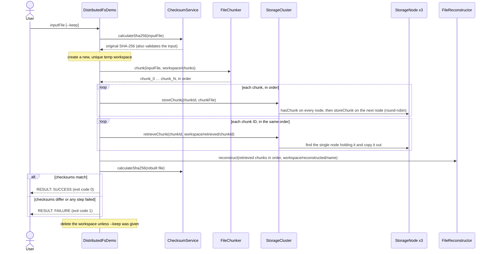

# DistributedFS

A learning implementation of the core ideas behind distributed file storage: splitting files into chunks, spreading the chunks across storage nodes, retrieving and reassembling them, and verifying the result is intact with SHA-256. It is written in plain Java with no external dependencies.

> **Status:** Phases 1–7 are complete, including an end-to-end command-line demo. Everything runs on one machine: the storage nodes are simulated as local folders, and there is no networking, replication, or HTTP API yet. See the [roadmap](#roadmap).

## Contents

- [Why this project exists](#why-this-project-exists)
- [Implemented features](#implemented-features)
- [Architecture](#architecture)
- [End-to-end workflow](#end-to-end-workflow)
- [Components](#components)
- [Getting started](#getting-started)
- [Running the demo](#running-the-demo)
- [Known limitations](#known-limitations)
- [Roadmap](#roadmap)
- [Repository structure](#repository-structure)
- [Running tests and contributing](#running-tests-and-contributing)

## Why this project exists

Distributed file systems such as HDFS and GFS store large files by splitting them into chunks, placing the chunks on many machines, and checking them for corruption. DistributedFS builds those ideas one small, tested step at a time, starting on a single machine, so that each design decision can be understood and verified before networking is added.

What it demonstrates:

- **Streaming with bounded memory.** Files are processed through fixed-size buffers and never loaded whole. Five stress tests push 64 MiB of data through the components, and the documented commands run them with the Java heap limited to 16 MiB (`-Xmx16m`).
- **Data integrity.** The demo compares the SHA-256 checksum of the rebuilt file with the original's, and a test confirms that corrupted chunk data is caught as a mismatch.
- **Existing files aren't replaced.** Chunk files, rebuilt files, and retrieved copies are created with `CREATE_NEW`, and temporary files and workspaces get new, unique names. A storage node writes each chunk to a temporary file and gives it the chunk's ID only after all of its bytes have been written. If a write fails with an I/O error that Java reports, the code tries to delete the files that operation created. This is not crash protection: a process that is killed mid-write can leave partial files behind (see [Known limitations](#known-limitations)).
- **Defensive input handling.** Chunk IDs are restricted so that they cannot point outside a node's folder, collide on case-insensitive file systems, or name Windows devices such as `nul`.
- **Explicit failure semantics.** "This chunk is missing" and "this node could not be checked" are reported differently, so a broken node is never mistaken for missing data.
- **Testing discipline.** 129 tests and 5 stress tests in plain-Java test runners, including simulated disk failures and corrupted data.

## Implemented features

- **Chunking** (`FileChunker`): splits a file into 1 MiB chunk files named `chunk_0`, `chunk_1`, … and returns them in order.
- **Reconstruction** (`FileReconstructor`): joins chunk files, in the order given, into a byte-identical copy of the original.
- **Integrity checks** (`ChecksumService`): calculates SHA-256 checksums and verifies a file against an expected value.
- **Simulated storage node** (`StorageNode`, `ChunkNotFoundException`): stores and retrieves chunks in its own local folder, with safe chunk IDs. A chunk's ID appears only after all of its bytes have been written successfully.
- **Storage cluster** (`StorageCluster`): spreads chunks over several nodes round-robin, keeps each chunk ID on exactly one node, and falls back to the next node when a store fails with an I/O error.
- **End-to-end demo** (`DistributedFsDemo`): runs the whole workflow from the command line and reports whether the rebuilt file's SHA-256 matches the original.
- **Tests:** six plain-Java test runners with 129 tests, plus 5 stress tests, which run with a 16 MiB heap when started with the documented `-Xmx16m` option.

## Architecture

Arrows point from a component to what it uses. The labelled arrows show the other relationships: `DistributedFsDemo` creates the storage nodes, and `StorageCluster` and the nodes throw `ChunkNotFoundException`. All seven classes are in the package `com.distributedfs`.


- `FileChunker`, `FileReconstructor`, and `ChecksumService` don't depend on any other project class. They exchange data as files and ordered lists of file paths.
- Only `StorageCluster` stores chunks on the nodes and retrieves them. `DistributedFsDemo` creates the nodes and wires everything together.
- The three storage nodes are ordinary folders on the same machine.

## End-to-end workflow

This is what `DistributedFsDemo` does with the file you give it:



- Chunk order is tracked in an explicit list of chunk IDs. It is never taken from a folder listing, which would sort `chunk_10` before `chunk_2`.
- The input file is only read. Everything the demo writes goes into the new workspace folder, so no existing file can be overwritten.

## Components

| Component | Responsibility | Key behavior |
|---|---|---|
| `FileChunker` | Splits a file into 1 MiB chunk files and returns them in order. | Streams through one chunk-sized buffer. Never overwrites existing files (`CREATE_NEW`). If it fails with an I/O error reported by Java, it tries to delete the chunks it created. Also usable on its own from the command line. |
| `FileReconstructor` | Joins chunk files, in list order, into one new file. | Streams through a 64 KiB buffer. An empty list produces an empty file. Refuses to overwrite the destination. If it fails with an I/O error reported by Java, it tries to delete the partial output it created. |
| `ChecksumService` | Calculates SHA-256 and checks a file against an expected checksum. | Streams through a 64 KiB buffer. `matches()` returns `true` or `false` only when it could actually read the file; otherwise it throws. |
| `StorageNode` | One simulated storage node that stores and retrieves chunks in its own local folder. | The chunk ID is the file name, and strict ID rules block path traversal. Writes each chunk to a temporary file and renames it to the chunk ID only after writing completes; the rename refuses to replace an existing chunk. Rejects retrieve destinations inside its own folder. A node that cannot check (for example, its folder was deleted) throws an `IOException` instead of reporting the chunk as absent. |
| `ChunkNotFoundException` | Reports that a chunk is definitely absent. | A subclass of `IOException` that carries the chunk ID. Thrown only when a node, or every node in a cluster, confirms the chunk is not there. |
| `StorageCluster` | Coordinates several storage nodes behind one interface. | Round-robin placement, falling back to the next node after an I/O failure. Checks every node before storing so each chunk ID lives on one node, and refuses to store if any node cannot answer. Distinguishes missing chunks from unavailable nodes. Rejects retrieve destinations inside any node's folder. |
| `DistributedFsDemo` | Command-line program that runs the whole workflow and verifies the result. | Works in a new temp workspace and deletes it afterwards, without following links, unless `--keep` is given. Prints the original checksum once it has read the input, and the rebuilt file's checksum only if the run gets that far. Once the arguments are accepted, every outcome it handles prints one `RESULT: SUCCESS` or `RESULT: FAILURE` line; argument errors print usage instructions instead. |

## Getting started

### Prerequisites

- **JDK 23.** The project has been built and tested with JDK 23.0.1 on Windows 11, using Windows PowerShell 5.1. Check your version with `java -version` and `javac -version`.
- **Git**, to clone the repository.
- **No build tool or libraries.** The code is compiled with plain `javac`; there is no Maven, Gradle, Spring Boot, or external dependency.
- **Free disk space.** The demo needs about four times the size of the file you give it, and each stress test uses up to about 320 MiB of temporary space.

The code also compiles against the Java 17 API (`javac --release 17`), but it has only been run and tested on JDK 23.0.1.

### Build

In PowerShell:

```powershell
git clone https://github.com/Manasva504/DistributedFS.git
cd DistributedFS
javac -d out src\main\java\com\distributedfs\*.java
javac -d out-test -cp out src\test\java\com\distributedfs\*.java
```

The compiled classes go to `out` (the program) and `out-test` (the tests). Git ignores both folders, and you can delete and rebuild them at any time.

### Run the tests

Each suite is a plain-Java program. It prints `PASS` or `FAIL` for every test and ends with a summary such as `18 passed, 0 failed`.

| Suite | Tests | Stress test |
|---|---|---|
| `FileChunkerTest` | 18 | none |
| `FileReconstructorTest` | 15 | yes |
| `ChecksumServiceTest` | 15 | yes |
| `StorageNodeTest` | 34 | yes |
| `StorageClusterTest` | 29 | yes |
| `DistributedFsDemoTest` | 18 | yes |

```powershell
java -cp "out;out-test" com.distributedfs.FileChunkerTest
java -cp "out;out-test" com.distributedfs.FileReconstructorTest
java -cp "out;out-test" com.distributedfs.ChecksumServiceTest
java -cp "out;out-test" com.distributedfs.StorageNodeTest
java -cp "out;out-test" com.distributedfs.StorageClusterTest
java -cp "out;out-test" com.distributedfs.DistributedFsDemoTest
```

Run the stress tests separately. The `-Xmx16m` option limits the Java heap to 16 MiB, so each test shows that 64 MiB of data streams through without being loaded into memory. Without that option the tests still run, but each prints a warning if the heap is 64 MiB or larger:

```powershell
java -Xmx16m -cp "out;out-test" com.distributedfs.FileReconstructorTest --stress
java -Xmx16m -cp "out;out-test" com.distributedfs.ChecksumServiceTest --stress
java -Xmx16m -cp "out;out-test" com.distributedfs.StorageNodeTest --stress
java -Xmx16m -cp "out;out-test" com.distributedfs.StorageClusterTest --stress
java -Xmx16m -cp "out;out-test" com.distributedfs.DistributedFsDemoTest --stress
```

In PowerShell, keep the quotes around `"out;out-test"`: an unquoted `;` ends the command.

## Running the demo

```powershell
java -cp out com.distributedfs.DistributedFsDemo C:\path\to\your-file.bin
```

Replace the path with any file. The input file is only read; everything the demo writes goes into a new, uniquely named workspace folder in your temp folder, which is deleted at the end.

Output from a real run on Windows 11 with a 3.5 MiB file. The input file's real path has been replaced with the shorter `C:\data\sample.bin`, and the user name in the workspace path with `<you>`:

```text
DistributedFS demo: a simulated cluster of 3 storage nodes (folders on this machine).
Each chunk is stored on exactly one node; there is no replication.
Input file:            C:\data\sample.bin (3,674,337 bytes)
Original SHA-256:      e128b8839e356ba810f8d4c2e409a2df79ae72ab8cd3331f3bf1a11b432fa1f9
Workspace:             C:\Users\<you>\AppData\Local\Temp\distributedfs-demo-12694042071003609230
[1/5] Split into 4 chunk(s) of up to 1,048,576 bytes
[2/5] Started 3 storage nodes
[3/5] Stored 4 chunk(s): node 0: 2, node 1: 1, node 2: 1
[4/5] Retrieved 4 chunk(s) in their original order
[5/5] Reconstructed 3,674,337 bytes
Reconstructed SHA-256: e128b8839e356ba810f8d4c2e409a2df79ae72ab8cd3331f3bf1a11b432fa1f9
RESULT: SUCCESS - the reconstructed file is identical to the original (SHA-256 match)
Workspace deleted.
```

| Exit code | Meaning |
|---|---|
| 0 | The rebuilt file's SHA-256 matches the original. |
| 1 | The input is missing, is not a regular file (for example, a directory), or can't be read; an I/O error occurred, for example while creating the workspace or copying chunks; or the checksums differ. |
| 2 | A usage error: no file (or a blank one), more than one file, an unknown option, or a path containing characters Windows doesn't allow. Usage instructions are printed instead of a `RESULT` line. |

### Keeping the workspace with `--keep`

Add `--keep`, before or after the file path, to keep the workspace for inspection:

```powershell
java -cp out com.distributedfs.DistributedFsDemo C:\path\to\your-file.bin --keep
```

Instead of deleting the workspace, the demo ends by printing where it is (user name again replaced with `<you>`):

```text
Workspace kept for inspection: C:\Users\<you>\AppData\Local\Temp\distributedfs-demo-10156030369148198879
  chunks\          chunk files made by FileChunker
  nodes\node-N\    each storage node's folder
  retrieved\       chunks copied back out of the cluster
  reconstructed\   the rebuilt file
```

For the 3.5 MiB example file, the kept workspace contained:

```text
distributedfs-demo-<digits>\
├── chunks\          chunk_0, chunk_1, chunk_2, chunk_3
├── nodes\
│   ├── node-0\      chunk_0, chunk_3
│   ├── node-1\      chunk_1
│   └── node-2\      chunk_2
├── retrieved\       chunk_0, chunk_1, chunk_2, chunk_3
└── reconstructed\   sample.bin
```

Delete a kept workspace yourself when you have finished with it, using the exact path the demo printed:

```powershell
Remove-Item -Recurse -Force "C:\Users\<you>\AppData\Local\Temp\distributedfs-demo-<digits>"
```

### Splitting a file without the cluster

`FileChunker` also works on its own:

```powershell
java -cp out com.distributedfs.FileChunker C:\path\to\your-file.bin C:\path\to\chunk-folder
```

It writes `chunk_0`, `chunk_1`, … into the output folder, creating the folder if needed, and refuses to overwrite existing chunk files. When it succeeds, it leaves the chunk files in place; if it fails partway with an I/O error, it tries to delete the chunks it created.

## Known limitations

- **Simulated, single machine.** The storage nodes are folders on one machine, and there is no network transport between them.
- **No replication.** Each chunk is stored on exactly one node. If that node's folder is lost, the chunk is lost.
- **No persistent metadata.** Nothing records which files exist or which chunks belong to them. The cluster finds a chunk by asking every node, and its round-robin position lives in memory and restarts at node 0.
- **Chunk IDs are global within a cluster.** The cluster has no file-level namespace, and `FileChunker` names every file's chunks `chunk_0`, `chunk_1`, and so on. Chunks from two files stored in one cluster under those names collide: storing a second `chunk_0` fails with `FileAlreadyExistsException`. The demo avoids this by creating a fresh cluster, in a new workspace, for each run.
- **Single-threaded.** `StorageNode` and `StorageCluster` are not safe for concurrent use. Checking every node and then storing is not atomic.
- **One unavailable node blocks all stores.** The cluster refuses to store a chunk when any node cannot confirm that it doesn't already hold that chunk ID. This prevents duplicates at the cost of availability; chunks on healthy nodes can still be retrieved.
- **No failure detection or self-healing.** Nothing monitors the nodes or repairs lost chunks.
- **No delete operation** for stored chunks.
- **Temporary disk usage.** A demo run needs about four times the input file's size.
- **Interrupted runs can leave files behind.** Files are cleaned up in only two situations: when an operation fails with an I/O error that Java reports (it then tries to delete the files it created), and when a demo run ends (its workspace is deleted unless `--keep` is given). If a process is killed (for example with Ctrl+C or Task Manager) or the power fails, that cleanup may not run, so partial files can remain: the demo's whole workspace, a `.tmp` file in a node folder, or a partially written output file. The demo prints its workspace path as soon as it creates it.
- **No durability guarantee.** Data is not forced to disk (no fsync), so recently written data may be lost if the power fails. Behavior after a power loss has not been tested.
- **Text-based path checks.** The checks that keep retrieved files out of node folders compare normalized paths and don't resolve symbolic links, junctions, or Windows short names. The demo's own cleanup never follows links or junctions.
- **Tested only on Windows 11 with JDK 23.0.1.** Other operating systems and JDK versions are untested, and the commands in this README are written for PowerShell.

## Roadmap

### Completed

| Phase | Delivered | Commit |
|---|---|---|
| 1 | `FileChunker`: streaming chunking | `76c028a`* |
| 2 | `FileReconstructor`: ordered, byte-exact reconstruction | `76c028a`* |
| 3 | `ChecksumService`: SHA-256 calculation and verification | `76c028a`* |
| 4 | `StorageNode` and `ChunkNotFoundException`: simulated storage node | `76c028a`* |
| 5 | `StorageCluster`: placement and lookup across nodes | `76c028a`* |
| 6 | `DistributedFsDemo`: end-to-end command-line demo | `59529d8` |
| 7 | Documentation: this README | the commit that adds this README |

\* Phases 1–5 were built before the Git repository was created, so they are all in the initial commit.

### Planned (not implemented)

- **Phase 8: HTTP API.** The next phase.
- **Order not final:**
  - Persistent metadata (a record of which chunks make up each file)
  - Replication
  - Failure detection
  - Self-healing
  - Networked nodes
  - Frontend

## Repository structure

```text
DistributedFS/
├── src/
│   ├── main/java/com/distributedfs/      the program
│   │   ├── FileChunker.java
│   │   ├── FileReconstructor.java
│   │   ├── ChecksumService.java
│   │   ├── StorageNode.java
│   │   ├── ChunkNotFoundException.java
│   │   ├── StorageCluster.java
│   │   └── DistributedFsDemo.java
│   └── test/java/com/distributedfs/      plain-Java test runners
│       ├── FileChunkerTest.java
│       ├── FileReconstructorTest.java
│       ├── ChecksumServiceTest.java
│       ├── StorageNodeTest.java
│       ├── StorageClusterTest.java
│       └── DistributedFsDemoTest.java
├── .gitattributes                         LF line endings for text files
├── .gitignore                             ignores build output, logs, editor and OS files, demo workspaces
└── README.md
```

`out/` and `out-test/` are created by `javac`. `.gitignore` excludes them along with `*.class`, `*.log`, editor folders (`.idea/`, `.vscode/`), operating-system files (`Thumbs.db`, `desktop.ini`, `.DS_Store`), and demo workspaces (`distributedfs-demo-*/`). `ChunkNotFoundException` has no test file of its own; `StorageNodeTest` and `StorageClusterTest` cover it.

## Running tests and contributing

Personal learning project; issues and suggestions welcome.

- Each `*Test` class is a small test runner with its own `main` method; no test framework is used. Every test runs in its own temporary folder, which is deleted afterwards, and a suite exits with code 1 if any test fails.
- A few classes have package-private test hooks (`FileReconstructor.openChunk`, `StorageNode.openForReading`, and `DistributedFsDemo.createNode`). Tests in the same package override them to simulate disk failures and corrupted data.
- Before suggesting a change, rebuild and run all six suites and the five stress tests, using the commands in [Getting started](#getting-started).
