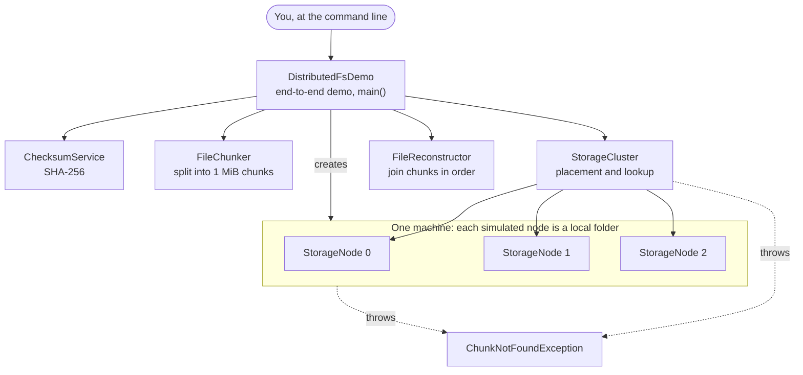
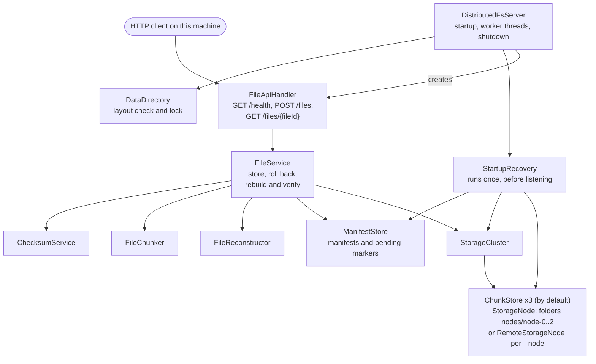
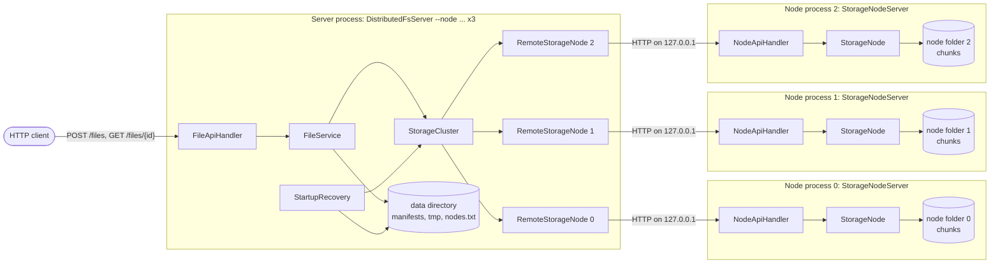
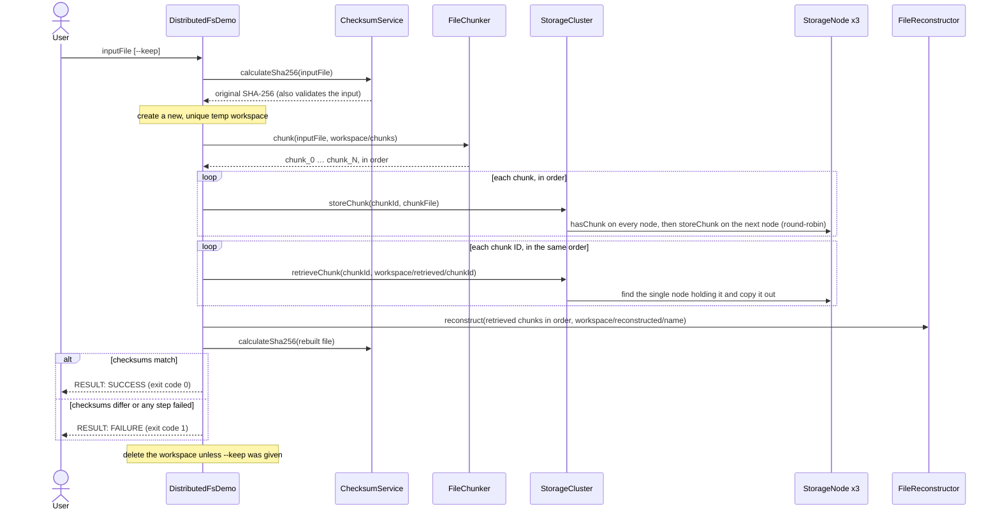

# DistributedFS: design and reference

The detailed design of DistributedFS: how the parts fit together, how uploads, downloads, replication, failure detection, repair and startup recovery work, every option and endpoint, and every known limitation. The [README](../README.md) is the short overview; [TESTING.md](TESTING.md) covers the tests and the recorded results.

## Contents

- [Status](#status)
- [Why this project exists](#why-this-project-exists)
- [Implemented features](#implemented-features)
- [Architecture](#architecture)
- [End-to-end workflow](#end-to-end-workflow)
- [Components](#components)
- [Running the demo](#running-the-demo)
- [Running the server](#running-the-server)
- [Running a storage node](#running-a-storage-node)
- [HTTP API](#http-api)
- [Replication](#replication)
- [Failure detection and repair](#failure-detection-and-repair)
- [Data directory, uploads, downloads and startup recovery](#data-directory-uploads-downloads-and-startup-recovery)
- [Known limitations](#known-limitations)
- [Repository structure](#repository-structure)

## Status

> **Status:** Phases 1–8 are complete: the storage components, an end-to-end command-line demo, and a local HTTP server that uploads files, downloads them only after checking every chunk and the whole file against the SHA-256 values recorded at upload, and recovers interrupted uploads when it starts. The storage nodes are local folders by default, or, with `--node` options, separate storage node processes that the server reaches over HTTP (milestone M1). Everything runs on one machine (`127.0.0.1`). The server keeps two copies of every chunk, on different nodes (milestone M2), so a file stays readable, and uploads keep working, while one node is down. A heartbeat checks the nodes every 2 seconds, `GET /cluster/status` shows which are UP or DOWN, `POST /cluster/repair` restores missing and damaged copies from a good one, and the server can start while a recorded node is down (milestone M3). See the [roadmap](../README.md#project-history).
>
> **This is a learning project, not production software.** The server has no authentication, no TLS (plain HTTP on `127.0.0.1` only) and no storage quotas, and it has been tested only on Windows (one laptop and GitHub Actions' Windows runners). See [Known limitations](#known-limitations).

## Why this project exists

A learning implementation of the core ideas behind distributed file storage: splitting files into chunks, spreading the chunks across storage nodes, retrieving and reassembling them, and verifying the result is intact with SHA-256. It is written in plain Java with no external dependencies.

Distributed file systems such as HDFS and GFS store large files by splitting them into chunks, placing the chunks on many machines, and checking them for corruption. DistributedFS builds those ideas one small, tested step at a time, starting on a single machine, so that each design decision can be understood and verified before networking is added.

What it demonstrates:

- **Streaming with bounded memory.** Files are processed through fixed-size buffers and never loaded whole. Ten stress tests push 64 to 100 MiB of data through the components, the demo, the upload and download endpoints, crash recovery and a storage node reached over HTTP, and the documented commands run them with the Java heap limited to 16 MiB (`-Xmx16m`).
- **Data integrity.** The demo compares the SHA-256 checksum of the rebuilt file with the original's, and a test confirms that corrupted chunk data is caught as a mismatch. An upload can carry its SHA-256, and if the data doesn't match, no file is committed to the storage cluster. Every upload also records the SHA-256 of each chunk. A download checks each retrieved chunk against its recorded checksum (naming a damaged chunk in the server log), then rebuilds the file and checks its size and whole-file SHA-256, all before any of it is sent; damaged data is reported as an error, never sent as the file.
- **Existing files aren't replaced.** Chunk files, rebuilt files, retrieved copies, manifests and pending-upload markers are created with `CREATE_NEW` or a rename that refuses to replace a file, and temporary files and workspaces get new, unique names. A storage node writes each chunk to a temporary file and gives it the chunk's ID only after all of its bytes have been written. If a write fails with an I/O error that Java reports, the code tries to delete the files that operation created.
- **Crash consistency for uploads.** The server records an upload as pending before storing anything, and treats writing the file's manifest as the moment the upload exists. When the server starts, it finishes or undoes uploads that a crash interrupted, and refuses to start if it cannot tell what is safe (see [startup recovery](#startup-recovery)).
- **Defensive input handling.** Chunk IDs are restricted so that they cannot point outside a node's folder, collide on case-insensitive file systems, or name Windows devices such as `nul`. File IDs are generated by the server and checked strictly. The HTTP server only answers requests addressed to `127.0.0.1` or `localhost`, and its error responses never contain file system paths or exception text.
- **Explicit failure semantics.** "This chunk is missing" and "this node could not be checked" are reported differently, so a broken node is never mistaken for missing data. Damaged metadata is reported as damaged, never as "not found".
- **Testing discipline.** 629 normal tests, plus 10 separate stress tests, in 36 plain-Java test runners, including simulated disk failures, corrupted data, server and storage-node processes killed partway through an upload or a store, nodes that never answer or drop the connection, and clients that stop reading or disconnect mid-download. A GitHub Actions workflow builds and runs them on Windows, and new safety rules are checked with deliberate-break runs: each rule is removed in a copy of the source to confirm a test fails (see [Recorded verification results](TESTING.md#recorded-verification-results)).

## Implemented features

- **Chunking** (`FileChunker`): splits a file into 1 MiB chunk files named `chunk_0`, `chunk_1`, … and returns them in order.
- **Reconstruction** (`FileReconstructor`): joins chunk files, in the order given, into a byte-identical copy of the original.
- **Integrity checks** (`ChecksumService`): calculates SHA-256 checksums and verifies a file against an expected value.
- **Simulated storage node** (`StorageNode`, `ChunkNotFoundException`): stores, retrieves and deletes chunks in its own local folder, with safe chunk IDs. A chunk's ID appears only after all of its bytes have been written successfully. Before storing, retrieving or deleting a chunk, it checks without following links that its folder is a plain folder; retrieving and deleting also require the chunk itself to be a regular file. See [Known limitations](#known-limitations) for what these checks don't cover.
- **Storage cluster** (`StorageCluster`): spreads chunks over several nodes round-robin and keeps a set number of copies of each, each on a different node: 2 in the server, 1 in the command-line demo. It falls back to the next node when a store certainly stored nothing (but never after a store whose outcome is unknown), skips nodes that cannot be reached, reads the first copy whose SHA-256 is right, and deletes every copy of a chunk only when every node answered. Its nodes can be local folders, remote node processes, or a mix. See [Replication](#replication).
- **Storage node process** (`StorageNodeServer`, `NodeApiHandler`, `NodeDataDirectory`) and its client (`RemoteStorageNode`): a storage node as its own Java process with its own folder, serving its chunks over HTTP on `127.0.0.1`, and the client that reaches it. The server uses node processes instead of its local node folders when it is started with `--node` options, records which nodes hold its chunks (`ClusterMembership`, `nodes.txt`), and runs startup recovery through the nodes' API. `scripts\demo.ps1` starts three nodes and the server and round-trips a file; see [Running a storage node](#running-a-storage-node).
- **Failure detection and repair** (`HeartbeatMonitor`, `RepairService`, `RepairReport`, `ClusterApi`): a heartbeat checks every node every 2 seconds and marks it DOWN after 3 failed checks in a row and UP again after 1 good one; `GET /cluster/status` shows the result. `POST /cluster/repair` (with `?dryRun=true` to only report) checks every copy of every chunk against its SHA-256, copies a chunk with one good copy to another node, replaces damaged copies, trims extra copies when every node is UP, and reports lost chunks. The server can also start while some recorded nodes are down. See [Failure detection and repair](#failure-detection-and-repair).
- **End-to-end demo** (`DistributedFsDemo`): runs the whole workflow from the command line and reports whether the rebuilt file's SHA-256 matches the original.
- **HTTP server** (`DistributedFsServer`, `FileApiHandler`): serves `GET /health`, `POST /files`, `GET /files/<fileId>`, `GET /cluster/status` and `POST /cluster/repair` on `127.0.0.1` only. See [HTTP API](#http-api).
- **Uploads** (`FileService`): checks the optional SHA-256, splits the upload into 1 MiB chunks, records the SHA-256 of every chunk, stores the chunks on the cluster and writes the file's manifest. A failed upload is rolled back.
- **Downloads** (`FileService`, `FileApiHandler`): copies a stored file's chunks into a temporary workspace, checking each copy against its recorded SHA-256 and using another node's copy when one is missing, damaged or on a node that is down, rebuilds the file, checks its size and whole-file SHA-256, and only then sends it. A watchdog disconnects clients that stop making progress.
- **Persistent metadata** (`ManifestStore`, `FileManifest`): one small text manifest per stored file, with the whole file's and each chunk's SHA-256, and a pending-upload marker for each upload in progress. Manifests written before per-chunk checksums existed are still read.
- **Data directory** (`DataDirectory`): checks, initializes and locks the server's data folder, so only one server uses it at a time.
- **Startup recovery** (`StartupRecovery`, `StaleTempFiles`): finishes or undoes interrupted uploads, removes stale temporary files and request workspaces, and reports chunks that nothing refers to, without deleting them.
- **Tests:** 36 plain-Java test runners with 629 normal tests, plus 10 separate stress tests, which run with a 16 MiB heap when started with the documented `-Xmx16m` option. `scripts\test.ps1` builds the project and runs them, locally and in [continuous integration](TESTING.md#continuous-integration).

## Architecture

### Storage components and the demo

Arrows point from a component to what it uses. The labelled arrows show the other relationships: `DistributedFsDemo` creates the storage nodes, and `StorageCluster` and the nodes throw `ChunkNotFoundException`. All classes are in the package `com.distributedfs`.



- `FileChunker`, `FileReconstructor`, and `ChecksumService` don't depend on any other project class. They exchange data as files and ordered lists of file paths.
- Only `StorageCluster` stores chunks on the nodes and retrieves them. `DistributedFsDemo` creates the nodes and wires everything together.
- The three storage nodes are ordinary folders on the same machine.

### HTTP server



- `FileApiHandler` knows HTTP; `FileService` knows nothing about HTTP.
- `StorageCluster` and `ManifestStore` are not thread-safe, so `FileService` runs every step that touches them while holding one lock, for uploads and downloads alike. Uploads are stored one at a time, and downloads copy their chunks one at a time. Reading and hashing an upload's body, and rebuilding, checking and sending a download, happen outside the lock.
- `StartupRecovery` runs while the data directory is locked and before the server listens, so no upload or download can run at the same time.

### Storage node processes

Started with `--node` options, the server keeps no chunks itself: each storage node is its own Java process with its own folder, and the server reaches it over HTTP on `127.0.0.1`. This is what `scripts\demo.ps1` starts:



- The cluster sees every node as a `ChunkStore`, so placement (round-robin, two copies on different nodes), the duplicate check before each store, verified reads, and deleting only with every node answering work the same as with local folders.
- Each node checks chunk IDs, never follows links, and publishes a chunk only if its length and SHA-256 match what the server sent. The server checks each chunk again against its manifest when the file is downloaded.
- A node that cannot be reached, times out, or answers unexpectedly is "could not check", never "absent". A store with an unknown outcome is not retried on another node; the upload fails and its chunk is rolled back as "maybe stored".
- The data directory's `nodes.txt` records the node IDs. Every later start needs those nodes (on any ports) and no others. A start may go ahead with some of them down, as long as at least 2 answer (see [Degraded start](#degraded-start)); recovery then never treats a chunk as absent while a node that may hold it is down.

## End-to-end workflow

This is what `DistributedFsDemo` does with the file you give it:



- Chunk order is tracked in an explicit list of chunk IDs. It is never taken from a folder listing, which would sort `chunk_10` before `chunk_2`.
- The input file is only read. Everything the demo writes goes into the new workspace folder, so no existing file can be overwritten.

The server's upload and download workflows are described in [Data directory, uploads, downloads and startup recovery](#data-directory-uploads-downloads-and-startup-recovery).

## Components

| Component | Responsibility | Key behavior |
|---|---|---|
| `FileChunker` | Splits a file into 1 MiB chunk files and returns them in order. | Streams through one chunk-sized buffer. Never overwrites existing files (`CREATE_NEW`). If it fails with an I/O error reported by Java, it tries to delete the chunks it created. Also usable on its own from the command line. |
| `FileReconstructor` | Joins chunk files, in list order, into one new file. | Streams through a 64 KiB buffer. An empty list produces an empty file. Refuses to overwrite the destination. If it fails with an I/O error reported by Java, it tries to delete the partial output it created. |
| `ChecksumService` | Calculates SHA-256 and checks a file against an expected checksum. | Streams through a 64 KiB buffer. `matches()` returns `true` or `false` only when it could actually read the file; otherwise it throws. |
| `StorageNode` | One simulated storage node that stores, retrieves and deletes chunks in its own local folder. | The chunk ID is the file name, and strict ID rules block path traversal. Writes each chunk to a temporary file and renames it to the chunk ID only after writing completes; the rename refuses to replace an existing chunk. Rejects retrieve destinations inside its own folder. A node that cannot check (for example, its folder was deleted) throws an `IOException` instead of reporting the chunk as absent. Before storing, retrieving or deleting, checks without following links that its folder is a plain folder; retrieving and deleting also require the chunk to be a regular file. `hasChunk` follows links (see [Known limitations](#known-limitations)). |
| `ChunkNotFoundException` | Reports that a chunk is definitely absent. | A subclass of `IOException` that carries the chunk ID. Thrown only when a node, or every node in a cluster, confirms the chunk is not there. |
| `ChunkStore` | What a storage node is to the cluster: store, retrieve, check, delete, list and sweep chunks by ID. | Implemented by `StorageNode` (a local folder) and `RemoteStorageNode` (a node process). Every implementation answers "absent" only when a working node confirms it, and throws an `IOException` when it cannot tell. |
| `RemoteStorageNode`, `RemoteNodeConfig` | The client of a storage node process, over HTTP on `127.0.0.1` with the JDK's `HttpClient`. | Checks chunk IDs before sending anything. Every reply must carry the node's own ID (`X-Node-Id`), so another program on the same port can never answer "absent". A refused connection, a timeout, a reset or an unexpected reply is "could not check", never "absent". A store that may have reached the node without a clear answer is an `AmbiguousStoreException`. Streams chunks from and to files; time limits for connecting, replies and stalled transfers. |
| `StorageNodeServer`, `NodeApiHandler`, `NodeDataDirectory` | A storage node as its own process: its folder, its lock, and its HTTP API. | Binds `127.0.0.1` only and checks the `Host` header. Publishes a stored chunk only if its length and SHA-256 match what the client sent. Runs one chunk operation at a time under a node-wide lock. Answers every request with its node ID and logs one line per request, without file paths or exception text. |
| `StorageCluster` | Coordinates several storage nodes behind one interface. | Keeps a set number of copies of each chunk (the replication factor: 2 in the server), each on a different node. Round-robin placement, falling back to the next node only after a store that certainly stored nothing; after a store whose outcome is unknown, no other node is tried. Checks every reachable node before storing and refuses to store if a reachable node cannot answer; nodes that cannot be reached at all are skipped. Verified reads keep the first copy whose SHA-256 matches. Distinguishes missing chunks from unavailable nodes. Rejects retrieve destinations inside any node's folder. Deletes a chunk's copies (all of them, however many) only if every node answered. More copies than the replication factor are allowed: lookups use the first holder, and the repair trims the extras. |
| `DistributedFsDemo` | Command-line program that runs the whole workflow and verifies the result. | Works in a new temp workspace and deletes it afterwards, without following links, unless `--keep` is given. Prints the original checksum once it has read the input, and the rebuilt file's checksum only if the run gets that far. Once the arguments are accepted, every outcome it handles prints one `RESULT: SUCCESS` or `RESULT: FAILURE` line; argument errors print usage instructions instead. |
| `DistributedFsServer` | Command-line server: opens the data directory, connects to its storage nodes, runs startup recovery, and serves the HTTP API on `127.0.0.1`. | Nothing listens until every startup step has succeeded; a failed start undoes what it started and releases the data directory's lock. With `--node` options, every node that answers its health check must have a distinct node ID that matches the membership file; a later start may go ahead with some recorded nodes down if at least 2 answer. Starts the heartbeat before it listens. 4 worker threads and a queue of 64 requests. Stops on Ctrl+C. |
| `ClusterMembership` | The membership file `nodes.txt`: which remote nodes hold this data directory's chunks. | Written once, by the first start with `--node` options (temporary file, forced to disk, renamed without replacing), which needs every node. Later starts must give one `--node` per recorded node, in any order and on any ports, and every node that answers must be a recorded one; the file is never changed. Refuses to switch a data directory between local node folders and remote nodes. |
| `HeartbeatMonitor` | Which nodes are UP or DOWN. | Checks every node's health every 2 seconds on one background thread (1-second limit per check). DOWN after 3 failed checks in a row, UP after 1 good one; an answer from the wrong node ID is a failed check. Logs each change. Affects only the status and the repair, never uploads or downloads. |
| `RepairService`, `RepairReport` | `POST /cluster/repair`: restores 2 good copies of every chunk. | Lists every UP node once, then handles one chunk at a time under the storage lock: reads and hashes every copy, deletes damaged ones, copies a good one to the least-loaded UP node without one (and checks the new copy), trims extra copies only when every node is UP, and reports lost chunks without touching them. One repair at a time; a dry run reads the same copies and changes nothing. |
| `ClusterApi` | The JSON of `GET /cluster/status` and `POST /cluster/repair`. | The status comes from the heartbeat's last results only: no chunk is read, no lock taken, no request sent. Names nodes by `127.0.0.1:<port>` or their local folder's name, never by a path. |
| `FileApiHandler` | Handles every HTTP request. | Checks the `Host` header first, routes by exact raw path, enforces the upload size limit while reading, checks download file IDs before any decoding, disconnects clients that stall while sending a request body or receiving a download, and sends fixed JSON error bodies. |
| `FileService` | Stores uploads and prepares downloads. | Upload: writes a pending marker, then the chunks, then the manifest (the commit point), and rolls back a failed upload, newest chunk first, every copy of each. A chunk counts as stored only once all of its copies are confirmed. Upload also records each chunk's SHA-256. Download: copies the chunks in order, keeping for each the first copy that matches its recorded SHA-256, rebuilds the file, and checks its size and SHA-256 against the manifest. |
| `ManifestStore`, `FileManifest` | Manifests (with whole-file and per-chunk SHA-256) and pending-upload markers as small text files. | Written to a temporary file and renamed into place, never replaced. Read strictly: anything not exactly as written is reported as invalid. Older manifests without chunk checksums (format 1) are still read. |
| `DataDirectory` | The server's data folder. | Creates the layout in a new folder, refuses a non-empty folder it doesn't recognize, and holds an operating-system lock on `server.lock` while the server runs. |
| `StartupRecovery`, `StaleTempFiles` | Recovery of interrupted uploads, and cleanup of leftovers from interrupted uploads and downloads, when the server starts. | Works through `ChunkStore`, so with remote nodes every listing, no-follow check and temp sweep runs on the node itself; a node that answers but cannot be listed stops the start. In a degraded start it finishes only the uploads it can decide without the missing nodes and keeps the others' markers for a later start. Assesses everything before changing anything, stops the start when a state is unsafe, sweeps only exact temporary-file and workspace names without following links, and only reports unreferenced chunks. With replication it accepts any number of copies of a committed chunk, deletes every copy of an interrupted upload's chunks, and reports under-replicated, lost and over-replicated chunks. |
| `FileIds`, `Json`, `ApiError`, `FileTrees` | Helpers. | 32-character lowercase hexadecimal file IDs from `SecureRandom`; JSON string quoting; the fixed list of API errors; folder-tree deletion that never follows links or junctions. |

## Running the demo

```powershell
java -cp out com.distributedfs.DistributedFsDemo C:\path\to\your-file.bin
```

Replace the path with any file. The input file is only read; everything the demo writes goes into a new, uniquely named workspace folder in your temp folder, which is deleted at the end.

Output from a real run on Windows 11 with a 3.5 MiB file. The input file's real path has been replaced with the shorter `C:\data\sample.bin`, and the user name in the workspace path with `<you>`:

```text
DistributedFS demo: a simulated cluster of 3 storage nodes (folders on this machine).
Each chunk is stored on exactly one node; there is no replication.
Input file:            C:\data\sample.bin (3,674,337 bytes)
Original SHA-256:      e128b8839e356ba810f8d4c2e409a2df79ae72ab8cd3331f3bf1a11b432fa1f9
Workspace:             C:\Users\<you>\AppData\Local\Temp\distributedfs-demo-12694042071003609230
[1/5] Split into 4 chunk(s) of up to 1,048,576 bytes
[2/5] Started 3 storage nodes
[3/5] Stored 4 chunk(s): node 0: 2, node 1: 1, node 2: 1
[4/5] Retrieved 4 chunk(s) in their original order
[5/5] Reconstructed 3,674,337 bytes
Reconstructed SHA-256: e128b8839e356ba810f8d4c2e409a2df79ae72ab8cd3331f3bf1a11b432fa1f9
RESULT: SUCCESS - the reconstructed file is identical to the original (SHA-256 match)
Workspace deleted.
```

| Exit code | Meaning |
|---|---|
| 0 | The rebuilt file's SHA-256 matches the original. |
| 1 | The input is missing, is not a regular file (for example, a directory), or can't be read; an I/O error occurred, for example while creating the workspace or copying chunks; or the checksums differ. |
| 2 | A usage error: no file (or a blank one), more than one file, an unknown option, or a path containing characters Windows doesn't allow. Usage instructions are printed instead of a `RESULT` line. |

### Keeping the workspace with `--keep`

Add `--keep`, before or after the file path, to keep the workspace for inspection:

```powershell
java -cp out com.distributedfs.DistributedFsDemo C:\path\to\your-file.bin --keep
```

Instead of deleting the workspace, the demo ends by printing where it is (user name again replaced with `<you>`):

```text
Workspace kept for inspection: C:\Users\<you>\AppData\Local\Temp\distributedfs-demo-10156030369148198879
  chunks\          chunk files made by FileChunker
  nodes\node-N\    each storage node's folder
  retrieved\       chunks copied back out of the cluster
  reconstructed\   the rebuilt file
```

For the 3.5 MiB example file, the kept workspace contained:

```text
distributedfs-demo-<digits>\
├── chunks\          chunk_0, chunk_1, chunk_2, chunk_3
├── nodes\
│   ├── node-0\      chunk_0, chunk_3
│   ├── node-1\      chunk_1
│   └── node-2\      chunk_2
├── retrieved\       chunk_0, chunk_1, chunk_2, chunk_3
└── reconstructed\   sample.bin
```

Delete a kept workspace yourself when you have finished with it, using the exact path the demo printed:

```powershell
Remove-Item -Recurse -Force "C:\Users\<you>\AppData\Local\Temp\distributedfs-demo-<digits>"
```

### Splitting a file without the cluster

`FileChunker` also works on its own:

```powershell
java -cp out com.distributedfs.FileChunker C:\path\to\your-file.bin C:\path\to\chunk-folder
```

It writes `chunk_0`, `chunk_1`, … into the output folder, creating the folder if needed, and refuses to overwrite existing chunk files. When it succeeds, it leaves the chunk files in place; if it fails partway with an I/O error, it tries to delete the chunks it created.

## Running the server

```powershell
java -cp out com.distributedfs.DistributedFsServer --data-dir C:\path\to\data-folder
```

| Option | Meaning |
|---|---|
| `--data-dir <folder>` | Required. The folder where the server keeps everything it stores. It is created if it doesn't exist. Use a new folder or one this server created before: a non-empty folder without the server's marker file is refused. |
| `--port <0-65535>` | Optional; default `8080`. `0` picks any free port, and the server prints the one it chose. |
| `--max-upload-mb <1-1024>` | Optional; default `100`. The largest upload accepted, in MiB. |
| `--node 127.0.0.1:<port>` | Optional, repeatable (1 to 16 times, each port once). Use the storage node process listening on that port instead of the local node folders; see [Running a storage node](#running-a-storage-node). |

Each option other than `--node` may be given once, in any order, and numbers are written without leading zeros. The server listens on `127.0.0.1` only, so other machines can't connect to it. When it is ready, it prints a line such as:

```text
DistributedFS server listening on http://127.0.0.1:8080/ (data directory: C:\path\to\data-folder)
Press Ctrl+C to stop.
```

A new data folder is also reported with `Initialized a new data directory: <folder>`. Press Ctrl+C to stop the server; according to the code, it then waits up to 2 seconds for requests in progress and prints `DistributedFS server stopped.` (This was checked by hand on 23 October 2026; see [Recorded verification results](TESTING.md#recorded-verification-results).)

| Exit code | Meaning |
|---|---|
| 0 | The server started (it then keeps running until Ctrl+C). |
| 1 | The server could not start, for example because the data folder is refused or in use by another server, the port is taken, a storage node did not answer on a first start, fewer than 2 recorded nodes answered, a node is not one of the recorded nodes, or startup recovery found a state it cannot recover safely. The message starts with `Error: the server could not start:`. |
| 2 | A usage error, such as a missing `--data-dir`, an unknown option, or an invalid number. Usage instructions are printed. |

Only one server can use a data folder at a time. If another server holds its lock, a new one retries for up to 2 seconds (Windows releases the lock of a killed process shortly after it ends) and then refuses to start.

## Running a storage node

A storage node can also run as its own Java process, with its own folder and port, so that nodes can fail independently. The server then uses the nodes instead of its local node folders. Start the nodes first, then the server with one `--node` option per node, each in its own PowerShell window:

```powershell
java -cp out com.distributedfs.StorageNodeServer --data-dir C:\dfs\node-0 --port 9101
java -cp out com.distributedfs.StorageNodeServer --data-dir C:\dfs\node-1 --port 9102
java -cp out com.distributedfs.StorageNodeServer --data-dir C:\dfs\node-2 --port 9103
java -cp out com.distributedfs.DistributedFsServer --data-dir C:\dfs\server-data --node 127.0.0.1:9101 --node 127.0.0.1:9102 --node 127.0.0.1:9103
```

The server checks every node's health and ID before anything else. The first start records the node IDs in the data directory's `nodes.txt`, and needs every node to answer. Every later start needs one `--node` per recorded node, in any order and on any ports, and refuses a node that is not recorded; it goes ahead with some recorded nodes down if at least 2 answer (see [Degraded start](#degraded-start)). A data directory that already keeps chunks in its local node folders cannot switch to remote nodes, and one with a `nodes.txt` cannot be started without `--node` options.

### The cluster demo

`scripts\demo.ps1` does all of that in a new temporary folder: it builds the program, starts three nodes and the server on free ports (read from their ready lines), uploads a random 5 MiB file, downloads it, compares the SHA-256 of both copies with `Get-FileHash`, prints how many chunks each node holds, stops the processes it started and deletes its folder (`-Keep` keeps the folder):

```powershell
powershell -ExecutionPolicy Bypass -File scripts\demo.ps1
```

It ends with `== RESULT: SUCCESS (the downloaded file is identical to the uploaded one)` and exit code 0, or `RESULT: FAILURE` and exit code 1. It starts the JDK's own `java.exe` (found through `java.home`), so that stopping a process really stops its JVM even where `java` on the `PATH` is a launcher such as Oracle's `javapath`.

### The kill demo

`scripts\kill-demo.ps1` shows replication at work. It starts three nodes and the server like `demo.ps1`, uploads a random 5 MiB file A and shows where the two copies of each chunk are, then kills node 1's process. It downloads A and compares its SHA-256, uploads a new file B while node 1 is still dead and checks that every chunk of B got its two copies on nodes 0 and 2, downloads B and compares its SHA-256, and prints the server's log lines that show node 1 being skipped. It cleans up like `demo.ps1` (`-Keep` keeps the folder) and exits with code 0 only if every check passed:

```powershell
powershell -ExecutionPolicy Bypass -File scripts\kill-demo.ps1
```

### The repair demo

`scripts\repair-demo.ps1` shows failure detection and repair. It starts three nodes and the server like `demo.ps1` and uploads a random 5 MiB file. It kills node 1 and polls `GET /cluster/status` until node 1 is DOWN, runs a dry run (which must change no node folder) and then a repair, and checks that every chunk now has a copy on nodes 0 and 2. It restarts node 1 on its old folder and port, polls until it is UP, runs a dry run that must report the extra copies, then a repair that trims them, and checks that every chunk has exactly 2 copies. Finally it downloads the file and compares its SHA-256. It cleans up like `demo.ps1` (`-Keep` keeps the folder) and exits with code 0 only if every check passed:

```powershell
powershell -ExecutionPolicy Bypass -File scripts\repair-demo.ps1
```

The three scripts share their process handling in `scripts\cluster-common.ps1`.

### Node options and API

| Option | Meaning |
|---|---|
| `--data-dir <folder>` | Required. The node's own folder, created if missing. A non-empty folder without the node's marker (including the server's data directory) is refused. |
| `--port <0-65535>` | Required. `0` picks any free port, and the node prints the one it chose. |
| `--max-chunk-mb <1-64>` | Optional; default `16`. The largest chunk the node accepts. |

The folder holds `distributedfs-node.txt` (a marker with the node's ID, 32 random hexadecimal characters chosen when the folder is created), `node.lock` (locked while a node process uses the folder, so only one can) and `chunks\` (one file per chunk, with the same ID rules as `StorageNode`). At startup the node removes temporary files that a killed store left behind, then prints a line such as:

```text
DistributedFS storage node 0123456789abcdef0123456789abcdef listening on http://127.0.0.1:9101/ (data directory: C:\path\to\node-folder)
```

and then one line per request, for example `POST /chunks/<id> 201 1048576 bytes 3 ms` (method, route, status or `-` if no answer was sent, bytes, duration). The request log never contains file paths or exception text. The exit codes are those of the server: 0 started, 1 could not start, 2 usage error.

The node's API, which only `RemoteStorageNode` is meant to call (bodies are `key=value` lines; errors are `error=<code>`):

| Request | Answers |
|---|---|
| `GET /health` | `200` with `status=ok`, `node-id`, `format=1` |
| `POST /chunks/<id>` with `Content-Length` and `X-Chunk-Sha256` | `201 stored=<bytes>`; `409 chunk_exists`; `400`; `413 too_large`; `422 checksum_mismatch`; `503 storage_unavailable` or `node_busy`; `500 store_failed`. Only `201` means the chunk was published, and only once its length and SHA-256 matched. |
| `GET /chunks/<id>` | `200` with the bytes; `404 chunk_not_found`; `500 unsafe_entry` (a link, junction or folder under the ID); `503` |
| `GET /chunks/<id>/exists?mode=follow` or `mode=nofollow` | `200 exists=true` or `exists=false`; `500 unsafe_entry`; `503` |
| `DELETE /chunks/<id>` | `200 deleted=true` or `deleted=false`; `500 unsafe_entry` or `delete_failed`; `503` |
| `GET /entries` | `200`, one `<kind> <percent-encoded name>` line per entry of the chunk folder; `503` |
| `POST /sweep` | `200` with `removed` and `warnings`; `503` |

Every answer carries `X-Node-Id` and closes the connection. A wrong `Host` header is `403 host_not_allowed`, an invalid chunk ID `400 invalid_chunk_id` before anything touches the disk. "Absent" (`404 chunk_not_found`, `exists=false`, `deleted=false`) is answered only when the chunk folder is a plain folder with no entry under the ID; a node that cannot tell answers `500` or `503`. On the client side, a refused connection, a timeout, a reset, an unexpected reply or a reply from a different node ID is "could not check", never "absent", and a store that may have reached the node without a clear answer is reported as an unknown outcome, so the cluster never stores that chunk on a second node.

## HTTP API

Every request must be addressed to the server itself: it needs exactly one `Host` header, either `127.0.0.1:<port>` or `localhost:<port>`, with the port the server is listening on. Any other request gets `403` before it is looked at. This protects the server from web pages that try to reach it through DNS rebinding. Tools such as `curl.exe` send the right `Host` header automatically when the URL is `http://127.0.0.1:<port>/…`.

In Windows PowerShell 5.1, `curl` is an alias for `Invoke-WebRequest`. The examples below call `curl.exe`, which is included with Windows 10 and 11. They assume the default port, 8080.

### `GET /health`

```powershell
curl.exe -i http://127.0.0.1:8080/health
```

Answers `200` with the body `{"status":"ok"}`. Other methods get `405` with `Allow: GET`.

### `POST /files`

Uploads one file. The request body is the file's raw bytes.

```powershell
curl.exe -i -X POST -H "Content-Type: application/octet-stream" --data-binary "@C:\path\to\your-file.bin" http://127.0.0.1:8080/files
```

To have the server check the data, add the file's SHA-256 as a header. `Get-FileHash` prints it in uppercase, and the server accepts either letter case:

```powershell
$sha = (Get-FileHash C:\path\to\your-file.bin -Algorithm SHA256).Hash
curl.exe -i -X POST -H "Content-Type: application/octet-stream" -H "X-Content-SHA256: $sha" --data-binary "@C:\path\to\your-file.bin" http://127.0.0.1:8080/files
```

Request rules:

- **`Content-Type`**: exactly one, `application/octet-stream` (parameters after a `;` are allowed).
- **`X-Content-SHA256`** (optional): exactly one, 64 hexadecimal characters in either case. If the uploaded data has a different SHA-256, the upload is refused and no file is committed to the storage cluster: nothing reaches the storage nodes or the manifest folder. (The body has already been written to the request's temporary workspace by then; that workspace is deleted afterwards, as for every upload.)
- **Size limit**: 100 MiB unless `--max-upload-mb` says otherwise. A `Content-Length` over the limit is refused with `413` after at most 64 KiB of the body has been read and discarded; the rest is never read. (Like every early answer, the refusal waits for that much of the declared body, under a fixed 30-second deadline: a client that sends no body at all, or not enough of it in time, gets no answer, and its connection is closed. See [Errors](#errors).) A body sent without a length (chunked transfer encoding) is cut off with `413` as soon as it passes the limit.
- `Expect: 100-continue` is supported.

A successful upload answers `201 Created`, with `Location: /files/<fileId>` and the new file's manifest as JSON:

```json
{"fileId":"<32 lowercase hex characters>","size":3145729,"sha256":"<64 lowercase hex characters>","chunkSize":1048576,"chunkCount":4}
```

The server creates the file ID; a client cannot choose it. The `Location` header is the path to download the file from.

### `GET /files/<fileId>`

Downloads a stored file.

```powershell
$fileId = "paste-the-actual-32-character-file-id-here"
curl.exe -o C:\path\to\downloaded.bin "http://127.0.0.1:8080/files/$fileId"
```

Replace the placeholder with the `fileId` from the upload's response (or the last part of its `Location` header) before running the command; the placeholder itself is not a valid file ID and would be refused with `400 invalid_file_id`.

- **File ID:** the part of the path after `/files/` must be exactly a file ID as the server wrote it: 32 characters, each `0-9` or lowercase `a-f`. It is checked exactly as received, before any percent-decoding, so encoded forms (`%30…`, `%2F`, `%2e%2e`), uppercase letters, extra path segments, dots and other characters are all refused with `400 invalid_file_id`. No form of the path can reach a file other than a stored one.
- **Integrity first:** the server copies the file's chunks, in order, into a new temporary workspace, checks each chunk against the SHA-256 recorded for it at upload, rebuilds the file there, and checks its size and whole-file SHA-256 against the manifest. Only a file that passes every check is sent. A file that fails is answered with an error, never sent as `200`.
- **Success:** `200` with the file's bytes, `Content-Type: application/octet-stream`, `Content-Length` set to the verified size (`0` for an empty file), `X-Content-Type-Options: nosniff` and `Accept-Ranges: none`.
- **Range requests are not supported.** A `Range` header is ignored: the answer is always `200` with the whole file, never `206`.
- **Methods:** only `GET`. Any other method on a path under `/files/`, including `HEAD`, gets `405` with `Allow: GET`.
- **Uncommitted uploads are not files.** Only a file whose manifest has been written can be downloaded. An upload that never committed (a pending marker without a manifest) is `404 file_not_found`, like an ID that was never used.
- **Damaged files** are reported, never served: an unreadable or invalid manifest is `500 metadata_corrupt`, a chunk that every storage node confirms is gone is `500 chunk_missing` (not `404`), and a chunk, or the rebuilt content, whose size or SHA-256 differs from the manifest is `500 integrity_check_failed`. A failed download never changes stored chunks, manifests or pending markers.
- **Slow and stalled clients:** a watchdog closes the connection if a download makes no progress for 30 seconds. Progress counts only when a whole write of up to 64 KiB has been taken in, so a client must accept roughly 64 KiB every 30 seconds; a slower client is disconnected and receives an incomplete body. A `GET` should have no request body; if one declares a body (`Content-Length` or chunked), up to 64 KiB of it is read and discarded first, under a fixed 30-second deadline. If it doesn't arrive in time, or is malformed, the connection is closed without a response (see [Errors](#errors)).

The whole file is rebuilt and checked before the first byte is sent, so large files take a moment to start, and each download needs temporary disk space (see [How a download is served](#how-a-download-is-served)).

### `GET /cluster/status`

```powershell
curl.exe http://127.0.0.1:8080/cluster/status
```

Answers `200` with what the heartbeat last saw, for example (with node processes; line breaks added):

```json
{"replicationFactor":2,"heartbeatIntervalMillis":2000,"downAfterFailures":3,"nodes":[
 {"index":0,"nodeId":"9806bb585d90d98b525ef3dfcbf79541","address":"127.0.0.1:9101","state":"UP","lastGoodCheck":"2026-10-26T12:16:54.457014300Z","failuresInARow":0},
 {"index":1,"nodeId":"0ae055b763124bec8b8a23fa619cc557","address":"127.0.0.1:9102","state":"DOWN","lastGoodCheck":"2026-10-26T12:16:48.403146200Z","failuresInARow":3},
 {"index":2,"nodeId":"94486daf5207d84b02e74bc3735192dd","address":"127.0.0.1:9103","state":"UP","lastGoodCheck":"2026-10-26T12:16:54.476469400Z","failuresInARow":0}]}
```

- `nodeId` is `null` for local node folders, and for a node that has not answered since a [degraded start](#degraded-start) when more than one node was missing. `address` is `127.0.0.1:<port>`, or `local folder node-<i>` in local mode; it is never a path.
- `lastGoodCheck` is the time of the node's last successful health check (UTC), or `null` if it has not had one since the server started. `failuresInARow` counts failed checks since then.
- The answer reads no chunk, takes no lock and sends nothing to the nodes, so it is cheap to poll.
- Only `GET`; other methods get `405` with `Allow: GET`. Any query string is `400 invalid_query`.

### `POST /cluster/repair`

```powershell
curl.exe -X POST "http://127.0.0.1:8080/cluster/repair?dryRun=true"   # report only
curl.exe -X POST http://127.0.0.1:8080/cluster/repair                 # repair
```

Runs a repair (see [Repair](#repair)) and answers `200` when it has finished, with a report such as:

```json
{"dryRun":false,"replicationFactor":2,"nodes":[{"index":0,"state":"UP"},{"index":1,"state":"DOWN"},{"index":2,"state":"UP"}],"filesChecked":1,"filesSkipped":0,"chunksChecked":5,"chunksHealthy":1,"copiesAdded":4,"copiesReplaced":0,"copiesRemoved":0,"chunksLost":0,"chunksUncertain":0,"chunksNotRepaired":0,"trimSkipped":false,"nodesFailedDuringRepair":[],"lost":[],"durationMillis":163}
```

| Field | Meaning |
|---|---|
| `nodes` | Each node's heartbeat state when the repair started. |
| `filesChecked`, `filesSkipped` | Committed files whose chunks were checked; files skipped because an upload is pending, the manifest cannot be read, or it is format 1 (no chunk checksums). |
| `chunksChecked`, `chunksHealthy` | Chunks checked; chunks that already had exactly 2 good copies and no damaged one. |
| `copiesAdded` | New copies made for chunks with too few good copies. |
| `copiesReplaced` | Damaged copies deleted and replaced by a new good copy. |
| `copiesRemoved` | Copies deleted without a replacement: extra copies trimmed, and damaged copies of a chunk that already had 2 good ones. |
| `chunksLost` | Chunks with no good copy anywhere, while every node is UP and answered; their IDs are listed in `lost` (at most 100). Nothing is deleted. |
| `chunksUncertain` | Chunks whose state could not be decided: a node that may hold a copy is DOWN or failed during the repair, or a new copy's store answer was lost. |
| `chunksNotRepaired` | Chunks that need a copy but have no UP node left to take it. |
| `trimSkipped` | `true` if extra copies were kept because a node was DOWN or failed. |
| `nodesFailedDuringRepair` | Nodes that failed during the repair; they were not used again in it. |

With `?dryRun=true` the counts are what a repair would do now: the same copies are read and checked, and nothing is stored, deleted or written. Only `POST`, with no query, `dryRun=true` or `dryRun=false`; anything else is `400 invalid_query`, and other methods get `405` with `Allow: POST`. A second repair while one is running is `409 repair_in_progress`.

### Errors

Every error has a JSON body of the same shape, for example:

```json
{"error":"payload_too_large","message":"The upload is larger than this server allows."}
```

The message is a fixed sentence: it never contains request input, exception text or file system paths. Details go to the server's console.

| Status | `error` | When |
|---|---|---|
| 400 | `invalid_checksum` | `X-Content-SHA256` is repeated or is not 64 hexadecimal characters. |
| 400 | `checksum_mismatch` | The uploaded data doesn't match `X-Content-SHA256`. No file was committed to the storage cluster. |
| 400 | `invalid_file_id` | The path under `/files/` is not exactly a file ID (including `/files/` itself). |
| 400 | `invalid_query` | A query string on `/cluster/status`, or one other than `dryRun=true` or `dryRun=false` on `/cluster/repair`. |
| 403 | `host_not_allowed` | The `Host` header is missing, repeated, or names another host or port, or the request target names a host. |
| 404 | `not_found` | Any path other than `/health`, `/files`, paths under `/files/`, `/cluster/status` and `/cluster/repair`. |
| 404 | `file_not_found` | No file with this ID has been committed. |
| 405 | `method_not_allowed` | A method the endpoint doesn't support. The `Allow` header lists the one it does: `GET` for `/health`, `/files/<fileId>` and `/cluster/status`, `POST` for `/files` and `/cluster/repair`. |
| 409 | `repair_in_progress` | `POST /cluster/repair` while another repair is running. |
| 413 | `payload_too_large` | The upload is over the size limit, or, only with a very small configured chunk size, it would need more than 65,536 chunks. |
| 415 | `unsupported_media_type` | `Content-Type` is missing, repeated, or not `application/octet-stream`. |
| 500 | `metadata_corrupt` | The file's manifest is unreadable or invalid. |
| 500 | `chunk_missing` | The file is committed, but one of its chunks is confirmed gone from every storage node. |
| 500 | `integrity_check_failed` | A chunk's SHA-256, or the rebuilt file's size or SHA-256, doesn't match its manifest. The server log names a damaged chunk; the response never does. |
| 500 | `storage_error` | The data couldn't be stored or read. A failed upload was rolled back, or, if that couldn't be completed, left for startup recovery. |
| 500 | `internal_error` | An unexpected error. |

A request that declares a body (a `Content-Length` other than 0, or chunked transfer encoding) but is answered without using it, such as an error answer or `GET /health`, first has up to 64 KiB of that body read and discarded. This has a fixed deadline of 30 seconds, counted from when the server starts discarding the body. Bytes that arrive don't extend it, so the first 64 KiB (or the whole body, if it is shorter) must arrive within that time. If it doesn't, if the body is malformed (for example, an invalid chunk), or if the client disconnects partway through it, the connection is closed without an HTTP response. If the body is longer than 64 KiB, the rest is never read, and the connection is closed after the answer.

If an upload's client disconnects, sends an incomplete body, or sends nothing for 30 seconds, the server sends no response and the upload is not committed to the storage cluster: nothing reaches the storage nodes or the manifest folder, and the request's temporary workspace, which may already hold part of the body, is deleted. If a download's client disconnects, the download is abandoned and its workspace deleted. When all 4 worker threads are busy and 64 more requests are waiting, the server closes new connections without a response.

## Replication

The server keeps **two copies of every chunk, each on a different node**, in local mode and with node processes alike (a one-node cluster keeps one copy; the command-line demo keeps one). There is no index of where copies are: the server asks the nodes.

- **Placement.** Copies go round-robin: copy 1 on the next node in turn, copy 2 on the next different node after it. With three nodes the pairs are 0+1, 1+2, 2+0, 0+1, and so on. A node that certainly stored nothing (it refused the connection, answered with an error, or a local disk error) is passed over for the next one. Each node is tried at most once per chunk, so it never holds two copies.
- **Writes.** A chunk counts as stored only once both copies are confirmed. Before a store, every reachable node must confirm that it does not hold the chunk ID; a node that cannot be reached at all is skipped (chunk IDs are unique anyway: file IDs are 128-bit random values checked against the manifests). The upload fails only if fewer than two nodes can take a chunk. A store whose answer is lost (`AmbiguousStoreException`) fails the upload at once, without trying another node, and the rollback removes every copy, including the one that may have been stored.
- **Reads.** For each chunk the nodes are tried in turn, and the first copy whose SHA-256 matches the manifest is used; a node that is down, has no copy, or has a damaged copy is skipped, with a warning in the server log. A download fails only when no good copy exists: `chunk_missing` if every node confirms there is none, `integrity_check_failed` if the copies found are all damaged, `storage_error` if a node that may hold one cannot be read. As before, every chunk and the whole file are checked before the first byte is sent.
- **Deleting** (rollback and recovery) removes every copy, however many there are, but only when every node answers; with a node down, nothing is deleted and the upload's pending marker is kept, so a later start with every node removes the copies.
- **Health.** For every chunk of every committed file, startup counts the copies: 2 is healthy, 1 is `UNDER_REPLICATED` (readable; `POST /cluster/repair` makes a second copy), 0 is `LOST_CHUNK`, more than 2 is `OVER_REPLICATED` (allowed: a repair while a node was down can create them, and a repair with every node UP trims them). The scan prints at most 20 lines per kind and never changes anything. Files stored before replication have one copy per chunk: they download normally and are reported as under-replicated.

## Failure detection and repair

### Heartbeat

While the server runs, one background thread asks every node `GET /health` every 2 seconds, with a 1-second limit. A node is **DOWN** after 3 failed checks in a row and **UP** again after 1 good check. A check fails if the node cannot be reached, does not answer in time, answers with an error, or answers with a node ID other than the one recorded for it. Each change is logged once, for example:

```text
Warning: node 1 (storage node 0ae055b763124bec8b8a23fa619cc557 at 127.0.0.1:64204) is DOWN after 3 failed health checks in a row (last: ... could not be reached to check its health: java.net.ConnectException)
Node 1 (storage node 0ae055b763124bec8b8a23fa619cc557 at 127.0.0.1:64204) is UP again
```

The state is used by `GET /cluster/status` and by the repair only. Uploads and downloads do not look at it: they try the nodes as before and skip those that cannot be reached. Local node folders are checked too (a folder that is no longer a plain folder fails its check).

### Repair

Nothing is repaired automatically: a repair runs when `POST /cluster/repair` asks for one, and the request waits until it has finished. One repair runs at a time.

1. Every UP node is listed once, to find which nodes hold which chunks. Files with a pending upload marker, unreadable manifests and format 1 manifests (which have no chunk checksums) are skipped and counted.
2. Each chunk is then handled on its own, holding the storage lock, so uploads and downloads wait only for the chunk being repaired. Every copy on an UP node is read and checked against the chunk's SHA-256 in the manifest.
3. Damaged copies are deleted. If fewer than 2 good copies remain, a good copy is stored on another UP node: the one with the fewest chunks that has no copy yet, and a node whose copy was damaged only if no other node can take it. The new copy is read back and checked; a copy that does not match is deleted and the next node is tried.
4. A chunk with more than 2 good copies is trimmed to 2, deleting from the nodes with the most chunks, but only when every node is UP and none failed during the repair, so 2 verified copies are certain to remain.
5. A chunk with no good copy is reported as lost only when every node is UP and answered; its damaged copies are kept. With a node DOWN, it is reported as uncertain instead.

A node that fails during a repair (it cannot be read, or a store's answer is lost) is not used again in that repair, and its chunks are reported as uncertain. A dry run (`?dryRun=true`) reads and checks the same copies and changes nothing. Repairs use a workspace `tmp\repair-<digits>` that is deleted afterwards (or by the next start).

### Degraded start

A data directory that already records its nodes in `nodes.txt` can be started while some of them are down:

- one `--node` must be given per recorded node, every node that answers must be a recorded one, and at least 2 must answer (1 in a one-node cluster); otherwise the start is refused with, for example, `only 1 of the 3 recorded storage nodes answered, and at least 2 are needed to start`;
- a first start, which records the nodes, still needs every node;
- the server prints which nodes are missing (`Started with node 1 missing. Uploads use the other nodes, and the cluster status shows when it is back.`), and they start as DOWN. If exactly one recorded ID did not answer, the missing node is expected to answer with it; with several missing, each missing `--node` accepts the first of the unanswered IDs it answers with. `nodes.txt` is never changed.
- startup recovery finishes only the interrupted uploads it can decide without the missing nodes. An incomplete upload (one of whose chunks a missing node might hold), or a committed one whose chunk no node that answered holds, keeps its marker, and the server prints, for example:

```text
Recovery: 1 interrupted upload(s) wait for node 1, which did not answer; their markers were kept, and the next start tries again:
  <fileId>: it is incomplete, and node 1 may hold some of its chunks
```

The chunk scan and replication report skip the missing nodes and say so.

## Data directory, uploads, downloads and startup recovery

### Layout

```text
<data-dir>\
├── distributedfs-data.txt   marker: identifies the folder as a DistributedFS data directory
├── server.lock              locked while a server uses the folder
├── manifests\               <fileId>.manifest and <fileId>.pending files
├── tmp\                     one workspace per upload (upload-<digits>), download (download-<digits>) or repair (repair-<digits>), deleted afterwards
├── nodes.txt                with --node only: the node IDs of the remote storage nodes holding the chunks
└── nodes\
    ├── node-0\              the storage nodes' chunks, named <fileId>_<index> (empty with --node)
    ├── node-1\
    └── node-2\
```

With `--node` options the chunks live in each node process's own folder instead (`distributedfs-node.txt` with the node's ID, `node.lock`, and `chunks\`), and the local `nodes\node-*` folders stay empty. Don't edit, move or delete files inside a data folder or a node folder by hand while it holds stored files. A damaged marker or membership file makes the server refuse to start, and it never deletes the folder's contents to fix that.

### Manifests and pending markers

A **manifest** records one stored file in plain text: six fixed lines, then the SHA-256 of each chunk, in order:

```text
format=2
fileId=0123456789abcdef0123456789abcdef
size=3145729
sha256=<64 lowercase hexadecimal characters: the whole file>
chunkSize=1048576
chunkCount=4
chunk0.sha256=<64 lowercase hexadecimal characters: chunk 0>
chunk1.sha256=<…>
chunk2.sha256=<…>
chunk3.sha256=<…>
```

Chunk `i` of the file is stored as `<fileId>_<i>`. The chunk IDs are derived from the file ID rather than stored, so a damaged manifest can never point at another file's chunks.

Every upload writes format 2. **Format 1** manifests are the first six lines with `format=1` and no chunk lines; they were written before per-chunk checksums existed. They are still read and served, but only their whole-file checksum can be checked, and they are never reported as having chunk checksums. A manifest lists at most 65,536 chunks. That limit is far above anything the default 1 MiB chunks can reach (the largest allowed upload is 1024 MiB); with a very small configured chunk size, an upload that would need more chunks is refused with `413` and nothing is stored.

A **pending-upload marker** (`<fileId>.pending`) records that an upload has started and how many chunks it will store:

```text
format=1
fileId=0123456789abcdef0123456789abcdef
chunkCount=4
```

Both are written to a temporary file and renamed into place, never replaced, and both are read strictly: any difference from exactly what the server writes means the file is invalid.

### How an upload is stored

1. The body is copied into a new workspace in `tmp\`, enforcing the size limit while reading. A watchdog abandons the upload if no data arrives for 30 seconds.
2. Its SHA-256 is calculated and compared with `X-Content-SHA256`, if given. On a mismatch, the upload stops here: no file is committed, and nothing reaches the storage nodes or the manifest folder. The workspace, which already holds the body, is deleted as in every other case.
3. The body is split into 1 MiB chunks inside the workspace, and the SHA-256 of each chunk is calculated from those exact files (each storage node copies its chunk byte for byte).
4. Holding the storage lock: the server picks an unused file ID, writes the pending marker, stores the chunks on the cluster, and writes the manifest. **Writing the manifest is the commit point:** before it, the file doesn't exist; after it, it does.
5. The pending marker is deleted. If that fails, the upload has still succeeded; the marker is left and the next start removes it.

If storing a chunk or writing the manifest fails, the upload is rolled back: the chunks it stored are deleted, newest first, and then the marker. If any of those deletes fails, the marker is kept, so the leftover chunks stay on record for startup recovery. If the manifest write reports a failure, the server reads the manifest back before rolling anything back, and rolls back only when the manifest is confirmed absent. The request's workspace is always deleted.

### How a download is served

1. The file ID in the path is checked exactly as received (see [`GET /files/<fileId>`](#get-filesfileid)). Any request body is read and discarded, under the stall watchdog, before anything is created.
2. A new workspace `download-<digits>` is created in `tmp\`.
3. Holding the storage lock: the server reads the manifest and copies the file's chunks, in manifest order, into the workspace. The manifest alone decides whether the file exists, because writing it is the upload's commit point. A pending marker without a manifest is an upload that never committed, so it is not found. A manifest with a leftover pending marker is a committed file whose marker could not be deleted, so it is served. Because uploads write the manifest last and roll back only uploads that have none, all under the same lock, a download never sees a half-stored or half-rolled-back file.
4. Without the lock: each chunk copy is checked against its SHA-256 in the manifest. The first one that differs stops the download with `integrity_check_failed`, and the server log names it (for example `chunk 1 (<fileId>_1)`). The file is never rebuilt from a damaged chunk. For a format 1 manifest, which has no chunk checksums, this step is skipped.
5. The chunks are joined into one file, the copies are deleted, and the file's size and SHA-256 are compared with the manifest.
6. Only if every check passes is the file sent, with a watchdog that disconnects a client that stops taking data.
7. The workspace is always deleted afterwards, whatever happened. Deletion never follows links or junctions. If it fails (for example because a file in it is held open), a warning is logged, the answer already given stands, and the next start's recovery removes the stale workspace.

While a download is prepared, its workspace needs up to about twice the file's size (the chunk copies and the rebuilt file), and the file's size while it is sent.

### Startup recovery

Every time the server starts, before it listens, it checks for uploads that a crash or kill interrupted (their pending marker is still there):

1. **List** the manifest folder and every node folder. If any listing fails, the server doesn't start, and nothing has been changed.
2. **Assess every marker before acting on any.** An upload whose manifest exists was committed: the server only checks it and deletes the marker. An upload without a manifest is incomplete: the server will delete the chunks it may have stored, then the marker. The server doesn't start, and changes nothing, if any marker or upload is in a state it can't explain, for example:
   - a corrupt or unreadable marker (its chunk count is never guessed);
   - an upload whose manifest is invalid or unreadable, so recovery cannot tell whether it was committed;
   - a committed upload whose manifest's chunk count differs from the marker's, or whose chunks are missing or not regular files (any number of copies is accepted);
   - an unexpected entry among the upload's chunk names on a node.
3. **Act**, one marker at a time. A marker is deleted only after all of its chunks have been deleted. If a delete fails, the upload is checked again: if its state is still understood, the cleanup is postponed to the next start and the server starts with a warning; otherwise the server stops and the message says which uploads were already resolved.
4. **Sweep stale temporary files** in the manifest folder, the node folders and `tmp\`. Only entries with the exact names the server itself uses for temporary files and for upload, download and repair workspaces (`upload-<digits>`, `download-<digits>`, `repair-<digits>`) are deleted. Symbolic links, junctions and other unexpected entries are never deleted or followed; they are left in place with a warning.
5. **Report unreferenced chunks.** A chunk named like a server chunk is reported as `ORPHAN_CHUNK` if its file ID has neither a manifest nor a pending marker, or as `UNREFERENCED_EXTRA_CHUNK` if its index is beyond its file's chunk count. A file whose manifest can't be read is reported as `UNCHECKED_FILE`. **This step only reports: it never deletes or changes anything.**

When recovery did something, it prints a summary such as:

```text
Recovery: 1 interrupted upload(s): 0 committed, 1 rolled back (3 chunk(s) deleted), 0 deferred; 3 stale temp file(s) or workspace(s) removed
```

Unreferenced chunks are listed under a `Chunk scan:` line, which ends with `Report only: nothing was deleted or changed.` Nothing is printed when there was nothing to do.

In a [degraded start](#degraded-start), the uploads that wait for a missing node are listed under their own `Recovery:` line and keep their markers; the next start tries them again.

If recovery stops the start, the message lists each upload concerned and why, and the server exits with code 1. Inspect the entries it names; recovery never deletes what it cannot explain.

## Known limitations

In short:

- **Stalled request headers can pin a worker thread.** A client that stops partway through its request headers holds one of the 4 worker threads until it disconnects; the stall watchdog cannot reach that step.
- **No fsync.** Chunks and manifests are not forced to disk, so recently written data may be lost if the power fails.
- **Check-then-act gaps in storage operations.** The no-follow checks on a node's folder and chunk files happen before the read, write or delete, not atomically with it, so a link swapped in between is not detected. The folders above a node's folder are not checked.
- **Repair is manual.** Each chunk has two copies, so one node can be down, or one copy damaged or lost, without losing data. A lost or damaged copy is made again only when someone calls `POST /cluster/repair`; until then the chunk stays under-replicated, and losing its other copy loses it. Nothing checks copies in the background.
- **A degraded start needs 2 nodes and leaves some work for later.** The server starts with recorded nodes down if at least 2 answer, but interrupted uploads that a missing node may be part of keep their markers, and a rollback that a down node cannot confirm keeps its marker, until a start with those nodes.

In detail:

- **One machine.** Storage node processes and the server reach each other over HTTP on `127.0.0.1` only, so the whole cluster runs on one machine. Without `--node` options the nodes are folders in the server's own data directory.
- **The node set is fixed.** The first start with `--node` options records the node IDs; adding, removing or replacing a node later is refused (a node may change its port, but only between starts: while the server runs, each `--node` port belongs to its recorded node). The repair copies chunks between the recorded nodes only.
- **A lost store answer can leave an unreferenced chunk.** If a node stores a chunk but its answer is lost, the upload fails and the chunk is rolled back as "maybe stored". If the node handles the store only after that rollback has already found it absent (it would have to wait in the node's queue for longer than the 30-second store timeout), the chunk stays behind. It is never served and never duplicated, because file IDs are never reused, and startup recovery reports it as `ORPHAN_CHUNK`.
- **No authentication between the server and storage nodes.** Any program on the machine can read, store and delete chunks through a node's port. Each node's ID lets the client notice that a different node answers, but it is not a password. The node's own requests are served one chunk operation at a time and each connection serves one request.
- **A client that stops partway through its request headers can hold a node's worker thread too.** Storage nodes use the same JDK HTTP server, with 4 worker threads, so the limitation described below for the server applies to them as well.
- **Two copies, sometimes three for a while.** The server keeps 2 copies of every chunk (1 in a one-node cluster, and the command-line demo keeps 1). In local mode that is twice the disk space of the stored files. A repair while a node is down can leave a third copy once that node is back; the next repair with every node UP removes it. Files stored before replication (format 1 manifests) have one copy and stay that way: the repair skips them, because it cannot check their chunks one by one.
- **The heartbeat's view is not shared with uploads and downloads.** They do not skip a node the heartbeat marked DOWN; they try it, and skip it only if it cannot be reached. A node that hangs costs its time limit, as before.
- **A repair holds up storage, one chunk at a time.** The repair runs inside the request, which waits until it has finished; on a large cluster that can take a long time, and uploads and downloads wait for each chunk being repaired. It reads every copy of every chunk, so its cost grows with the stored data.
- **Another node on a recorded node's port blocks uploads.** If a different storage node answers on a `--node` port, it stays DOWN and gets no copies, but, as in M2, it cannot confirm that a new chunk ID is unused, so uploads are refused until it is stopped.
- **A node that hangs costs time.** A node that cannot be reached at all is skipped at once. A node that accepts connections but does not answer costs its time limit (10 seconds) once per download, and makes stores fail, because it might hold data.
- **Not production-ready.** This is a learning project. It has been built and tested on one Windows machine only, and it lacks the safeguards listed below.
- **Upload and download only.** There is no endpoint to list files, read a file's metadata on its own, or delete a file over HTTP.
- **No authentication, TLS or quotas.** The server only accepts connections from this machine (`127.0.0.1`) and requests addressed to `127.0.0.1` or `localhost`, but any program on this machine can upload and download files. Traffic is plain HTTP, and nothing limits how much a client stores in total; the only limit is the per-upload size.
- **A client that stops partway through its request headers can hold a worker thread.** The JDK's built-in HTTP server reads the request line and headers on a worker thread before this project's code runs, with no time limit by default, so the stall watchdog cannot reach that step. Four such connections would block all 4 worker threads until they disconnect.
- **The stall watchdog covers three kinds of wait, and no others.** It closes the connection when a declared request body that the answer doesn't use (up to 64 KiB of it) has not arrived within 30 seconds, when an upload's body brings no new data for 30 seconds, and when a download's response makes no progress for 30 seconds. Other answers (`GET /health`, `201` after an upload, and every error answer) are small JSON bodies written without the watchdog. They normally fit in the connection's buffers, but a client that keeps sending requests on one connection without ever reading the answers can eventually fill those buffers and hold a worker thread until it disconnects. Stalled request headers (above) are not covered either.
- **Early answers wait for up to 64 KiB of a declared body, under a fixed deadline.** An error answer such as `413` for a too-large `Content-Length`, or any other answer that doesn't use the body, is sent only after up to 64 KiB of the declared body has arrived. That must happen within 30 seconds in total: arriving bytes don't reset the deadline, so a client that sends those 64 KiB slower than roughly 2 KiB per second is disconnected. A client that declares a body and sends nothing, sends too little in time, sends a malformed body, or disconnects partway through gets no HTTP response; the connection is simply closed.
- **Very slow uploads are not cut off.** The upload watchdog counts any bytes arriving as progress, so only a complete stop for 30 seconds is detected. A client that sends a few bytes every 29 seconds keeps a worker thread busy for as long as it keeps doing that.
- **Slow downloads can be disconnected.** A client that takes in less than roughly 64 KiB in 30 seconds is cut off, even if it is still reading.
- **Downloads start only after the whole file is checked.** The server checks every chunk, rebuilds the file and checks its SHA-256 before sending the first byte, so the start is delayed for large files, and each download in progress needs temporary disk space of up to about twice the file's size. There is no check of free disk space.
- **Recovery checks committed chunks only by name and type.** For a committed upload, startup recovery checks that each chunk exists as a regular file on one or two nodes, and the chunk scan counts every committed chunk's copies. Neither checks the chunks' sizes or contents against the manifest: a damaged chunk is found when the file is downloaded or when `POST /cluster/repair` runs.
- **Chunk checksums detect damage; they cannot repair it, and they are not signatures.** A download skips a damaged copy and uses the other one, but the damaged copy stays on its node until a repair replaces it; with both copies damaged, the file cannot be read, and the repair reports the chunk as lost. Anyone who can change the data folder can also change a manifest to match altered chunks. Files stored before per-chunk checksums existed (format 1 manifests) are checked only as a whole file.
- **Unreferenced chunks are never deleted automatically.** Startup recovery reports them; removing them is up to you.
- **Storage steps run one at a time.** Several requests can upload and download at once, but storing an upload's chunks and copying a download's chunks run under one lock, so a large transfer delays the others' storage steps. `StorageNode` and `StorageCluster` themselves are not safe for concurrent use.
- **The demo's chunk names are global within its cluster.** `FileChunker` names every file's chunks `chunk_0`, `chunk_1`, and so on, so two files stored in one cluster under those names would collide. The demo avoids this by creating a fresh cluster, in a new workspace, for each run. The server names chunks `<fileId>_<index>`, so its files never collide.
- **A node that is alive but cannot answer blocks stores.** Before a store, the cluster asks every node whether it holds the chunk ID. A node that cannot be reached at all (connection refused or not set up in time) is skipped. A node that answers, but cannot tell (its folder is broken, it times out after connecting, or it answers with another node ID), refuses the store, because it may hold data.
- **Failure detection is a health check, nothing more.** The heartbeat only asks `GET /health`; a node whose disk fails but whose process still answers stays UP. Node states are kept in memory, so after a restart every node that answered starts UP again.
- **Temporary disk usage.** A demo run needs about four times the input file's size. While the server handles an upload, its workspace needs up to about twice the upload's size, in addition to the stored chunks.
- **Interrupted demo runs can leave files behind.** If the demo is killed (for example with Ctrl+C or Task Manager) or the power fails, its workspace may remain. The demo prints its workspace path as soon as it creates it. (The server's startup recovery handles interrupted uploads in its data folder.)
- **No durability guarantee.** Data is not forced to disk (no fsync), so recently written data may be lost if the power fails. Damaged manifests are then reported as invalid rather than read as wrong data. Behavior after a power loss has not been tested.
- **Text-based path checks.** The checks that keep retrieved files out of node folders compare normalized paths and don't resolve symbolic links, junctions, or Windows short names. Deleting (chunk deletes, the temporary-file sweep, and workspace cleanup) never follows links or junctions.
- **Link protection for chunk reads is a check, not a guarantee.** Before a chunk is retrieved, the node checks, without following links, that its own folder is a plain folder (not a link or junction) and that the chunk is a regular file, and refuses anything else. The check and the read are two separate steps, so a link that another program swaps in between them would still be followed. The folders above the node's folder are not checked, and a hard link looks like a regular file. Each node assumes that no other program changes its folder. A chunk with the wrong content is still caught by a download's SHA-256 check.
- **Not every chunk operation makes the full check.** `hasChunk`, which the cluster uses to find a chunk and to refuse duplicate stores, still follows links: through the cluster, a link under a chunk's name that points nowhere is reported as a missing chunk rather than refused (it is still not read). `storeChunk` first refuses a node folder that has been replaced by a link or junction (the cluster then falls back to the next node), so a file behind such a junction is never reported as a duplicate chunk; its later check for an existing chunk still follows links. Like the read check, the folder check comes before the write, so a swap in between is not detected.
- **Symbolic-link tests need Developer Mode or administrator rights.** The five tests that create symbolic links are skipped on Windows without one of them. With Developer Mode turned on they ran and passed on the verification machine: the first four on 23 October 2026, and all five, including the new `NodeApiTest` one, on 24 October 2026 (see [Recorded verification results](TESTING.md#recorded-verification-results)). In earlier runs, with Developer Mode off, they were skipped.
- **Tested only on Windows 11 with JDK 23.0.1.** Other operating systems and JDK versions are untested, and the commands in these documents are written for PowerShell.

## Repository structure

```text
DistributedFS/
├── src/
│   ├── main/java/com/distributedfs/      the program
│   │   ├── FileChunker.java              chunking
│   │   ├── FileReconstructor.java        reconstruction
│   │   ├── ChecksumService.java          SHA-256
│   │   ├── ChunkStore.java               what a storage node is to the cluster
│   │   ├── StorageNode.java              one simulated node (a local folder)
│   │   ├── ChunkNotFoundException.java
│   │   ├── AmbiguousStoreException.java  a store whose outcome is unknown
│   │   ├── IncompleteReplicationException.java  a chunk that got too few copies
│   │   ├── NodeUnavailableException.java a node that cannot be reached at all
│   │   ├── StorageCluster.java           placement across nodes
│   │   ├── StorageNodeServer.java        a storage node as its own process
│   │   ├── NodeApiHandler.java           the storage node's HTTP API
│   │   ├── NodeDataDirectory.java        a storage node's folder and lock
│   │   ├── NodeProtocol.java             paths, headers and body format of the node API
│   │   ├── RemoteStorageNode.java        the client of a storage node process
│   │   ├── RemoteNodeConfig.java         its time and size limits
│   │   ├── DistributedFsDemo.java        command-line demo
│   │   ├── DistributedFsServer.java      HTTP server: startup and shutdown
│   │   ├── FileApiHandler.java           HTTP requests and responses
│   │   ├── ApiError.java                 the API's error responses
│   │   ├── Json.java                     JSON string quoting
│   │   ├── FileService.java              storing uploads, preparing downloads
│   │   ├── FileServiceException.java
│   │   ├── FileIds.java                  file and chunk IDs
│   │   ├── FileManifest.java             the manifest format
│   │   ├── ManifestStore.java            manifests and pending markers on disk
│   │   ├── InvalidManifestException.java
│   │   ├── DataDirectory.java            the server's data folder and lock
│   │   ├── DataDirectoryException.java
│   │   ├── ClusterMembership.java        nodes.txt: which remote nodes hold the chunks
│   │   ├── HeartbeatMonitor.java         node health checks every 2 seconds: UP or DOWN
│   │   ├── RepairService.java            POST /cluster/repair: restores 2 good copies
│   │   ├── RepairReport.java             the repair's counts and JSON
│   │   ├── ClusterApi.java               the JSON of the cluster endpoints
│   │   ├── StartupRecovery.java          recovery when the server starts
│   │   ├── UnsafeRecoveryException.java
│   │   ├── StaleTempFiles.java           temporary-file sweep
│   │   └── FileTrees.java                link-safe folder deletion
│   └── test/java/com/distributedfs/      plain-Java test runners
│       ├── 36 test runners (*Test.java)
│       ├── CrashUploadMain.java          helper program that CrashRecoveryTest kills mid-upload
│       ├── RemoteCrashUploadMain.java    the same with remote nodes, for NetworkedRecoveryTest
│       └── NodeTestKit.java              shared helpers of the storage-node and replication suites
├── scripts/test.ps1                       builds and runs the tests (used by CI)
├── scripts/demo.ps1                       starts three storage nodes and the server, round-trips a file
├── scripts/kill-demo.ps1                  the same, killing a node: downloads and uploads go on with 2 copies
├── scripts/repair-demo.ps1                kills a node, repairs, restarts it and trims the extra copies
├── scripts/cluster-common.ps1             process handling shared by the three demo scripts and bench.ps1
├── scripts/bench.ps1                      throughput, failure-detection and repair timings (not run in CI)
├── .github/workflows/ci.yml               GitHub Actions: build and test on Windows
├── .gitattributes                         LF line endings for text files
├── .gitignore                             ignores build output, logs, editor and OS files, demo workspaces
├── docs/DESIGN.md                        this document
├── docs/TESTING.md                       the tests and the recorded verification results
├── docs/BENCHMARKS.md                    the latest benchmark results, written by scripts/bench.ps1
└── README.md
```

`out/` and `out-test/` are created by `javac`. `.gitignore` excludes them along with `*.class`, `*.log`, editor folders (`.idea/`, `.vscode/`), operating-system files (`Thumbs.db`, `desktop.ini`, `.DS_Store`), and demo workspaces (`distributedfs-demo-*/`). `ChunkNotFoundException`, `FileServiceException`, `InvalidManifestException`, `DataDirectoryException` and `UnsafeRecoveryException` have no test files of their own; the tests of the classes that throw them cover them. `FileApiHandler` and `DistributedFsServer` are tested by `DistributedFsServerTest`, `UploadEndpointTest`, `DownloadEndpointTest` and `StalledRequestTest`; the stall watchdog also has its own unit tests in `StallWatchTest`. The storage node process is tested by `NodeApiTest` (its HTTP API), `NodeDataDirectoryTest` (its folder), `RemoteStorageNodeTest` (the client, against a real node and against stand-in servers that answer exactly as each test scripts them), `RemoteClusterTest` (the cluster over remote nodes) and `StorageNodeServerTest` (node processes that are restarted or killed); `AmbiguousStoreException`, `NodeProtocol` and `RemoteNodeConfig` are covered by those suites. The server with remote nodes is tested by `RemoteServerTest` (uploads, downloads, nodes that are down or lose a store's answer, `--node` and `nodes.txt`, which also covers `ClusterMembership`) and `NetworkedRecoveryTest` (startup recovery through the node API, and a server process killed mid-upload). Replication is tested by `ReplicatedClusterTest` (placement, the duplicate check, deleting and verified reads, with nodes whose failures each test switches on), `ReplicatedServerTest` (uploads and downloads over HTTP with nodes down and copies damaged or missing) and `ReplicatedRecoveryTest` (recovery and the replication report, and a server process killed between two copies); `NodeUnavailableException` and `IncompleteReplicationException` are covered by those suites. Failure detection and repair are tested by `HeartbeatMonitorTest` (the UP and DOWN rules, with a test clock), `ClusterStatusEndpointTest` and `RepairEndpointTest` (the two endpoints over HTTP, including a node stopped, repaired around, restarted and trimmed), `RepairServiceTest` (each repair rule, with nodes whose failures each test switches on) and `DegradedStartupTest` (starts with recorded nodes down); `RepairReport` and `ClusterApi` are covered by those suites.
